# Results: Private Query Difference Explanations

Generated from the raw data of each experiment (`pqde plot <exp>` rebuilds the figures). Every experiment varies one parameter and keeps the others at the defaults of `configs/experiments.yaml`; all experiments use the original statistics route of Section 4.2. Released quantities are differentially private; `exact_*` fields are non-private diagnostics used only to check statements.

## The query pairs

Sources of every pair: [docs/PAIRS.md](../docs/PAIRS.md).

| pair | dataset | synthetic | Q1 | Q2 | |Q1| | |Q2| | |P| | tau | gamma |
|---|---|---|---|---|---|---|---|---|---|
| A1 | adult | False | occupation = 'Craft-repair' AND hoursPerWeek >= 40 | hoursPerWeek >= 40 | 5447 | 37155 | 1048 | 15 | 150.3 |
| A2 | adult | False | education IN ('Bachelors', 'Masters') AND hoursPerWeek >= 50 | education = 'Masters' AND hoursPerWeek >= 30 | 3055 | 2453 | 1048 | 15 | 150.3 |
| A3 | adult | False | maritalStatus = 'Married-civ-spouse' AND hoursPerWeek >= 45 | maritalStatus IN ('Divorced', 'Married-civ-spouse', 'Never-married') AND hoursPerWeek >= 38 | 8216 | 35446 | 1048 | 15 | 150.3 |
| T1 | tax | False | MaritalStatus = 'M' AND Rate <= 5 | Rate <= 5 | 57164 | 114957 | 1792 | 15 | 147.2 |
| T2 | tax | False | MaritalStatus = 'S' AND HasChild = 'N' AND Salary >= 50000 | MaritalStatus = 'S' AND Salary >= 50000 | 27694 | 55195 | 1792 | 15 | 147.2 |
| T3 | tax | False | Salary >= 60000 AND Rate <= 2 | Salary >= 60000 AND Rate <= 3.9 | 18893 | 31709 | 1792 | 15 | 147.2 |
| H1 | hospital | False | HospitalType = 'acute care hospitals' | Q_Sigma(HospitalType = 'acute care hospitals') | 968 | 93 | 502 | 15 | 150.3 |
| H2 | hospital | False | EmergencyService = 'yes' | Q_Sigma(EmergencyService = 'yes') | 830 | 91 | 502 | 15 | 150.3 |
| H3 | hospital | False | HospitalOwner = 'government - hospital district or authority' | Q_Sigma(HospitalOwner = 'government - hospital district or authority') | 198 | 54 | 502 | 15 | 150.3 |
| R1 | adult | False | education IN ('Masters', 'Doctorate', 'Prof-school') AND hoursPerWeek >= 50 | education IN ('Doctorate', 'Masters', 'Prof-school', 'Some-college') AND hoursPerWeek >= 35 | 1554 | 12064 | 1048 | 15 | 150.3 |
| R2 | adult | False | occupation = 'Prof-specialty' AND maritalStatus = 'Married-civ-spouse' | occupation IN ('Other-service', 'Prof-specialty') AND maritalStatus IN ('Married-civ-spouse', 'Never-married') | 3182 | 8561 | 1048 | 15 | 150.3 |
| R3 | adult | False | maritalStatus = 'Married-civ-spouse' AND age >= 40 | maritalStatus IN ('Divorced', 'Married-civ-spouse', 'Widowed') AND age >= 61 | 12932 | 3296 | 1048 | 15 | 150.3 |
| R4 | adult | False | occupation = 'Prof-specialty' AND hoursPerWeek >= 50 | occupation IN ('Other-service', 'Prof-specialty') AND hoursPerWeek >= 30 | 1681 | 9186 | 1048 | 15 | 150.3 |
| R5 | tax | False | Salary <= 30000 AND Rate <= 2 | Salary <= 30000 AND Rate <= 3.2016153 | 16774 | 25621 | 1792 | 15 | 147.2 |
| R6 | tax | False | MaritalStatus = 'S' AND HasChild = 'N' AND Salary >= 50000 | MaritalStatus = 'S' AND Salary >= 50000 | 27694 | 55195 | 1792 | 15 | 147.2 |
| C1 | tax_dirty | False | State IN ('AK', 'CA', 'HI', 'OR', 'WA') | Q_Sigma(State IN ('AK', 'CA', 'HI', 'OR', 'WA')) | 18729 | 16404 | 1977 | 15 | 147.2 |
| C2 | tax_dirty | False | State IN ('AL', 'KY', 'MS', 'TN') AND HasChild = 'N' | Q_Sigma(State IN ('AL', 'KY', 'MS', 'TN') AND HasChild = 'N') | 7986 | 7082 | 1977 | 15 | 147.2 |
| C3 | tax_dirty | False | State IN ('AK', 'CA', 'HI', 'OR', 'WA') AND Rate <= 3 | Q_Sigma(State IN ('AK', 'CA', 'HI', 'OR', 'WA') AND Rate <= 3) | 8126 | 6152 | 1977 | 15 | 147.2 |
| C4 | hospital | False | HospitalType = 'acute care hospitals' | Q_Sigma(HospitalType = 'acute care hospitals') | 968 | 93 | 502 | 15 | 150.3 |
| ACS_Q1C1 | acsincome | False | WKHP >= 40 AND SCHL >= 19 AND COW IN ('3', '4', '5') | WKHP >= 40 AND SCHL >= 19 AND COW IN ('3', '4', '5', '1') | 141100 | 587712 | 914 | 15 | 150.3 |
| ACS_Q1C2 | acsincome | False | WKHP >= 40 AND SCHL >= 19 AND COW IN ('3', '4', '5') | WKHP >= 41 AND SCHL >= 19 AND COW IN ('3', '4', '5') | 141100 | 48096 | 914 | 15 | 150.3 |
| ACS_Q2C1 | acsincome | False | WKHP <= 40 AND SCHL <= 19 AND PINCP_bucket IN ('<20K', '20K-40K') | WKHP <= 40 AND SCHL <= 19 AND PINCP_bucket IN ('<20K', '20K-40K', '40K-60K') | 539089 | 635774 | 914 | 15 | 150.3 |
| ACS_Q2C2 | acsincome | False | WKHP <= 40 AND SCHL <= 19 AND PINCP_bucket IN ('<20K', '20K-40K') | WKHP <= 39 AND SCHL <= 19 AND PINCP_bucket IN ('<20K', '20K-40K') | 539089 | 292741 | 914 | 15 | 150.3 |
| ACS_Q2C3 | acsincome | False | WKHP <= 40 AND SCHL <= 19 AND PINCP_bucket IN ('<20K', '20K-40K') | WKHP <= 38 AND SCHL <= 22 AND PINCP_bucket IN ('<20K', '20K-40K', '>60K') | 539089 | 450201 | 914 | 15 | 150.3 |
| ACS_Q3C4 | acsincome | False | WKHP >= 60 AND SCHL <= 16 AND PINCP_bucket = '<20K' | WKHP >= 60 AND SCHL <= 16 AND PINCP_bucket IN ('<20K', '>60K') | 4367 | 13177 | 914 | 15 | 150.3 |
| ACS_Q3C5 | acsincome | False | WKHP >= 60 AND SCHL <= 16 AND PINCP_bucket = '<20K' | WKHP >= 60 AND SCHL <= 15 AND PINCP_bucket = '<20K' | 4367 | 1553 | 914 | 15 | 150.3 |
| ACS_Q3C6 | acsincome | False | WKHP >= 60 AND SCHL <= 16 AND PINCP_bucket = '<20K' | WKHP >= 66 AND SCHL <= 21 AND PINCP_bucket = '<20K' | 4367 | 4317 | 914 | 15 | 150.3 |
| ACS_Q4C7 | acsincome | False | WKHP >= 60 AND SCHL >= 22 AND PINCP_bucket = '>60K' AND COW IN ('6', '7') | WKHP >= 60 AND SCHL >= 21 AND PINCP_bucket = '>60K' AND COW IN ('6', '7') | 2343 | 4997 | 914 | 15 | 150.3 |
| ACS_Q4C8 | acsincome | False | WKHP >= 60 AND SCHL >= 22 AND PINCP_bucket = '>60K' AND COW IN ('6', '7') | WKHP >= 60 AND SCHL >= 23 AND PINCP_bucket = '>60K' AND COW IN ('6', '7') | 2343 | 1471 | 914 | 15 | 150.3 |
| I1 | ipums | False | SEX = 'Male' | SEX = 'Female' | 556230 | 590322 | 1070 | 15 | 143.6 |
| I2 | ipums | False | RELATE = 'Spouse' | RELATE = 'Head/householder' | 263032 | 600801 | 783 | 15 | 143.6 |
| I3 | ipums | False | RELATE = 'Spouse' | RELATE = 'Unmarried partner' | 263032 | 31495 | 783 | 15 | 143.6 |
| I4 | ipums | False | RELATE = 'Head/householder' | RELATE = 'Child' | 600801 | 124068 | 783 | 15 | 143.6 |
| I5 | ipums | False | RELATE = 'Head/householder' | RELATE = 'Parent' | 600801 | 23629 | 783 | 15 | 143.6 |
| I6 | ipums | False | MARST = 'Married, spouse present' | MARST = 'Never married/single' | 615671 | 302721 | 894 | 15 | 143.6 |
| I7 | ipums | False | MARST = 'Divorced' | MARST = 'Never married/single' | 121129 | 302721 | 894 | 15 | 143.6 |
| I8 | ipums | False | RACE = 'White' | RACE = 'Black' | 899281 | 136119 | 894 | 15 | 143.6 |
| I9 | ipums | False | RACE = 'Asian only' | RACE = 'White' | 67414 | 899281 | 894 | 15 | 143.6 |
| I10 | ipums | False | CITIZEN = 'Born in U.S' | CITIZEN = 'Not a citizen' | 949180 | 89876 | 935 | 15 | 143.6 |
| I11 | ipums | False | CITIZEN = 'Naturalized citizen' | CITIZEN = 'Born in U.S' | 88951 | 949180 | 935 | 15 | 143.6 |
| I12 | ipums | False | CLASSWKR = 'Wage/salary, private' | CLASSWKR = 'Self-employed, not incorporated' | 608462 | 50383 | 783 | 15 | 143.6 |
| I13 | ipums | False | CLASSWKR = 'Federal government employee' | CLASSWKR = 'State government employee' | 23005 | 40551 | 783 | 15 | 143.6 |
| I14 | ipums | False | AGE = '(40, 50]' | AGE = '(30, 40]' | 214313 | 213553 | 818 | 15 | 143.6 |
| I15 | ipums | False | AGE = '(60, 70]' | AGE = '(20, 30]' | 146860 | 181255 | 818 | 15 | 143.6 |
| I16 | ipums | False | EDUC = 'Bachelor''s degree' | EDUC = 'High school diploma or equivalent' | 221181 | 327032 | 1170 | 15 | 143.6 |
| I17 | ipums | False | EDUC = 'Master''s degree' | EDUC = 'Bachelor''s degree' | 90627 | 221181 | 1170 | 15 | 143.6 |

## E2 — accuracy vs ε

Mean over 40 private runs per point.

**ApproxRatio** (F_λ with γ_eval = 0) against B1, B2, B3:

| pair | eps=1 ratio B1 | eps=1 ratio B2 | eps=1 ratio B3 | eps=5 ratio B1 | eps=5 ratio B2 | eps=5 ratio B3 |
|---|---|---|---|---|---|---|
| A1 | 0.975 | 0.948 | 0.948 | 0.993 | 0.979 | 0.979 |
| A2 | 0.943 | 0.898 | 0.898 | 0.988 | 0.941 | 0.941 |
| A3 | 0.977 | 0.953 | 0.953 | 0.990 | 0.988 | 0.988 |
| T1 | 0.994 | 0.983 | 0.983 | 0.987 | 0.987 | 0.987 |
| T2 | 0.989 | 0.987 | 0.987 | 0.990 | 0.990 | 0.990 |
| T3 | 0.898 | 0.898 | 0.898 | 0.903 | 0.903 | 0.903 |
| H1 | 0.978 | 0.821 | 0.821 | 0.990 | 0.925 | 0.925 |
| H2 | 0.969 | 0.843 | 0.843 | 0.992 | 0.981 | 0.981 |
| H3 | 0.253 | 0.223 | 0.223 | 0.979 | 0.862 | 0.862 |
| R1 | 0.990 | 0.964 | 0.964 | 0.990 | 0.990 | 0.990 |
| R2 | 1.226 | 0.940 | 0.940 | 0.924 | 0.880 | 0.880 |
| R3 | 0.966 | 0.931 | 0.931 | 0.960 | 0.959 | 0.959 |
| R4 | 1.058 | 0.979 | 0.979 | 1.029 | 0.956 | 0.956 |
| R5 | 0.974 | 0.968 | 0.968 | 0.993 | 0.987 | 0.987 |
| R6 | 0.985 | 0.983 | 0.983 | 0.988 | 0.987 | 0.987 |
| C1 | 0.799 | 0.780 | 0.780 | 0.828 | 0.828 | 0.828 |
| C2 | 0.442 | 0.440 | 0.440 | 0.571 | 0.569 | 0.569 |
| C3 | 0.707 | 0.707 | 0.707 | 0.846 | 0.846 | 0.846 |
| C4 | 0.979 | 0.822 | 0.822 | 0.995 | 0.930 | 0.930 |
| ACS_Q1C1 | 0.984 | 0.979 | 0.979 | 0.986 | 0.986 | 0.986 |
| ACS_Q1C2 | 0.972 | 0.972 | 0.972 | 0.980 | 0.980 | 0.980 |
| ACS_Q2C1 | 0.860 | 0.860 | 0.860 | 0.874 | 0.874 | 0.874 |
| ACS_Q2C2 | 0.969 | 0.969 | 0.969 | 0.971 | 0.971 | 0.971 |
| ACS_Q2C3 | 0.977 | 0.977 | 0.977 | 0.982 | 0.982 | 0.982 |
| ACS_Q3C4 | 0.918 | 0.918 | 0.918 | 0.948 | 0.948 | 0.948 |
| ACS_Q3C5 | 0.758 | 0.758 | 0.758 | 0.780 | 0.780 | 0.780 |
| ACS_Q3C6 | 0.672 | 0.672 | 0.672 | 0.733 | 0.733 | 0.733 |
| ACS_Q4C7 | 0.413 | 0.413 | 0.413 | 0.633 | 0.633 | 0.633 |
| ACS_Q4C8 | 0.471 | 0.471 | 0.471 | 0.555 | 0.555 | 0.555 |
| I1 | 0.928 | 0.928 | 0.928 | 0.929 | 0.929 | 0.929 |
| I2 | 0.965 | 0.965 | 0.965 | 0.967 | 0.967 | 0.967 |
| I3 | 0.987 | 0.986 | 0.986 | 0.989 | 0.989 | 0.989 |
| I4 | 0.986 | 0.975 | 0.975 | 0.980 | 0.980 | 0.980 |
| I5 | 0.969 | 0.969 | 0.969 | 0.973 | 0.973 | 0.973 |
| I6 | 0.954 | 0.954 | 0.954 | 0.962 | 0.962 | 0.962 |
| I7 | 0.932 | 0.932 | 0.932 | 0.935 | 0.935 | 0.935 |
| I8 | 0.985 | 0.985 | 0.985 | 0.987 | 0.987 | 0.987 |
| I9 | 0.980 | 0.977 | 0.977 | 0.982 | 0.982 | 0.982 |
| I10 | 0.983 | 0.980 | 0.980 | 0.985 | 0.984 | 0.984 |
| I11 | 0.979 | 0.976 | 0.976 | 0.977 | 0.977 | 0.977 |
| I12 | 0.969 | 0.969 | 0.969 | 0.971 | 0.971 | 0.971 |
| I13 | 0.620 | 0.620 | 0.620 | 0.616 | 0.616 | 0.616 |
| I14 | 0.752 | 0.739 | 0.739 | 0.758 | 0.756 | 0.756 |
| I15 | 0.852 | 0.852 | 0.852 | 0.861 | 0.861 | 0.861 |
| I16 | 0.833 | 0.833 | 0.833 | 0.838 | 0.838 | 0.838 |
| I17 | 0.843 | 0.843 | 0.843 | 0.851 | 0.851 | 0.851 |

**Set agreement** with the baselines (precision@k = share of the k released explanations that the baseline also returns; Jaccard on the (view, attribute) sets):

| pair | eps=1 precision_at_k B1 | eps=1 precision_at_k B2 | eps=1 precision_at_k B3 | eps=1 jaccard B1 | eps=1 jaccard B2 | eps=1 jaccard B3 | eps=5 precision_at_k B1 | eps=5 precision_at_k B2 | eps=5 precision_at_k B3 | eps=5 jaccard B1 | eps=5 jaccard B2 | eps=5 jaccard B3 |
|---|---|---|---|---|---|---|---|---|---|---|---|---|
| A1 | 0.575 | 0.430 | 0.430 | 0.422 | 0.284 | 0.284 | 0.665 | 0.580 | 0.580 | 0.520 | 0.433 | 0.433 |
| A2 | 0.615 | 0.505 | 0.505 | 0.479 | 0.359 | 0.359 | 0.665 | 0.575 | 0.575 | 0.528 | 0.419 | 0.419 |
| A3 | 0.480 | 0.395 | 0.395 | 0.342 | 0.265 | 0.265 | 0.640 | 0.600 | 0.600 | 0.486 | 0.451 | 0.451 |
| T1 | 0.735 | 0.710 | 0.710 | 0.607 | 0.579 | 0.579 | 0.785 | 0.785 | 0.785 | 0.686 | 0.686 | 0.686 |
| T2 | 0.625 | 0.635 | 0.635 | 0.463 | 0.479 | 0.479 | 0.680 | 0.660 | 0.660 | 0.524 | 0.505 | 0.505 |
| T3 | 0.185 | 0.185 | 0.185 | 0.110 | 0.110 | 0.110 | 0.205 | 0.205 | 0.205 | 0.123 | 0.123 | 0.123 |
| H1 | 0.730 | 0.170 | 0.170 | 0.652 | 0.094 | 0.094 | 0.815 | 0.200 | 0.200 | 0.711 | 0.111 | 0.111 |
| H2 | 0.530 | 0.250 | 0.250 | 0.437 | 0.152 | 0.152 | 0.920 | 0.395 | 0.395 | 0.871 | 0.247 | 0.247 |
| H3 | 0.040 | 0.030 | 0.030 | 0.027 | 0.017 | 0.017 | 0.285 | 0.190 | 0.190 | 0.196 | 0.110 | 0.110 |
| R1 | 0.790 | 0.760 | 0.760 | 0.680 | 0.644 | 0.644 | 0.920 | 0.920 | 0.920 | 0.869 | 0.869 | 0.869 |
| R2 | 0.240 | 0.165 | 0.165 | 0.153 | 0.101 | 0.101 | 0.400 | 0.280 | 0.280 | 0.271 | 0.178 | 0.178 |
| R3 | 0.435 | 0.410 | 0.410 | 0.296 | 0.272 | 0.272 | 0.465 | 0.430 | 0.430 | 0.327 | 0.288 | 0.288 |
| R4 | 0.355 | 0.130 | 0.130 | 0.259 | 0.076 | 0.076 | 0.445 | 0.315 | 0.315 | 0.329 | 0.204 | 0.204 |
| R5 | 0.690 | 0.615 | 0.615 | 0.548 | 0.461 | 0.461 | 0.640 | 0.645 | 0.645 | 0.490 | 0.493 | 0.493 |
| R6 | 0.585 | 0.595 | 0.595 | 0.427 | 0.435 | 0.435 | 0.665 | 0.655 | 0.655 | 0.510 | 0.496 | 0.496 |
| C1 | 0.225 | 0.170 | 0.170 | 0.138 | 0.101 | 0.101 | 0.135 | 0.125 | 0.125 | 0.079 | 0.073 | 0.073 |
| C2 | 0.135 | 0.165 | 0.165 | 0.080 | 0.099 | 0.099 | 0.305 | 0.345 | 0.345 | 0.193 | 0.216 | 0.216 |
| C3 | 0.110 | 0.110 | 0.110 | 0.064 | 0.064 | 0.064 | 0.180 | 0.180 | 0.180 | 0.107 | 0.107 | 0.107 |
| C4 | 0.770 | 0.175 | 0.175 | 0.668 | 0.097 | 0.097 | 0.870 | 0.200 | 0.200 | 0.798 | 0.111 | 0.111 |
| ACS_Q1C1 | 0.525 | 0.485 | 0.485 | 0.376 | 0.338 | 0.338 | 0.575 | 0.575 | 0.575 | 0.418 | 0.418 | 0.418 |
| ACS_Q1C2 | 0.760 | 0.760 | 0.760 | 0.631 | 0.631 | 0.631 | 0.785 | 0.785 | 0.785 | 0.668 | 0.668 | 0.668 |
| ACS_Q2C1 | 0.355 | 0.355 | 0.355 | 0.225 | 0.225 | 0.225 | 0.390 | 0.390 | 0.390 | 0.254 | 0.254 | 0.254 |
| ACS_Q2C2 | 0.515 | 0.515 | 0.515 | 0.371 | 0.371 | 0.371 | 0.500 | 0.500 | 0.500 | 0.351 | 0.351 | 0.351 |
| ACS_Q2C3 | 0.690 | 0.690 | 0.690 | 0.554 | 0.554 | 0.554 | 0.715 | 0.715 | 0.715 | 0.580 | 0.580 | 0.580 |
| ACS_Q3C4 | 0.740 | 0.740 | 0.740 | 0.608 | 0.608 | 0.608 | 0.830 | 0.830 | 0.830 | 0.724 | 0.724 | 0.724 |
| ACS_Q3C5 | 0.485 | 0.485 | 0.485 | 0.331 | 0.331 | 0.331 | 0.540 | 0.540 | 0.540 | 0.384 | 0.384 | 0.384 |
| ACS_Q3C6 | 0.455 | 0.455 | 0.455 | 0.308 | 0.308 | 0.308 | 0.505 | 0.505 | 0.505 | 0.349 | 0.349 | 0.349 |
| ACS_Q4C7 | 0.205 | 0.205 | 0.205 | 0.134 | 0.134 | 0.134 | 0.380 | 0.380 | 0.380 | 0.255 | 0.255 | 0.255 |
| ACS_Q4C8 | 0.165 | 0.165 | 0.165 | 0.096 | 0.096 | 0.096 | 0.255 | 0.255 | 0.255 | 0.153 | 0.153 | 0.153 |
| I1 | 0.535 | 0.535 | 0.535 | 0.382 | 0.382 | 0.382 | 0.535 | 0.535 | 0.535 | 0.385 | 0.385 | 0.385 |
| I2 | 0.395 | 0.395 | 0.395 | 0.262 | 0.262 | 0.262 | 0.380 | 0.380 | 0.380 | 0.246 | 0.246 | 0.246 |
| I3 | 0.735 | 0.695 | 0.695 | 0.610 | 0.556 | 0.556 | 0.705 | 0.710 | 0.710 | 0.564 | 0.573 | 0.573 |
| I4 | 0.350 | 0.380 | 0.380 | 0.223 | 0.247 | 0.247 | 0.410 | 0.410 | 0.410 | 0.268 | 0.268 | 0.268 |
| I5 | 0.260 | 0.260 | 0.260 | 0.157 | 0.157 | 0.157 | 0.305 | 0.305 | 0.305 | 0.195 | 0.195 | 0.195 |
| I6 | 0.375 | 0.375 | 0.375 | 0.247 | 0.247 | 0.247 | 0.425 | 0.425 | 0.425 | 0.289 | 0.289 | 0.289 |
| I7 | 0.355 | 0.355 | 0.355 | 0.234 | 0.234 | 0.234 | 0.370 | 0.370 | 0.370 | 0.243 | 0.243 | 0.243 |
| I8 | 0.560 | 0.555 | 0.555 | 0.408 | 0.401 | 0.401 | 0.565 | 0.565 | 0.565 | 0.420 | 0.420 | 0.420 |
| I9 | 0.515 | 0.495 | 0.495 | 0.379 | 0.354 | 0.354 | 0.570 | 0.570 | 0.570 | 0.422 | 0.422 | 0.422 |
| I10 | 0.365 | 0.355 | 0.355 | 0.239 | 0.231 | 0.231 | 0.415 | 0.410 | 0.410 | 0.280 | 0.278 | 0.278 |
| I11 | 0.340 | 0.295 | 0.295 | 0.221 | 0.188 | 0.188 | 0.330 | 0.330 | 0.330 | 0.211 | 0.211 | 0.211 |
| I12 | 0.355 | 0.355 | 0.355 | 0.228 | 0.228 | 0.228 | 0.385 | 0.385 | 0.385 | 0.254 | 0.254 | 0.254 |
| I13 | 0.085 | 0.085 | 0.085 | 0.048 | 0.048 | 0.048 | 0.090 | 0.090 | 0.090 | 0.052 | 0.052 | 0.052 |
| I14 | 0.155 | 0.170 | 0.170 | 0.090 | 0.103 | 0.103 | 0.175 | 0.165 | 0.165 | 0.102 | 0.099 | 0.099 |
| I15 | 0.205 | 0.205 | 0.205 | 0.124 | 0.124 | 0.124 | 0.215 | 0.215 | 0.215 | 0.130 | 0.130 | 0.130 |
| I16 | 0.170 | 0.170 | 0.170 | 0.101 | 0.101 | 0.101 | 0.165 | 0.165 | 0.165 | 0.098 | 0.098 | 0.098 |
| I17 | 0.140 | 0.140 | 0.140 | 0.084 | 0.084 | 0.084 | 0.150 | 0.150 | 0.150 | 0.090 | 0.090 | 0.090 |

Per-pair panels: `e2/eps_<metric>_by_pair.png`.

## E6 — accuracy vs γ

ApproxRatio against B2; columns are γ / γ_Eq.(12) (0 = unsmoothed):

| pair | x0 | x0.03 | x0.1 | x0.3 | x1 | x3 | x10 | x30 |
|---|---|---|---|---|---|---|---|---|
| A1 | 0.524 | 0.683 | 0.839 | 0.894 | 0.943 | 0.897 | 0.804 | 0.785 |
| A2 | 0.199 | 0.285 | 0.488 | 0.753 | 0.912 | 0.830 | 0.648 | 0.427 |
| A3 | 0.421 | 0.559 | 0.771 | 0.913 | 0.955 | 0.924 | 0.889 | 0.889 |
| T1 | 0.353 | 0.620 | 0.836 | 0.942 | 0.981 | 0.988 | 0.989 | 0.971 |
| T2 | 0.251 | 0.555 | 0.809 | 0.926 | 0.986 | 0.984 | 0.977 | 0.934 |
| T3 | 0.337 | 0.440 | 0.604 | 0.782 | 0.915 | 0.990 | 0.980 | 0.978 |
| H1 | 0.322 | 0.666 | 0.842 | 0.855 | 0.825 | 0.824 | 0.811 | 0.736 |
| H2 | 0.353 | 0.680 | 0.847 | 0.889 | 0.846 | 0.841 | 0.816 | 0.744 |
| H3 | 0.100 | 0.147 | 0.190 | 0.207 | 0.248 | 0.243 | 0.243 | 0.252 |
| R1 | 0.322 | 0.462 | 0.710 | 0.917 | 0.957 | 0.889 | 0.784 | 0.703 |
| R2 | 0.395 | 0.474 | 0.546 | 0.787 | 0.972 | 0.916 | 0.838 | 0.613 |
| R3 | 0.451 | 0.494 | 0.612 | 0.796 | 0.949 | 0.948 | 0.927 | 0.867 |
| R4 | 0.363 | 0.502 | 0.649 | 0.931 | 1.048 | 1.046 | 0.918 | 0.686 |
| R5 | 0.281 | 0.559 | 0.789 | 0.919 | 0.977 | 0.953 | 0.894 | 0.924 |
| R6 | 0.243 | 0.543 | 0.809 | 0.922 | 0.983 | 0.987 | 0.977 | 0.937 |
| C1 | 0.339 | 0.362 | 0.434 | 0.562 | 0.722 | 0.851 | 0.801 | 0.660 |
| C2 | 0.126 | 0.126 | 0.181 | 0.222 | 0.402 | 0.525 | 0.593 | 0.489 |
| C3 | 0.357 | 0.362 | 0.398 | 0.545 | 0.708 | 0.819 | 0.782 | 0.678 |
| C4 | 0.282 | 0.695 | 0.825 | 0.848 | 0.810 | 0.808 | 0.792 | 0.688 |
| ACS_Q1C1 | 0.370 | 0.499 | 0.732 | 0.905 | 0.983 | 0.990 | 0.970 | 0.944 |
| ACS_Q1C2 | 0.201 | 0.257 | 0.500 | 0.734 | 0.973 | 0.999 | 1.000 | 0.962 |
| ACS_Q2C1 | 0.361 | 0.385 | 0.455 | 0.662 | 0.834 | 0.956 | 0.961 | 0.861 |
| ACS_Q2C2 | 0.376 | 0.432 | 0.607 | 0.841 | 0.962 | 0.982 | 0.969 | 0.969 |
| ACS_Q2C3 | 0.296 | 0.339 | 0.570 | 0.822 | 0.976 | 0.997 | 1.000 | 1.000 |
| ACS_Q3C4 | 0.139 | 0.170 | 0.308 | 0.646 | 0.916 | 0.996 | 0.991 | 0.971 |
| ACS_Q3C5 | 0.095 | 0.123 | 0.162 | 0.302 | 0.731 | 0.963 | 0.979 | 0.980 |
| ACS_Q3C6 | 0.095 | 0.095 | 0.106 | 0.223 | 0.647 | 0.939 | 0.964 | 0.965 |
| ACS_Q4C7 | 0.110 | 0.123 | 0.134 | 0.205 | 0.373 | 0.526 | 0.583 | 0.572 |
| ACS_Q4C8 | 0.146 | 0.151 | 0.162 | 0.204 | 0.398 | 0.796 | 0.953 | 0.963 |
| I1 | 0.463 | 0.485 | 0.572 | 0.733 | 0.919 | 0.989 | 0.992 | 0.893 |
| I2 | 0.569 | 0.627 | 0.709 | 0.858 | 0.955 | 0.988 | 0.984 | 0.956 |
| I3 | 0.412 | 0.453 | 0.640 | 0.838 | 0.983 | 0.998 | 0.998 | 0.946 |
| I4 | 0.647 | 0.684 | 0.809 | 0.885 | 0.976 | 0.983 | 0.984 | 0.936 |
| I5 | 0.724 | 0.779 | 0.843 | 0.907 | 0.971 | 0.989 | 0.989 | 0.963 |
| I6 | 0.611 | 0.651 | 0.810 | 0.896 | 0.953 | 0.974 | 0.979 | 0.950 |
| I7 | 0.528 | 0.562 | 0.674 | 0.807 | 0.921 | 0.979 | 0.961 | 0.903 |
| I8 | 0.670 | 0.757 | 0.828 | 0.925 | 0.981 | 0.993 | 0.979 | 0.932 |
| I9 | 0.696 | 0.790 | 0.857 | 0.924 | 0.975 | 0.987 | 0.952 | 0.934 |
| I10 | 0.682 | 0.776 | 0.861 | 0.927 | 0.980 | 0.991 | 0.981 | 0.964 |
| I11 | 0.729 | 0.794 | 0.870 | 0.942 | 0.977 | 0.992 | 0.980 | 0.977 |
| I12 | 0.647 | 0.715 | 0.850 | 0.905 | 0.969 | 0.989 | 0.987 | 0.972 |
| I13 | 0.489 | 0.492 | 0.496 | 0.524 | 0.583 | 0.753 | 0.920 | 0.976 |
| I14 | 0.503 | 0.503 | 0.508 | 0.563 | 0.745 | 0.881 | 0.964 | 0.981 |
| I15 | 0.505 | 0.533 | 0.582 | 0.723 | 0.885 | 0.956 | 0.967 | 0.969 |
| I16 | 0.597 | 0.620 | 0.648 | 0.740 | 0.850 | 0.943 | 0.986 | 0.978 |
| I17 | 0.665 | 0.683 | 0.706 | 0.763 | 0.843 | 0.919 | 0.973 | 0.969 |

## E3 — what drives accuracy

**Margins** (round-1 candidates of the exact top-τ views):

| pair | gamma | smoothed_margin_abs | smoothed_margin_rel | unsmoothed_margin_rel | em_resolution | margin_over_resolution | use_gap_over_scale |
|---|---|---|---|---|---|---|---|
| A1 | 150.3 | 0.234 | 0.024 | 0.04023 | 0.9588 | 0.244 | 2.25 |
| A2 | 150.3 | 0.01907 | 0.007912 | 0.03231 | 0.9619 | 0.01982 | 0.3089 |
| A3 | 150.3 | 0.02585 | 0.002557 | 0.01256 | 0.9588 | 0.02696 | 0.6848 |
| T1 | 147.2 | 0.8017 | 0.03814 | 0.002581 | 0.959 | 0.836 | 7.707 |
| T2 | 147.2 | 0 | 0 | 0 | 0.9536 | 0 | 2.069 |
| T3 | 147.2 | 0.0001729 | 5.524e-05 | 0.004667 | 0.9554 | 0.000181 | 0 |
| H1 | 150.3 | 0.1594 | 0.03445 | 0.001361 | 0.9619 | 0.1657 | 0.005713 |
| H2 | 150.3 | 0.02682 | 0.006559 | 0.006561 | 0.9588 | 0.02797 | 0.05197 |
| H3 | 150.3 | 0.01794 | 0.01968 | 0.005264 | 0.9588 | 0.01871 | 0.00516 |
| R1 | 150.3 | 0.6249 | 0.07031 | 0.2154 | 0.9572 | 0.6528 | 2.133 |
| R2 | 150.3 | 0.03657 | 0.01902 | 0.007083 | 0.9588 | 0.03814 | 1.101 |
| R3 | 150.3 | 0.03404 | 0.008871 | 0.06334 | 0.9588 | 0.0355 | 0.2574 |
| R4 | 150.3 | 0.2488 | 0.06033 | 0.01056 | 0.9588 | 0.2595 | 0.4138 |
| R5 | 147.2 | 1.662 | 0.141 | 0.1205 | 0.9518 | 1.746 | 0.6153 |
| R6 | 147.2 | 0 | 0 | 0 | 0.9536 | 0 | 2.069 |
| C1 | 147.2 | 0.02 | 0.02509 | 0.001533 | 0.959 | 0.02085 | 9.057 |
| C2 | 147.2 | 0.1092 | 0.2054 | 0.01742 | 0.9572 | 0.1141 | 0.07887 |
| C3 | 147.2 | 0.001511 | 0.002462 | 0.001334 | 0.9572 | 0.001579 | 0.3475 |
| C4 | 150.3 | 0.1594 | 0.03445 | 0.001361 | 0.9619 | 0.1657 | 0.005713 |
| ACS_Q1C1 | 150.3 | 0.128 | 0.01152 | 0.01289 | 0.9619 | 0.1331 | 10.82 |
| ACS_Q1C2 | 150.3 | 4.151 | 0.5678 | 0.5964 | 0.9619 | 4.315 | 8.837 |
| ACS_Q2C1 | 150.3 | 0.1907 | 0.06873 | 0.04714 | 0.9635 | 0.198 | 57.91 |
| ACS_Q2C2 | 150.3 | 0.1158 | 0.01756 | 0.03473 | 0.9619 | 0.1204 | 4.87 |
| ACS_Q2C3 | 150.3 | 1.721 | 0.2184 | 0.2352 | 0.965 | 1.784 | 148.7 |
| ACS_Q3C4 | 150.3 | 2.508 | 0.6255 | 0.6947 | 0.9588 | 2.615 | 0.2107 |
| ACS_Q3C5 | 150.3 | 0.7853 | 0.443 | 0.5302 | 0.9588 | 0.8191 | 0.2904 |
| ACS_Q3C6 | 150.3 | 0.4683 | 0.3588 | 0.4202 | 0.9619 | 0.4868 | 0.5662 |
| ACS_Q4C7 | 150.3 | 1.032 | 0.6036 | 0.7108 | 0.9604 | 1.075 | 0.6826 |
| ACS_Q4C8 | 150.3 | 0.2568 | 0.3868 | 0.5867 | 0.9588 | 0.2679 | 0.1994 |
| I1 | 143.6 | 0.5414 | 0.1587 | 0.1617 | 0.9489 | 0.5705 | 9.272 |
| I2 | 143.6 | 0.03874 | 0.007486 | 0.03318 | 0.9468 | 0.04091 | 222.8 |
| I3 | 143.6 | 1.196 | 0.1539 | 0.1621 | 0.9468 | 1.263 | 102.6 |
| I4 | 143.6 | 0.04866 | 0.006498 | 0.02835 | 0.9468 | 0.05139 | 129.4 |
| I5 | 143.6 | 0.03447 | 0.004417 | 0.0179 | 0.9468 | 0.03641 | 190.3 |
| I6 | 143.6 | 0.02782 | 0.004638 | 0.006923 | 0.9468 | 0.02939 | 294.7 |
| I7 | 143.6 | 0.3954 | 0.09789 | 0.1436 | 0.9468 | 0.4176 | 134.9 |
| I8 | 143.6 | 0.01272 | 0.001086 | 0.005734 | 0.9489 | 0.0134 | 34.71 |
| I9 | 143.6 | 0.3765 | 0.0303 | 0.03206 | 0.9489 | 0.3968 | 22.54 |
| I10 | 143.6 | 0.03892 | 0.003635 | 0.01311 | 0.9511 | 0.04092 | 0.5002 |
| I11 | 143.6 | 0.02335 | 0.002272 | 0.004933 | 0.9489 | 0.02461 | 5.807 |
| I12 | 143.6 | 0.06428 | 0.008542 | 0.01243 | 0.9468 | 0.06789 | 222.2 |
| I13 | 143.6 | 0.001538 | 0.004396 | 0.01243 | 0.9468 | 0.001624 | 9.204 |
| I14 | 143.6 | 0.009559 | 0.01357 | 0.006067 | 0.9489 | 0.01007 | 23.95 |
| I15 | 143.6 | 0.09468 | 0.04048 | 0.04385 | 0.9489 | 0.09977 | 5.81 |
| I16 | 143.6 | 0.1925 | 0.1192 | 0.1214 | 0.9489 | 0.2029 | 3.175 |
| I17 | 143.6 | 0.09089 | 0.07291 | 0.07578 | 0.9489 | 0.09578 | 15.39 |

**Bins vs γ:**

| dataset | pair | N | nonempty_bins | median_nonempty_bin | gamma_default | share_bins_below_gamma_default | share_bins_below_gamma_0.5%N | share_bins_below_gamma_5.0%N |
|---|---|---|---|---|---|---|---|---|
| adult | A1 | 48842 | 36480 | 20 | 150 | 0.794 | 0.848 | 0.982 |
| acsincome | ACS_Q1C1 | 1664500 | 55211 | 883 | 150 | 0.237 | 0.82 | 0.977 |
| tax | T1 | 200000 | 29671 | 898 | 147 | 0.0453 | 0.652 | 0.953 |
| tax_dirty | C1 | 200000 | 31417 | 737 | 147 | 0.0942 | 0.67 | 0.955 |
| hospital | H1 | 1000 | 19849 | 3 | 150 | 0.996 | 0.6 | 0.978 |
| ipums | I1 | 1146552 | 50111 | 229 | 144 | 0.431 | 0.89 | 0.986 |

**View stage alone** — overlap of the retained views with the exact top-τ, vs ε_P:

| eps_P | A1 | A2 | A3 | T1 | T2 | T3 | H1 | H2 | H3 | R1 | R2 | R3 | R4 | R5 | R6 | C1 | C2 | C3 | C4 | ACS_Q1C1 | ACS_Q1C2 | ACS_Q2C1 | ACS_Q2C2 | ACS_Q2C3 | ACS_Q3C4 | ACS_Q3C5 | ACS_Q3C6 | ACS_Q4C7 | ACS_Q4C8 | I1 | I2 | I3 | I4 | I5 | I6 | I7 | I8 | I9 | I10 | I11 | I12 | I13 | I14 | I15 | I16 | I17 |
|---|---|---|---|---|---|---|---|---|---|---|---|---|---|---|---|---|---|---|---|---|---|---|---|---|---|---|---|---|---|---|---|---|---|---|---|---|---|---|---|---|---|---|---|---|---|---|
| 0.010 | 0.250 | 0.018 | 0.210 | 0.862 | 0.673 | 0.437 | 0.047 | 0.033 | 0.038 | 0.035 | 0.022 | 0.050 | 0.025 | 0.257 | 0.677 | 0.102 | 0.032 | 0.028 | 0.028 | 0.950 | 0.813 | 0.988 | 0.942 | 1.000 | 0.062 | 0.020 | 0.025 | 0.030 | 0.022 | 0.952 | 1.000 | 0.992 | 1.000 | 1.000 | 1.000 | 0.997 | 0.942 | 0.953 | 0.928 | 0.918 | 1.000 | 0.465 | 0.950 | 0.898 | 0.958 | 0.952 |
| 0.033 | 0.748 | 0.043 | 0.717 | 0.963 | 0.955 | 0.807 | 0.037 | 0.025 | 0.035 | 0.235 | 0.177 | 0.322 | 0.138 | 0.827 | 0.958 | 0.728 | 0.373 | 0.425 | 0.032 | 0.978 | 0.952 | 1.000 | 0.978 | 1.000 | 0.578 | 0.082 | 0.108 | 0.125 | 0.055 | 0.960 | 1.000 | 1.000 | 1.000 | 1.000 | 1.000 | 1.000 | 0.993 | 0.983 | 0.940 | 0.953 | 1.000 | 0.933 | 0.993 | 0.945 | 0.975 | 0.993 |
| 0.100 | 0.925 | 0.315 | 0.938 | 0.985 | 0.987 | 0.855 | 0.058 | 0.060 | 0.025 | 0.813 | 0.728 | 0.757 | 0.687 | 0.882 | 0.975 | 0.985 | 0.770 | 0.785 | 0.057 | 1.000 | 0.993 | 1.000 | 0.982 | 1.000 | 0.900 | 0.495 | 0.615 | 0.685 | 0.287 | 0.985 | 1.000 | 1.000 | 1.000 | 1.000 | 1.000 | 1.000 | 1.000 | 1.000 | 0.963 | 0.983 | 1.000 | 0.987 | 1.000 | 0.982 | 0.983 | 1.000 |
| 0.333 | 0.988 | 0.812 | 0.975 | 1.000 | 0.993 | 0.890 | 0.190 | 0.198 | 0.075 | 0.990 | 0.958 | 0.912 | 0.947 | 0.923 | 0.990 | 1.000 | 0.908 | 0.917 | 0.208 | 1.000 | 1.000 | 1.000 | 0.998 | 1.000 | 0.922 | 0.927 | 0.923 | 0.925 | 0.887 | 1.000 | 1.000 | 1.000 | 1.000 | 1.000 | 1.000 | 1.000 | 1.000 | 1.000 | 0.977 | 1.000 | 1.000 | 1.000 | 1.000 | 1.000 | 0.997 | 1.000 |
| 1.000 | 1.000 | 0.957 | 0.990 | 1.000 | 1.000 | 0.940 | 0.357 | 0.360 | 0.183 | 1.000 | 0.998 | 0.967 | 0.977 | 0.973 | 0.998 | 1.000 | 0.970 | 0.977 | 0.368 | 1.000 | 1.000 | 1.000 | 1.000 | 1.000 | 0.968 | 0.970 | 0.983 | 0.990 | 0.955 | 1.000 | 1.000 | 1.000 | 1.000 | 1.000 | 1.000 | 1.000 | 1.000 | 1.000 | 0.988 | 1.000 | 1.000 | 1.000 | 1.000 | 1.000 | 1.000 | 1.000 |
| 3.000 | 1.000 | 0.995 | 1.000 | 1.000 | 1.000 | 0.967 | 0.802 | 0.775 | 0.477 | 1.000 | 1.000 | 0.993 | 1.000 | 1.000 | 1.000 | 1.000 | 0.982 | 0.995 | 0.800 | 1.000 | 1.000 | 1.000 | 1.000 | 1.000 | 0.980 | 0.993 | 1.000 | 1.000 | 0.992 | 1.000 | 1.000 | 1.000 | 1.000 | 1.000 | 1.000 | 1.000 | 1.000 | 1.000 | 1.000 | 1.000 | 1.000 | 1.000 | 1.000 | 1.000 | 1.000 | 1.000 |
| 10.000 | 1.000 | 1.000 | 1.000 | 1.000 | 1.000 | 0.970 | 0.928 | 0.952 | 0.790 | 1.000 | 1.000 | 1.000 | 1.000 | 1.000 | 1.000 | 1.000 | 0.998 | 1.000 | 0.932 | 1.000 | 1.000 | 1.000 | 1.000 | 1.000 | 1.000 | 1.000 | 1.000 | 1.000 | 1.000 | 1.000 | 1.000 | 1.000 | 1.000 | 1.000 | 1.000 | 1.000 | 1.000 | 1.000 | 1.000 | 1.000 | 1.000 | 1.000 | 1.000 | 1.000 | 1.000 | 1.000 |

**Budget split** — ApproxRatio vs B2 (ε = 1):

| split | A1 | A2 | A3 | T1 | T2 | T3 | H1 | H2 | H3 | R1 | R2 | R3 | R4 | R5 | R6 | C1 | C2 | C3 | C4 | ACS_Q1C1 | ACS_Q1C2 | ACS_Q2C1 | ACS_Q2C2 | ACS_Q2C3 | ACS_Q3C4 | ACS_Q3C5 | ACS_Q3C6 | ACS_Q4C7 | ACS_Q4C8 | I1 | I2 | I3 | I4 | I5 | I6 | I7 | I8 | I9 | I10 | I11 | I12 | I13 | I14 | I15 | I16 | I17 |
|---|---|---|---|---|---|---|---|---|---|---|---|---|---|---|---|---|---|---|---|---|---|---|---|---|---|---|---|---|---|---|---|---|---|---|---|---|---|---|---|---|---|---|---|---|---|---|
| 0.33/0.33/0.33 | 0.945 | 0.875 | 0.953 | 0.985 | 0.986 | 0.907 | 0.830 | 0.839 | 0.165 | 0.959 | 1.065 | 0.935 | 1.018 | 0.975 | 0.987 | 0.730 | 0.439 | 0.719 | 0.823 | 0.984 | 0.974 | 0.840 | 0.952 | 0.979 | 0.902 | 0.746 | 0.670 | 0.477 | 0.448 | 0.911 | 0.964 | 0.978 | 0.972 | 0.971 | 0.956 | 0.935 | 0.980 | 0.976 | 0.978 | 0.980 | 0.968 | 0.597 | 0.730 | 0.851 | 0.836 | 0.840 |
| 0.10/0.55/0.35 | 0.959 | 0.606 | 0.974 | 0.982 | 0.988 | 0.907 | 0.635 | 0.672 | 0.169 | 0.880 | 1.067 | 0.939 | 1.026 | 0.983 | 0.988 | 0.828 | 0.570 | 0.834 | 0.625 | 0.983 | 0.977 | 0.842 | 0.961 | 0.976 | 0.911 | 0.732 | 0.562 | 0.218 | 0.302 | 0.921 | 0.957 | 0.987 | 0.977 | 0.972 | 0.959 | 0.926 | 0.983 | 0.975 | 0.982 | 0.982 | 0.969 | 0.614 | 0.752 | 0.873 | 0.836 | 0.837 |
| 0.20/0.40/0.40 | 0.954 | 0.935 | 0.961 | 0.984 | 0.985 | 0.883 | 0.750 | 0.688 | 0.220 | 0.967 | 1.185 | 0.943 | 1.003 | 0.982 | 0.985 | 0.793 | 0.486 | 0.793 | 0.702 | 0.986 | 0.975 | 0.858 | 0.962 | 0.976 | 0.928 | 0.750 | 0.672 | 0.344 | 0.479 | 0.916 | 0.960 | 0.985 | 0.973 | 0.968 | 0.954 | 0.934 | 0.984 | 0.975 | 0.978 | 0.980 | 0.966 | 0.595 | 0.741 | 0.880 | 0.841 | 0.847 |
| 0.50/0.25/0.25 | 0.932 | 0.845 | 0.948 | 0.983 | 0.977 | 0.898 | 0.825 | 0.845 | 0.192 | 0.938 | 0.840 | 0.930 | 0.962 | 0.971 | 0.987 | 0.723 | 0.359 | 0.699 | 0.820 | 0.984 | 0.977 | 0.835 | 0.952 | 0.978 | 0.909 | 0.696 | 0.622 | 0.435 | 0.349 | 0.914 | 0.958 | 0.982 | 0.977 | 0.971 | 0.956 | 0.913 | 0.980 | 0.973 | 0.981 | 0.982 | 0.967 | 0.562 | 0.761 | 0.860 | 0.827 | 0.841 |
| 0.05/0.60/0.35 | 0.972 | 0.383 | 0.976 | 0.984 | 0.988 | 0.929 | 0.635 | 0.646 | 0.223 | 0.746 | 0.942 | 0.930 | 0.895 | 0.983 | 0.989 | 0.792 | 0.576 | 0.916 | 0.662 | 0.987 | 0.982 | 0.874 | 0.956 | 0.982 | 0.954 | 0.218 | 0.173 | 0.110 | 0.081 | 0.942 | 0.963 | 0.987 | 0.976 | 0.973 | 0.962 | 0.927 | 0.985 | 0.980 | 0.984 | 0.984 | 0.965 | 0.636 | 0.737 | 0.869 | 0.850 | 0.852 |

**Budget split** — precision@k vs B2 (ε = 1):

| split | A1 | A2 | A3 | T1 | T2 | T3 | H1 | H2 | H3 | R1 | R2 | R3 | R4 | R5 | R6 | C1 | C2 | C3 | C4 | ACS_Q1C1 | ACS_Q1C2 | ACS_Q2C1 | ACS_Q2C2 | ACS_Q2C3 | ACS_Q3C4 | ACS_Q3C5 | ACS_Q3C6 | ACS_Q4C7 | ACS_Q4C8 | I1 | I2 | I3 | I4 | I5 | I6 | I7 | I8 | I9 | I10 | I11 | I12 | I13 | I14 | I15 | I16 | I17 |
|---|---|---|---|---|---|---|---|---|---|---|---|---|---|---|---|---|---|---|---|---|---|---|---|---|---|---|---|---|---|---|---|---|---|---|---|---|---|---|---|---|---|---|---|---|---|---|
| 0.33/0.33/0.33 | 0.435 | 0.470 | 0.430 | 0.750 | 0.635 | 0.170 | 0.175 | 0.240 | 0.010 | 0.730 | 0.155 | 0.440 | 0.115 | 0.655 | 0.640 | 0.160 | 0.175 | 0.125 | 0.175 | 0.495 | 0.770 | 0.305 | 0.405 | 0.745 | 0.710 | 0.485 | 0.450 | 0.255 | 0.155 | 0.500 | 0.415 | 0.655 | 0.385 | 0.285 | 0.400 | 0.405 | 0.500 | 0.465 | 0.300 | 0.320 | 0.355 | 0.070 | 0.150 | 0.220 | 0.150 | 0.095 |
| 0.10/0.55/0.35 | 0.390 | 0.180 | 0.570 | 0.705 | 0.605 | 0.190 | 0.035 | 0.085 | 0.005 | 0.370 | 0.185 | 0.395 | 0.100 | 0.700 | 0.585 | 0.205 | 0.160 | 0.200 | 0.040 | 0.450 | 0.770 | 0.350 | 0.465 | 0.725 | 0.735 | 0.505 | 0.375 | 0.090 | 0.060 | 0.495 | 0.375 | 0.710 | 0.345 | 0.375 | 0.450 | 0.385 | 0.525 | 0.460 | 0.325 | 0.350 | 0.355 | 0.105 | 0.165 | 0.275 | 0.165 | 0.125 |
| 0.20/0.40/0.40 | 0.430 | 0.600 | 0.485 | 0.740 | 0.580 | 0.170 | 0.095 | 0.130 | 0.025 | 0.785 | 0.145 | 0.400 | 0.110 | 0.660 | 0.595 | 0.145 | 0.190 | 0.155 | 0.040 | 0.535 | 0.800 | 0.325 | 0.465 | 0.710 | 0.765 | 0.485 | 0.455 | 0.170 | 0.165 | 0.450 | 0.370 | 0.715 | 0.325 | 0.320 | 0.440 | 0.460 | 0.570 | 0.495 | 0.335 | 0.340 | 0.365 | 0.085 | 0.150 | 0.325 | 0.160 | 0.105 |
| 0.50/0.25/0.25 | 0.350 | 0.475 | 0.400 | 0.715 | 0.585 | 0.210 | 0.170 | 0.225 | 0.015 | 0.640 | 0.185 | 0.420 | 0.145 | 0.645 | 0.650 | 0.140 | 0.155 | 0.100 | 0.195 | 0.525 | 0.780 | 0.325 | 0.400 | 0.725 | 0.745 | 0.420 | 0.395 | 0.210 | 0.150 | 0.500 | 0.335 | 0.680 | 0.345 | 0.310 | 0.370 | 0.325 | 0.495 | 0.480 | 0.345 | 0.345 | 0.355 | 0.055 | 0.165 | 0.270 | 0.140 | 0.115 |
| 0.05/0.60/0.35 | 0.465 | 0.080 | 0.570 | 0.685 | 0.615 | 0.225 | 0.090 | 0.045 | 0.010 | 0.165 | 0.180 | 0.485 | 0.040 | 0.685 | 0.595 | 0.155 | 0.160 | 0.145 | 0.045 | 0.515 | 0.825 | 0.375 | 0.470 | 0.765 | 0.815 | 0.095 | 0.065 | 0.025 | 0.015 | 0.525 | 0.330 | 0.735 | 0.390 | 0.315 | 0.460 | 0.395 | 0.535 | 0.535 | 0.365 | 0.410 | 0.345 | 0.105 | 0.150 | 0.285 | 0.160 | 0.205 |

## E4 — end-to-end running time

PRIV_EXPL, B1, B2, B3 on the original route; OPT_PRIV_EXPL = PRIV_EXPL with O1 + O3. Time limit 60.0 s per run (✕ = timeout). Mean over the pairs of each dataset of the median over 2 repeats.

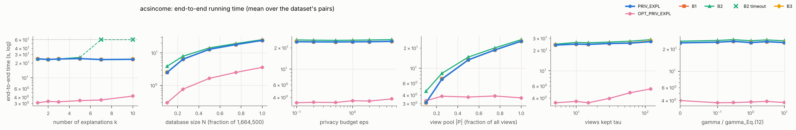

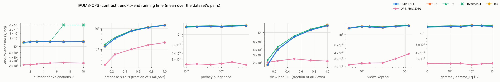

## E5 — cost per pair at the defaults, B2 growth, optimisations

End-to-end seconds per pair (`speedup OPT` = PRIV_EXPL / OPT_PRIV_EXPL):

| dataset | pair | PRIV_EXPL | OPT_PRIV_EXPL | B1 | B2 | B3 | speedup OPT |
|---|---|---|---|---|---|---|---|
| adult | A1 | 0.7172 | 0.07027 | 0.715 | 2.378 | 0.7146 | 10.21 |
| adult | A2 | 0.6651 | 0.05667 | 0.665 | 2.387 | 0.666 | 11.74 |
| adult | R1 | 0.6868 | 0.07897 | 0.6865 | 2.482 | 0.686 | 8.698 |
| adult | R3 | 0.6886 | 0.06972 | 0.6882 | 2.176 | 0.6877 | 9.877 |
| acsincome | ACS_Q1C1 | 26.16 | 4.166 | 26.18 | 27.87 | 26.22 | 6.279 |
| acsincome | ACS_Q2C2 | 25.19 | 4.444 | 25.22 | 26.84 | 25.24 | 5.668 |
| acsincome | ACS_Q4C7 | 26.06 | 3.472 | 26.08 | 28.1 | 26.05 | 7.508 |
| tax | T1 | 4.113 | 0.5081 | 4.12 | 4.917 | 4.113 | 8.094 |
| tax | T2 | 4.296 | 0.515 | 4.298 | 5.67 | 4.296 | 8.343 |
| tax | R5 | 4.228 | 0.4326 | 4.226 | 5.357 | 4.225 | 9.775 |
| tax_dirty | C1 | 4.922 | 0.4841 | 4.916 | 5.877 | 4.926 | 10.17 |
| tax_dirty | C2 | 4.516 | 0.4216 | 4.528 | 5.489 | 4.521 | 10.71 |
| tax_dirty | C3 | 4.564 | 0.4496 | 4.556 | 5.9 | 4.549 | 10.15 |
| hospital | H1 | 0.1155 | 0.01126 | 0.1156 | 1.75 | 0.1152 | 10.26 |
| hospital | H2 | 0.1162 | 0.01313 | 0.1163 | 1.542 | 0.1164 | 8.851 |
| hospital | H3 | 0.112 | 0.01119 | 0.1122 | 1.532 | 0.1118 | 10.01 |
| ipums | I1 | 15.09 | 2.374 | 15.08 | 15.67 | 15.03 | 6.355 |
| ipums | I6 | 13.2 | 2.114 | 13.18 | 14.01 | 13.17 | 6.241 |
| ipums | I8 | 13.79 | 2.075 | 13.79 | 14.55 | 13.81 | 6.649 |

**Statistics routes** (PRIV_EXPL end to end, mean over pairs, seconds):

| dataset | O1 | O1 + O3 (OPT_PRIV_EXPL) | original (Sec. 4.2) |
|---|---|---|---|
| acsincome | 4.222 | 3.921 | 25.28 |
| adult | 0.07052 | 0.06616 | 0.7228 |
| hospital | 0.01923 | 0.01578 | 0.1252 |
| ipums | 2.476 | 2.05 | 14.02 |
| tax | 0.529 | 0.4753 | 4.215 |
| tax_dirty | 0.382 | 0.4233 | 4.5 |

**OPT_PRIV_EXPL releases exactly what PRIV_EXPL releases** (same randomness):

| dataset | pair | runs | identical_runs | max_abs_use_diff |
|---|---|---|---|---|
| adult | A1 | 5 | 5 | 1.11e-16 |
| adult | A2 | 5 | 5 | 1.39e-17 |
| adult | R1 | 5 | 5 | 2.78e-17 |
| adult | R3 | 5 | 5 | 2.78e-17 |
| acsincome | ACS_Q1C1 | 5 | 5 | 2.78e-17 |
| acsincome | ACS_Q2C2 | 5 | 5 | 5.55e-17 |
| acsincome | ACS_Q4C7 | 5 | 5 | 4.34e-19 |
| tax | T1 | 5 | 5 | 5.55e-17 |
| tax | T2 | 5 | 5 | 1.39e-17 |
| tax | R5 | 5 | 5 | 2.78e-17 |
| tax_dirty | C1 | 5 | 5 | 1.39e-17 |
| tax_dirty | C2 | 5 | 5 | 6.94e-18 |
| tax_dirty | C3 | 5 | 5 | 6.94e-18 |
| hospital | H1 | 5 | 5 | 1.11e-16 |
| hospital | H2 | 5 | 5 | 1.11e-16 |
| hospital | H3 | 5 | 5 | 2.78e-17 |
| ipums | I1 | 5 | 5 | 5.55e-17 |
| ipums | I6 | 5 | 5 | 5.55e-17 |
| ipums | I8 | 5 | 5 | 5.55e-17 |

## E1 — one release per pair (ε = 1, k = 5)

### A1 — adult

* Q1 = `occupation = 'Craft-repair' AND hoursPerWeek >= 40` (|Q1| = 5,447)
* Q2 = `hoursPerWeek >= 40` (|Q2| = 37,155; overlap 5,447)
* constraint: >= 25% with gender = 'Female': 4.7% → 26.9% — paper: 0.047 → 0.269
* |P| = 1,048, tau = 15, gamma = 150.3, Laplace scale per bin = 30.0 (sd of released difference 60.0)
* view stage: overlap of the retained views with the exact top-tau = 1.00
* single-atom views on the query attributes (exact rank by Use / coverage / Rep): `hoursPerWeek IN (32, 40]` #6 (0.541 / 0.67); `occupation='Craft-repair'` #16 (0.223 / 0.56); `hoursPerWeek IN (40, 50]` #17 (0.208 / 0.58); `hoursPerWeek IN (50, 99]` #35 (0.123 / 0.55); `occupation='Exec-managerial'` #37 (0.111 / 0.56); `occupation='Prof-specialty'` #42 (0.100 / 0.56)

| round | view | attribute | bins clearing 2σ | exact |Q1| / |Q2| in view |
|---|---|---|---|---|
| 1 | `hoursPerWeek IN (32, 40]` | occupation | Prof-specialty, Exec-managerial, Adm-clerical, Sales, Other-service, Machine-op-inspct, NA, Transport-moving, Handlers-cleaners, Farming-fishing, Tech-support, Protective-serv | 3,614 / 22,803 |
| 2 | `hoursPerWeek IN (32, 40]` | education | HS-grad, Some-college, Bachelors, Masters, Assoc-voc, 11th, Assoc-acdm, 10th, 7th-8th, Prof-school, 9th, 12th, Doctorate, 5th-6th, 1st-4th | 3,614 / 22,803 |
| 3 | `race='White'` | workclass | Private, Self-emp-not-inc, Local-gov, NA, State-gov, Self-emp-inc, Federal-gov | 4,907 / 31,903 |
| 4 | `gender='Male' AND hoursPerWeek IN (32, 40]` | occupation | Prof-specialty, Craft-repair, Exec-managerial, Adm-clerical, Sales, Other-service, Machine-op-inspct, NA, Transport-moving, Handlers-cleaners, Farming-fishing, Tech-support, Protective-serv | 3,426 / 15,428 |
| 5 | `hoursPerWeek IN (32, 40]` | age | [17, 24], (24, 31], (31, 37], (37, 44], (44, 53], (53, 90] | 3,614 / 22,803 |

### A2 — adult

* Q1 = `education IN ('Bachelors', 'Masters') AND hoursPerWeek >= 50` (|Q1| = 3,055)
* Q2 = `education = 'Masters' AND hoursPerWeek >= 30` (|Q2| = 2,453; overlap 874)
* constraint: >= 25% with gender = 'Female': 19.5% → 30.6% — paper: 0.195 → 0.306
* |P| = 1,048, tau = 15, gamma = 150.3, Laplace scale per bin = 30.0 (sd of released difference 60.0)
* view stage: overlap of the retained views with the exact top-tau = 0.80
* single-atom views on the query attributes (exact rank by Use / coverage / Rep): `education='Masters'` #6 (0.068 / 0.53); `hoursPerWeek IN (40, 50]` #9 (0.047 / 0.58); `education='Bachelors'` #10 (0.045 / 0.57); `hoursPerWeek IN (50, 99]` #15 (0.041 / 0.55); `hoursPerWeek IN (32, 40]` #27 (0.024 / 0.67); `hoursPerWeek IN [1, 32]` #160 (0.001 / 0.57)

| round | view | attribute | bins clearing 2σ | exact |Q1| / |Q2| in view |
|---|---|---|---|---|
| 1 | `education='Masters'` | age | (24, 31], (31, 37], (37, 44], (44, 53], (53, 90] | 874 / 2,453 |
| 2 | `education='Masters' AND gender='Male'` | workclass | Private, Local-gov, State-gov | 690 / 1,702 |
| 3 | `education='Masters'` | occupation | Prof-specialty, Exec-managerial | 874 / 2,453 |
| 4 | `education='Masters'` | maritalStatus | Married-civ-spouse, Never-married, Divorced | 874 / 2,453 |
| 5 | `education='Masters' AND race='White'` | hoursPerWeek | [1, 32], (32, 40], (40, 50] | 813 / 2,174 |

### A3 — adult

* Q1 = `maritalStatus = 'Married-civ-spouse' AND hoursPerWeek >= 45` (|Q1| = 8,216)
* Q2 = `maritalStatus IN ('Divorced', 'Married-civ-spouse', 'Never-married') AND hoursPerWeek >= 38` (|Q2| = 35,446; overlap 8,216)
* constraint: >= 25% with gender = 'Female': 5.0% → 25.2%
* Q' found by the refinement search (predicate distance 0.738, 637 refinements evaluated)
* |P| = 1,048, tau = 15, gamma = 150.3, Laplace scale per bin = 30.0 (sd of released difference 60.0)
* view stage: overlap of the retained views with the exact top-tau = 1.00
* single-atom views on the query attributes (exact rank by Use / coverage / Rep): `hoursPerWeek IN (32, 40]` #7 (0.446 / 0.67); `hoursPerWeek IN (40, 50]` #12 (0.272 / 0.58); `hoursPerWeek IN (50, 99]` #22 (0.176 / 0.55); `hoursPerWeek IN [1, 32]` #886 (0.000 / 0.57)

| round | view | attribute | bins clearing 2σ | exact |Q1| / |Q2| in view |
|---|---|---|---|---|
| 1 | `gender='Male' AND hoursPerWeek IN (32, 40]` | education | HS-grad, Some-college, Bachelors, Masters, Assoc-voc, 11th, Assoc-acdm, 10th, 7th-8th, Prof-school, 9th, 12th, 5th-6th | 0 / 15,125 |
| 2 | `hoursPerWeek IN (32, 40]` | occupation | Prof-specialty, Craft-repair, Exec-managerial, Adm-clerical, Sales, Other-service, Machine-op-inspct, NA, Transport-moving, Handlers-cleaners, Farming-fishing, Tech-support, Protective-serv, Armed-Forces | 0 / 21,771 |
| 3 | `gender='Male' AND hoursPerWeek IN (32, 40]` | workclass | Private, Self-emp-not-inc, Local-gov, NA, State-gov, Self-emp-inc, Federal-gov | 0 / 15,125 |
| 4 | `race='White' AND hoursPerWeek IN (32, 40]` | education | HS-grad, Some-college, Bachelors, Masters, Assoc-voc, 11th, Assoc-acdm, 10th, 7th-8th, Prof-school, 9th, 12th, 5th-6th | 0 / 18,168 |
| 5 | `workclass='Private' AND hoursPerWeek IN (32, 40]` | age | [17, 24], (24, 31], (31, 37], (37, 44], (44, 53], (53, 90] | 0 / 15,869 |

### T1 — tax

* Q1 = `MaritalStatus = 'M' AND Rate <= 5` (|Q1| = 57,164)
* Q2 = `Rate <= 5` (|Q2| = 114,957; overlap 57,164)
* constraint: >= 30% with HasChild = 'Y': 49.9% → 49.8% — paper: 0.035 → 0.501
* |P| = 1,792, tau = 15, gamma = 147.2, Laplace scale per bin = 30.0 (sd of released difference 60.0)
* view stage: overlap of the retained views with the exact top-tau = 1.00
* single-atom views on the query attributes (exact rank by Use / coverage / Rep): `MaritalStatus='M'` #5 (0.572 / 0.67); `Rate IN [0, 3.07]` #8 (0.503 / 0.63); `MaritalStatus='S'` #26 (0.289 / 0.67); `Rate IN (3.07, 4.75]` #37 (0.256 / 0.57); `Rate IN (4.75, 5.95]` #89 (0.101 / 0.57); `Rate IN (5.95, 7]` #1076 (0.000 / 0.59)

| round | view | attribute | bins clearing 2σ | exact |Q1| / |Q2| in view |
|---|---|---|---|---|
| 1 | `MarriedExemp IN [0, 174]` | State | PR, MT, KY, VT, NY, OH, NM, PA, CT, WV, RI, ND, IL, DC, MS, WI, TN, AL, KS, NH, ID, CO, CA, AK, AR, ME, IA, MD, AZ, FL, TX, WY, VA, IN, NJ, HI, NC, WA, NV, NE, SD, LA, DE, MI | 29,112 / 86,905 |
| 2 | `MarriedExemp IN [0, 174] AND ChildExemp IN [0, 103]` | State | PR, KY, VT, NY, OH, NM, PA, CT, WV, RI, ND, IL, DC, MS, WI, TN, AL, MN, KS, NH, ID, CO, CA, AK, AR, IA, MD, AZ, FL, TX, WY, IN, NJ, HI, WA, NV, NE, SD, DE, MI | 27,902 / 71,526 |
| 3 | `Rate IN [0, 3.07]` | State | PR, MT, OK, KY, OH, NM, PA, RI, ND, IL, TN, NH, CA, AK, AR, IA, AZ, FL, TX, WY, NJ, HI, WA, NV, SD, LA, DE | 33,447 / 67,229 |
| 4 | `Rate IN [0, 3.07]` | Salary | [5000, 20000], (20000, 35000], (35000, 50000], (50000, 70000], (70000, 85000], (85000, 100000] | 33,447 / 67,229 |
| 5 | `Rate IN [0, 3.07]` | SingleExemp | [0, 87], (87, 2100], (2100, 12750] | 33,447 / 67,229 |

### T2 — tax

* Q1 = `MaritalStatus = 'S' AND HasChild = 'N' AND Salary >= 50000` (|Q1| = 27,694)
* Q2 = `MaritalStatus = 'S' AND Salary >= 50000` (|Q2| = 55,195; overlap 27,694)
* constraint: >= 30% with HasChild = 'Y': 0.0% → 49.8%
* Q' found by the refinement search (predicate distance 1.000, 188 refinements evaluated)
* |P| = 1,792, tau = 15, gamma = 147.2, Laplace scale per bin = 30.0 (sd of released difference 60.0)
* view stage: overlap of the retained views with the exact top-tau = 1.00
* single-atom views on the query attributes (exact rank by Use / coverage / Rep): `MaritalStatus='S'` #2 (0.414 / 0.67); `HasChild='N'` #7 (0.277 / 0.67); `HasChild='Y'` #21 (0.138 / 0.67); `Salary IN (50000, 70000]` #23 (0.150 / 0.58); `Salary IN (85000, 100000]` #42 (0.113 / 0.57); `Salary IN (70000, 85000]` #43 (0.113 / 0.57)

| round | view | attribute | bins clearing 2σ | exact |Q1| / |Q2| in view |
|---|---|---|---|---|
| 1 | `MaritalStatus='S' AND MarriedExemp IN [0, 174]` | State | PR, MT, OK, MO, KY, VT, UT, NY, OH, NM, PA, SC, GA, CT, WV, RI, ND, IL, DC, MS, WI, TN, AL, MN, KS, NH, ID, CO, CA, AK, AR, ME, IA, MD, AZ, FL, MA, TX, WY, VA, IN, NJ, HI, NC, WA, NV, NE, OR, SD, LA, DE, MI | 27,694 / 55,195 |
| 2 | `MaritalStatus='S'` | State | PR, MT, OK, MO, KY, VT, UT, NY, OH, NM, PA, SC, GA, CT, WV, RI, ND, IL, DC, MS, WI, TN, AL, MN, KS, NH, ID, CO, CA, AK, AR, ME, IA, MD, AZ, FL, MA, TX, WY, VA, IN, NJ, HI, NC, WA, NV, NE, OR, SD, LA, DE, MI | 27,694 / 55,195 |
| 3 | `MarriedExemp IN [0, 174]` | State | PR, MT, OK, MO, KY, VT, UT, NY, OH, NM, PA, SC, GA, CT, WV, RI, ND, IL, DC, MS, WI, TN, AL, MN, KS, NH, ID, CO, CA, AK, AR, ME, IA, MD, AZ, FL, MA, TX, WY, VA, IN, NJ, HI, NC, WA, NV, NE, OR, SD, LA, DE, MI | 27,694 / 55,195 |
| 4 | `Gender='F' AND MaritalStatus='S'` | State | PR, MT, OK, MO, KY, VT, UT, NY, OH, NM, PA, SC, GA, CT, WV, RI, ND, IL, DC, MS, WI, TN, AL, MN, KS, NH, ID, CO, CA, AK, AR, ME, IA, MD, AZ, FL, MA, TX, WY, VA, IN, NJ, HI, NC, WA, NV, NE, SD, LA, DE, MI | 13,931 / 27,742 |
| 5 | `MaritalStatus='S' AND MarriedExemp IN [0, 174]` | Salary | (35000, 50000], (50000, 70000], (70000, 85000], (85000, 100000] | 27,694 / 55,195 |

### T3 — tax

* Q1 = `Salary >= 60000 AND Rate <= 2` (|Q1| = 18,893)
* Q2 = `Salary >= 60000 AND Rate <= 3.9` (|Q2| = 31,709; overlap 18,893)
* constraint: >= 40% with Rate > 0: 0.0% → 40.4%
* Q' found by the refinement search (predicate distance 0.204, 860 refinements evaluated)
* |P| = 1,792, tau = 15, gamma = 147.2, Laplace scale per bin = 30.0 (sd of released difference 60.0)
* view stage: overlap of the retained views with the exact top-tau = 0.93
* single-atom views on the query attributes (exact rank by Use / coverage / Rep): `Rate IN [0, 3.07]` #4 (0.228 / 0.63); `Salary IN (50000, 70000]` #41 (0.085 / 0.58); `Salary IN (70000, 85000]` #42 (0.085 / 0.57); `Salary IN (85000, 100000]` #43 (0.083 / 0.57); `Rate IN (3.07, 4.75]` #86 (0.025 / 0.57); `Salary IN [5000, 20000]` #470 (0.000 / 0.58)

| round | view | attribute | bins clearing 2σ | exact |Q1| / |Q2| in view |
|---|---|---|---|---|
| 1 | `MaritalStatus='S'` | State | OH, PA, CT, ND, IL, ID, AZ, IN, NJ, NE, MI | 9,455 / 15,919 |
| 2 | `HasChild='N'` | State | OH, PA, CT, ND, IL, MD, AZ, IN, NJ, MI | 9,445 / 15,821 |
| 3 | `MaritalStatus='S'` | HasChild | N, Y | 9,455 / 15,919 |
| 4 | `Rate IN [0, 3.07]` | MarriedExemp | [0, 174], (174, 4200], (4200, 24500] | 18,893 / 26,630 |
| 5 | `MarriedExemp IN [0, 174]` | Salary | (50000, 70000], (70000, 85000], (85000, 100000] | 18,893 / 26,223 |

### H1 — hospital

* Q1 = `HospitalType = 'acute care hospitals'` (|Q1| = 968)
* Q2 = `Q_Sigma(HospitalType = 'acute care hospitals')` (|Q2| = 93; overlap 93)
* conflict hypergraph: 902 of 1000 tuples on 2170 edges
* |P| = 502, tau = 15, gamma = 150.3, Laplace scale per bin = 30.0 (sd of released difference 60.0)
* view stage: overlap of the retained views with the exact top-tau = 0.13

| round | view | attribute | bins clearing 2σ | exact |Q1| / |Q2| in view |
|---|---|---|---|---|
| 1 | `State='al'` | City | oneonta, opelika | 923 / 89 |
| 2 | `State='al'` | MeasureCode | scip-inf-3 | 923 / 89 |
| 3 | `State='al'` | CountyName | clarke, cullman, morgan | 923 / 89 |
| 4 | `State='al'` | Score | [0, 82], (91, 96], (99, 100], NA | 923 / 89 |
| 5 | `State='al'` | HospitalOwner | government - state, proprietary, voluntary non-profit - other | 923 / 89 |

### H2 — hospital

* Q1 = `EmergencyService = 'yes'` (|Q1| = 830)
* Q2 = `Q_Sigma(EmergencyService = 'yes')` (|Q2| = 91; overlap 91)
* selection rule: `EmergencyService = 'yes'`, |Q| = 830, Q_Sigma drops 89%, most uneven over `City` (TVD 0.10)
* conflict hypergraph: 902 of 1000 tuples on 2170 edges
* |P| = 502, tau = 15, gamma = 150.3, Laplace scale per bin = 30.0 (sd of released difference 60.0)
* view stage: overlap of the retained views with the exact top-tau = 0.20
* single-atom views on the query attributes (exact rank by Use / coverage / Rep): `EmergencyService='yes'` #1 (0.921 / 0.73); `EmergencyService='no'` #373 (0.000 / 0.56); `EmergencyService='Other'` #374 (0.000 / 0.51)

| round | view | attribute | bins clearing 2σ | exact |Q1| / |Q2| in view |
|---|---|---|---|---|
| 1 | `EmergencyService='yes'` | MeasureCode | — | 830 / 91 |
| 2 | `EmergencyService='yes'` | CountyName | marshall, mobile | 830 / 91 |
| 3 | `EmergencyService='yes'` | City | clanton, cullman | 830 / 91 |
| 4 | `State='al' AND EmergencyService='yes'` | Sample | (210, 1421] | 789 / 89 |
| 5 | `EmergencyService='yes'` | HospitalOwner | proprietary, voluntary non-profit - other, voluntary non-profit - private | 830 / 91 |

### H3 — hospital

* Q1 = `HospitalOwner = 'government - hospital district or authority'` (|Q1| = 198)
* Q2 = `Q_Sigma(HospitalOwner = 'government - hospital district or authority')` (|Q2| = 54; overlap 54)
* selection rule: `HospitalOwner = 'government - hospital district or authority'`, |Q| = 198, Q_Sigma drops 73%, most uneven over `CountyName` (TVD 0.27)
* conflict hypergraph: 902 of 1000 tuples on 2170 edges
* |P| = 502, tau = 15, gamma = 150.3, Laplace scale per bin = 30.0 (sd of released difference 60.0)
* view stage: overlap of the retained views with the exact top-tau = 0.07
* single-atom views on the query attributes (exact rank by Use / coverage / Rep): `HospitalOwner='government - hospital district or authority'` #4 (0.252 / 0.58); `HospitalOwner='government - federal'` #198 (0.000 / 0.52); `HospitalOwner='government - local'` #199 (0.000 / 0.51); `HospitalOwner='government - state'` #200 (0.000 / 0.52); `HospitalOwner='proprietary'` #201 (0.000 / 0.59); `HospitalOwner='voluntary non-profit - church'` #202 (0.000 / 0.53)

| round | view | attribute | bins clearing 2σ | exact |Q1| / |Q2| in view |
|---|---|---|---|---|
| 1 | `State='Other' AND HospitalOwner='Other'` | HospitalType | — | 0 / 0 |
| 2 | `EmergencyService='yes'` | HospitalOwner | government - hospital district or authority | 193 / 52 |
| 3 | `EmergencyService='yes'` | Condition | — | 193 / 52 |
| 4 | `EmergencyService='yes'` | City | — | 193 / 52 |
| 5 | `EmergencyService='yes'` | CountyName | de kalb, lauderdale | 193 / 52 |

### R1 — adult

* Q1 = `education IN ('Masters', 'Doctorate', 'Prof-school') AND hoursPerWeek >= 50` (|Q1| = 1,554)
* Q2 = `education IN ('Doctorate', 'Masters', 'Prof-school', 'Some-college') AND hoursPerWeek >= 35` (|Q2| = 12,064; overlap 1,554)
* constraint: >= 30% with gender = 'Female': 17.6% → 30.6%
* |P| = 1,048, tau = 15, gamma = 150.3, Laplace scale per bin = 30.0 (sd of released difference 60.0)
* view stage: overlap of the retained views with the exact top-tau = 1.00
* single-atom views on the query attributes (exact rank by Use / coverage / Rep): `education='Some-college'` #6 (0.172 / 0.59); `hoursPerWeek IN (32, 40]` #7 (0.148 / 0.67); `hoursPerWeek IN (40, 50]` #17 (0.073 / 0.58); `education='Masters'` #22 (0.067 / 0.53); `hoursPerWeek IN (50, 99]` #25 (0.057 / 0.55); `education='Prof-school'` #61 (0.024 / 0.51)

| round | view | attribute | bins clearing 2σ | exact |Q1| / |Q2| in view |
|---|---|---|---|---|
| 1 | `education='Some-college' AND hoursPerWeek IN (32, 40]` | occupation | Prof-specialty, Craft-repair, Exec-managerial, Adm-clerical, Sales, Other-service, Machine-op-inspct, NA, Transport-moving, Handlers-cleaners, Tech-support, Protective-serv | 0 / 5,606 |
| 2 | `education='Some-college'` | age | [17, 24], (24, 31], (31, 37], (37, 44], (44, 53], (53, 90] | 0 / 8,400 |
| 3 | `education='Some-college' AND hoursPerWeek IN (32, 40]` | workclass | Private, Self-emp-not-inc, Local-gov, NA, State-gov, Federal-gov | 0 / 5,606 |
| 4 | `education='Some-college' AND hoursPerWeek IN (32, 40]` | relationship | Husband, Not-in-family, Own-child, Unmarried, Wife | 0 / 5,606 |
| 5 | `education='Some-college' AND hoursPerWeek IN (32, 40]` | maritalStatus | Married-civ-spouse, Never-married, Divorced, Separated | 0 / 5,606 |

### R2 — adult

* Q1 = `occupation = 'Prof-specialty' AND maritalStatus = 'Married-civ-spouse'` (|Q1| = 3,182)
* Q2 = `occupation IN ('Other-service', 'Prof-specialty') AND maritalStatus IN ('Married-civ-spouse', 'Never-married')` (|Q2| = 8,561; overlap 3,182)
* constraint: >= 15% with race IN ('Black', 'Asian-Pac-Islander', 'Amer-Indian-Eskimo', 'Other'): 10.2% → 15.7%
* |P| = 1,048, tau = 15, gamma = 150.3, Laplace scale per bin = 30.0 (sd of released difference 60.0)
* view stage: overlap of the retained views with the exact top-tau = 0.87
* single-atom views on the query attributes (exact rank by Use / coverage / Rep): `occupation='Prof-specialty'` #5 (0.168 / 0.56); `occupation='Other-service'` #17 (0.072 / 0.55); `occupation='Craft-repair'` #470 (0.000 / 0.56); `occupation='Exec-managerial'` #471 (0.000 / 0.56); `occupation='Adm-clerical'` #472 (0.000 / 0.55); `occupation='Sales'` #473 (0.000 / 0.55)

| round | view | attribute | bins clearing 2σ | exact |Q1| / |Q2| in view |
|---|---|---|---|---|
| 1 | `workclass='Private' AND occupation='Other-service'` | education | HS-grad, Some-college, Bachelors, 11th, 10th | 0 / 2,945 |
| 2 | `workclass='Private' AND occupation='Other-service'` | age | [17, 24], (24, 31], (31, 37], (37, 44], (44, 53], (53, 90] | 0 / 2,945 |
| 3 | `workclass='Private' AND occupation='Other-service'` | relationship | Husband, Not-in-family, Own-child, Unmarried, Wife, Other-relative | 0 / 2,945 |
| 4 | `workclass='Private' AND occupation='Other-service'` | hoursPerWeek | [1, 32], (32, 40], (40, 50], (50, 99] | 0 / 2,945 |
| 5 | `workclass='Private' AND occupation='Other-service'` | race | White, Black | 0 / 2,945 |

### R3 — adult

* Q1 = `maritalStatus = 'Married-civ-spouse' AND age >= 40` (|Q1| = 12,932)
* Q2 = `maritalStatus IN ('Divorced', 'Married-civ-spouse', 'Widowed') AND age >= 61` (|Q2| = 3,296; overlap 2,134)
* constraint: >= 30% with gender = 'Female': 8.9% → 30.2%
* |P| = 1,048, tau = 15, gamma = 150.3, Laplace scale per bin = 30.0 (sd of released difference 60.0)
* view stage: overlap of the retained views with the exact top-tau = 0.93

| round | view | attribute | bins clearing 2σ | exact |Q1| / |Q2| in view |
|---|---|---|---|---|
| 1 | `race='White' AND gender='Male'` | education | HS-grad, Some-college, Bachelors, Masters, Assoc-voc, Assoc-acdm, 10th, 7th-8th, Prof-school, Doctorate | 10,665 / 2,106 |
| 2 | `race='White' AND gender='Male'` | occupation | Prof-specialty, Craft-repair, Exec-managerial, Adm-clerical, Sales, Other-service, Machine-op-inspct, NA, Transport-moving, Handlers-cleaners, Farming-fishing, Tech-support, Protective-serv, Priv-house-serv | 10,665 / 2,106 |
| 3 | `hoursPerWeek IN (32, 40]` | education | HS-grad, Some-college, Bachelors, Masters, Assoc-voc, Assoc-acdm, 10th, 5th-6th | 6,582 / 1,371 |
| 4 | `race='White' AND gender='Male'` | workclass | Private, Self-emp-not-inc, Local-gov, NA, State-gov, Self-emp-inc, Federal-gov | 10,665 / 2,106 |
| 5 | `gender='Male'` | age | (24, 31], (37, 44], (44, 53], (53, 90] | 11,780 / 2,300 |

### R4 — adult

* Q1 = `occupation = 'Prof-specialty' AND hoursPerWeek >= 50` (|Q1| = 1,681)
* Q2 = `occupation IN ('Other-service', 'Prof-specialty') AND hoursPerWeek >= 30` (|Q2| = 9,186; overlap 1,681)
* constraint: >= 25% with age < 30: 14.7% → 25.3%
* |P| = 1,048, tau = 15, gamma = 150.3, Laplace scale per bin = 30.0 (sd of released difference 60.0)
* view stage: overlap of the retained views with the exact top-tau = 0.93
* single-atom views on the query attributes (exact rank by Use / coverage / Rep): `occupation='Prof-specialty'` #4 (0.149 / 0.56); `hoursPerWeek IN (32, 40]` #7 (0.113 / 0.67); `occupation='Other-service'` #16 (0.074 / 0.55); `hoursPerWeek IN (40, 50]` #22 (0.055 / 0.58); `hoursPerWeek IN (50, 99]` #32 (0.041 / 0.55); `hoursPerWeek IN [1, 32]` #75 (0.014 / 0.57)

| round | view | attribute | bins clearing 2σ | exact |Q1| / |Q2| in view |
|---|---|---|---|---|
| 1 | `occupation='Prof-specialty'` | education | HS-grad, Some-college, Bachelors, Masters, Assoc-voc, Assoc-acdm, Prof-school, 12th, Doctorate | 1,681 / 5,588 |
| 2 | `occupation='Prof-specialty' AND race='White'` | age | [17, 24], (24, 31], (31, 37], (37, 44], (44, 53], (53, 90] | 1,552 / 4,915 |
| 3 | `occupation='Prof-specialty'` | relationship | Husband, Not-in-family, Own-child, Unmarried, Wife | 1,681 / 5,588 |
| 4 | `occupation='Prof-specialty' AND race='White'` | maritalStatus | Married-civ-spouse, Never-married, Divorced | 1,552 / 4,915 |
| 5 | `occupation='Prof-specialty'` | workclass | Private, Self-emp-not-inc, Local-gov, State-gov, Federal-gov, Never-worked | 1,681 / 5,588 |

### R5 — tax

* Q1 = `Salary <= 30000 AND Rate <= 2` (|Q1| = 16,774)
* Q2 = `Salary <= 30000 AND Rate <= 3.2016153` (|Q2| = 25,621; overlap 16,774)
* constraint: >= 50% with Rate > 0: 23.7% → 50.0%
* |P| = 1,792, tau = 15, gamma = 147.2, Laplace scale per bin = 30.0 (sd of released difference 60.0)
* view stage: overlap of the retained views with the exact top-tau = 1.00
* single-atom views on the query attributes (exact rank by Use / coverage / Rep): `Rate IN [0, 3.07]` #1 (0.210 / 0.63); `Salary IN [5000, 20000]` #11 (0.154 / 0.58); `Salary IN (20000, 35000]` #52 (0.058 / 0.56); `Rate IN (3.07, 4.75]` #435 (0.002 / 0.57); `Salary IN (35000, 50000]` #642 (0.000 / 0.57); `Salary IN (50000, 70000]` #643 (0.000 / 0.58)

| round | view | attribute | bins clearing 2σ | exact |Q1| / |Q2| in view |
|---|---|---|---|---|
| 1 | `Salary IN [5000, 20000] AND Rate IN [0, 3.07]` | State | MT, OK, KY, PA, GA, CT, WV, ND, IL, MS, ID, CO, CA, AK, AR, ME, IA, AZ, VA, HI, NE, DE | 11,756 / 19,052 |
| 2 | `Rate IN [0, 3.07]` | State | KY, OH, PA, WV, ND, IL, MS, ID, CA, AR, ME, IA, AZ, HI, NE, LA, DE | 16,774 / 25,230 |
| 3 | `Salary IN [5000, 20000] AND ChildExemp IN [0, 103]` | State | MT, KY, PA, CT, WV, ND, IL, MS, ME, IA, AZ, WY, HI, NE, DE | 10,416 / 15,245 |
| 4 | `Salary IN [5000, 20000] AND Rate IN [0, 3.07]` | SingleExemp | [0, 87], (87, 2100], (2100, 12750] | 11,756 / 19,052 |
| 5 | `Salary IN [5000, 20000] AND Rate IN [0, 3.07]` | ChildExemp | [0, 103], (103, 1500], (1500, 3300] | 11,756 / 19,052 |

### R6 — tax

* Q1 = `MaritalStatus = 'S' AND HasChild = 'N' AND Salary >= 50000` (|Q1| = 27,694)
* Q2 = `MaritalStatus = 'S' AND Salary >= 50000` (|Q2| = 55,195; overlap 27,694)
* constraint: >= 30% with HasChild = 'Y': 0.0% → 49.8%
* |P| = 1,792, tau = 15, gamma = 147.2, Laplace scale per bin = 30.0 (sd of released difference 60.0)
* view stage: overlap of the retained views with the exact top-tau = 1.00
* single-atom views on the query attributes (exact rank by Use / coverage / Rep): `MaritalStatus='S'` #2 (0.414 / 0.67); `HasChild='N'` #7 (0.277 / 0.67); `HasChild='Y'` #21 (0.138 / 0.67); `Salary IN (50000, 70000]` #23 (0.150 / 0.58); `Salary IN (85000, 100000]` #42 (0.113 / 0.57); `Salary IN (70000, 85000]` #43 (0.113 / 0.57)

| round | view | attribute | bins clearing 2σ | exact |Q1| / |Q2| in view |
|---|---|---|---|---|
| 1 | `MaritalStatus='S' AND MarriedExemp IN [0, 174]` | State | PR, MT, OK, MO, KY, VT, UT, NY, OH, NM, PA, SC, GA, CT, WV, RI, ND, IL, DC, MS, WI, TN, AL, MN, KS, NH, ID, CO, CA, AK, AR, ME, IA, MD, AZ, FL, MA, TX, WY, VA, IN, NJ, HI, NC, WA, NV, NE, OR, SD, LA, DE, MI | 27,694 / 55,195 |
| 2 | `MaritalStatus='S'` | State | PR, MT, OK, MO, KY, VT, UT, NY, OH, NM, PA, SC, GA, CT, WV, RI, ND, IL, DC, MS, WI, TN, AL, MN, KS, NH, ID, CO, CA, AK, AR, ME, IA, MD, AZ, FL, MA, TX, WY, VA, IN, NJ, HI, NC, WA, NV, NE, OR, SD, LA, DE, MI | 27,694 / 55,195 |
| 3 | `Gender='F' AND MaritalStatus='S'` | State | PR, MT, OK, MO, KY, VT, UT, NY, OH, NM, PA, SC, GA, CT, WV, RI, ND, IL, DC, MS, WI, TN, AL, MN, KS, NH, ID, CO, CA, AK, AR, ME, IA, MD, AZ, FL, MA, TX, WY, VA, IN, NJ, HI, NC, WA, NV, NE, OR, SD, LA, DE, MI | 13,931 / 27,742 |
| 4 | `MaritalStatus='S' AND MarriedExemp IN [0, 174]` | Salary | (35000, 50000], (50000, 70000], (70000, 85000], (85000, 100000] | 27,694 / 55,195 |
| 5 | `MaritalStatus='S'` | Rate | [0, 3.07], (3.07, 4.75], (4.75, 5.95], (5.95, 7], (7, 9.3] | 27,694 / 55,195 |

### C1 — tax_dirty

* Q1 = `State IN ('AK', 'CA', 'HI', 'OR', 'WA')` (|Q1| = 18,729)
* Q2 = `Q_Sigma(State IN ('AK', 'CA', 'HI', 'OR', 'WA'))` (|Q2| = 16,404; overlap 16,404)
* conflict hypergraph: 7851 of 200000 tuples on 231552 edges
* |P| = 1,977, tau = 15, gamma = 147.2, Laplace scale per bin = 30.0 (sd of released difference 60.0)
* view stage: overlap of the retained views with the exact top-tau = 1.00
* single-atom views on the query attributes (exact rank by Use / coverage / Rep): `State='CA'` #78 (0.038 / 0.51); `State='WA'` #83 (0.037 / 0.51); `State='OR'` #84 (0.037 / 0.51); `State='HI'` #86 (0.036 / 0.51); `State='AK'` #103 (0.027 / 0.51); `State='AL'` #363 (0.000 / 0.51)

| round | view | attribute | bins clearing 2σ | exact |Q1| / |Q2| in view |
|---|---|---|---|---|
| 1 | `MaritalStatus='S'` | State | AK, CA, DE, HI, MI, MO | 9,349 / 8,549 |
| 2 | `SingleExemp IN [0, 87] AND MarriedExemp IN [0, 174]` | ChildExemp | [0, 103], NA | 11,025 / 9,247 |
| 3 | `Gender='M'` | State | AK, DE, MN | 9,248 / 8,073 |
| 4 | `SingleExemp IN [0, 87] AND ChildExemp IN [0, 103]` | Salary | [5000, 20000], (20000, 35000], (35000, 50000], (50000, 70000], (70000, 85000], (85000, 100000] | 10,819 / 9,175 |
| 5 | `SingleExemp IN [0, 87]` | Rate | [0, 3.07], (7, 9.3] | 14,769 / 12,827 |

### C2 — tax_dirty

* Q1 = `State IN ('AL', 'KY', 'MS', 'TN') AND HasChild = 'N'` (|Q1| = 7,986)
* Q2 = `Q_Sigma(State IN ('AL', 'KY', 'MS', 'TN') AND HasChild = 'N')` (|Q2| = 7,082; overlap 7,082)
* conflict hypergraph: 7851 of 200000 tuples on 231552 edges
* |P| = 1,977, tau = 15, gamma = 147.2, Laplace scale per bin = 30.0 (sd of released difference 60.0)
* view stage: overlap of the retained views with the exact top-tau = 0.93
* single-atom views on the query attributes (exact rank by Use / coverage / Rep): `HasChild='N'` #2 (0.075 / 0.67); `State='KY'` #51 (0.020 / 0.51); `State='MS'` #54 (0.020 / 0.51); `State='TN'` #57 (0.019 / 0.51); `State='AL'` #66 (0.017 / 0.51); `HasChild='Y'` #290 (0.000 / 0.67)

| round | view | attribute | bins clearing 2σ | exact |Q1| / |Q2| in view |
|---|---|---|---|---|
| 1 | `MaritalStatus='S' AND MarriedExemp IN [0, 174]` | State | AL, KY, NV, TX, Other | 3,884 / 3,597 |
| 2 | `MaritalStatus='S'` | MarriedExemp | [0, 174] | 3,884 / 3,597 |
| 3 | `HasChild='N'` | ChildExemp | [0, 103], (103, 1500], NA | 7,986 / 7,082 |
| 4 | `HasChild='N' AND ChildExemp IN [0, 103]` | State | AL, OH, WI, Other | 7,786 / 7,064 |
| 5 | `HasChild='N' AND MarriedExemp IN [0, 174]` | SingleExemp | (87, 2100] | 5,946 / 5,524 |

### C3 — tax_dirty

* Q1 = `State IN ('AK', 'CA', 'HI', 'OR', 'WA') AND Rate <= 3` (|Q1| = 8,126)
* Q2 = `Q_Sigma(State IN ('AK', 'CA', 'HI', 'OR', 'WA') AND Rate <= 3)` (|Q2| = 6,152; overlap 6,152)
* conflict hypergraph: 7851 of 200000 tuples on 231552 edges
* |P| = 1,977, tau = 15, gamma = 147.2, Laplace scale per bin = 30.0 (sd of released difference 60.0)
* view stage: overlap of the retained views with the exact top-tau = 0.93
* single-atom views on the query attributes (exact rank by Use / coverage / Rep): `Rate IN [0, 3.07]` #4 (0.071 / 0.63); `State='WA'` #44 (0.037 / 0.51); `State='AK'` #48 (0.027 / 0.51); `State='CA'` #157 (0.004 / 0.51); `State='HI'` #162 (0.003 / 0.51); `Rate IN (3.07, 4.75]` #245 (0.000 / 0.57)

| round | view | attribute | bins clearing 2σ | exact |Q1| / |Q2| in view |
|---|---|---|---|---|
| 1 | `SingleExemp IN [0, 87] AND MarriedExemp IN [0, 174]` | ChildExemp | [0, 103], NA | 7,574 / 5,820 |
| 2 | `Rate IN [0, 3.07]` | State | AK, CA, IL, KS, MN, TN | 8,126 / 6,152 |
| 3 | `MarriedExemp IN [0, 174]` | Gender | F, M | 7,957 / 5,993 |
| 4 | `MarriedExemp IN [0, 174]` | SingleExemp | [0, 87], NA | 7,957 / 5,993 |
| 5 | `Gender='M'` | HasChild | N, Y | 4,011 / 3,007 |

### C4 — hospital

* Q1 = `HospitalType = 'acute care hospitals'` (|Q1| = 968)
* Q2 = `Q_Sigma(HospitalType = 'acute care hospitals')` (|Q2| = 93; overlap 93)
* conflict hypergraph: 902 of 1000 tuples on 2170 edges
* |P| = 502, tau = 15, gamma = 150.3, Laplace scale per bin = 30.0 (sd of released difference 60.0)
* view stage: overlap of the retained views with the exact top-tau = 0.20

| round | view | attribute | bins clearing 2σ | exact |Q1| / |Q2| in view |
|---|---|---|---|---|
| 1 | `State='al'` | MeasureCode | ami-5, ami-7a | 923 / 89 |
| 2 | `State='al'` | CountyName | marshall, talladega | 923 / 89 |
| 3 | `State='al'` | City | birmingham, dothan, florence, mobile, oneonta, ozark, prattville | 923 / 89 |
| 4 | `State='al' AND EmergencyService='yes'` | Sample | [0, 3], (3, 19], (58, 107], (107, 210] | 761 / 84 |
| 5 | `EmergencyService='yes'` | Score | [0, 82], (82, 91], (91, 96], (96, 99], (99, 100] | 802 / 86 |

### ACS_Q1C1 — acsincome

* Q1 = `WKHP >= 40 AND SCHL >= 19 AND COW IN ('3', '4', '5')` (|Q1| = 141,100)
* Q2 = `WKHP >= 40 AND SCHL >= 19 AND COW IN ('3', '4', '5', '1')` (|Q2| = 587,712; overlap 141,100)
* constraint: >= 48884 tuples with SEX = 'F' AND MAR = 1: 33.0% → 25.2%
* constraint: >= 15719 tuples with RAC1P = 2: 10.6% → 8.3%
* |P| = 914, tau = 15, gamma = 150.3, Laplace scale per bin = 30.0 (sd of released difference 60.0)
* view stage: overlap of the retained views with the exact top-tau = 1.00
* single-atom views on the query attributes (exact rank by Use / coverage / Rep): `COW='private'` #2 (0.268 / 0.70); `WKHP IN (25, 40]` #3 (0.270 / 0.68); `SCHL IN (19, 21]` #8 (0.230 / 0.62); `WKHP IN (40, 50]` #36 (0.119 / 0.58); `SCHL IN (21, 24]` #39 (0.111 / 0.56); `SCHL IN (18, 19]` #44 (0.096 / 0.57)

| round | view | attribute | bins clearing 2σ | exact |Q1| / |Q2| in view |
|---|---|---|---|---|
| 1 | `SCHL IN (19, 21]` | OCCP_bucket | OASO, MBSA, SRO, TMMO, ETLO, HPTO, PO, FPASO, CEO, BGCMO, BOS, CMO, IMRW, HSO, PCSO, FS, ASESMO, PSO, AEO, CSSO, LO, LPSSO, FFFO, EW | 66,537 / 316,948 |
| 2 | `COW='private' AND WKHP IN (25, 40]` | OCCP_bucket | OASO, MBSA, SRO, TMMO, ETLO, HPTO, PO, FPASO, CEO, BGCMO, BOS, CMO, IMRW, HSO, PCSO, FS, ASESMO, PSO, AEO, CSSO, LO, LPSSO, FFFO, EW | 0 / 262,881 |
| 3 | `SCHL IN (19, 21]` | RELP | reference-person, spouse, biological-child, Other, unmarried-partner, noninst-group-quarters, housemate-roommate, sibling, other-nonrelative | 66,537 / 316,948 |
| 4 | `RAC1P='White' AND SCHL IN (19, 21]` | AGEP | [17, 26], (26, 35], (35, 43], (43, 52], (52, 60], (60, 96] | 52,121 / 254,091 |
| 5 | `COW='private' AND RAC1P='White'` | OCCP_bucket | OASO, MBSA, SRO, TMMO, ETLO, HPTO, PO, FPASO, CEO, BGCMO, BOS, CMO, IMRW, HSO, PCSO, FS, ASESMO, PSO, AEO, CSSO, LO, LPSSO, FFFO, EW | 0 / 350,188 |

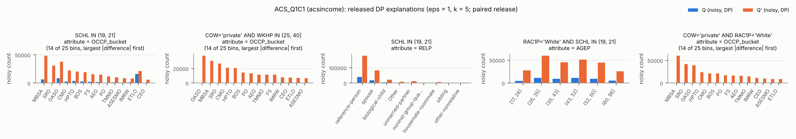

### ACS_Q1C2 — acsincome

* Q1 = `WKHP >= 40 AND SCHL >= 19 AND COW IN ('3', '4', '5')` (|Q1| = 141,100)
* Q2 = `WKHP >= 41 AND SCHL >= 19 AND COW IN ('3', '4', '5')` (|Q2| = 48,096; overlap 48,096)
* constraint: <= 15249 tuples with SEX = 'M' AND RELP = 1: 11.4% → 12.9%
* constraint: <= 11498 tuples with age_bucket = '30-60' AND MAR = 3: 8.6% → 8.3%
* |P| = 914, tau = 15, gamma = 150.3, Laplace scale per bin = 30.0 (sd of released difference 60.0)
* view stage: overlap of the retained views with the exact top-tau = 1.00
* single-atom views on the query attributes (exact rank by Use / coverage / Rep): `WKHP IN (25, 40]` #6 (0.056 / 0.68); `SCHL IN (19, 21]` #9 (0.052 / 0.62); `COW='local-gov'` #13 (0.050 / 0.53); `SCHL IN (21, 24]` #16 (0.043 / 0.56); `WKHP IN (40, 50]` #18 (0.040 / 0.58); `COW='state-gov'` #27 (0.037 / 0.52)

| round | view | attribute | bins clearing 2σ | exact |Q1| / |Q2| in view |
|---|---|---|---|---|
| 1 | `COW='local-gov'` | OCCP_bucket | OASO, MBSA, SRO, TMMO, ETLO, HPTO, PO, FPASO, CEO, BGCMO, BOS, CMO, IMRW, HSO, PCSO, FS, ASESMO, PSO, AEO, CSSO, LO, LPSSO | 61,959 / 21,737 |
| 2 | `COW='local-gov'` | RELP | reference-person, spouse, biological-child, Other, unmarried-partner, noninst-group-quarters, housemate-roommate, sibling, other-nonrelative | 61,959 / 21,737 |
| 3 | `RAC1P='White' AND SCHL IN (19, 21]` | COW | local-gov, state-gov, federal-gov | 52,121 / 17,142 |
| 4 | `COW='local-gov'` | AGEP | [17, 26], (26, 35], (35, 43], (43, 52], (52, 60], (60, 96] | 61,959 / 21,737 |
| 5 | `COW='local-gov'` | RAC1P | White, Black, Asian, other-race, two-or-more, Other | 61,959 / 21,737 |

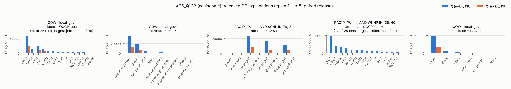

### ACS_Q2C1 — acsincome

* Q1 = `WKHP <= 40 AND SCHL <= 19 AND PINCP_bucket IN ('<20K', '20K-40K')` (|Q1| = 539,089)
* Q2 = `WKHP <= 40 AND SCHL <= 19 AND PINCP_bucket IN ('<20K', '20K-40K', '40K-60K')` (|Q2| = 635,774; overlap 539,089)
* constraint: >= 125492 tuples with SEX = 'F' AND MAR = 1: 22.2% → 22.2%
* constraint: >= 69207 tuples with RAC1P = 2: 12.2% → 11.9%
* |P| = 914, tau = 15, gamma = 150.3, Laplace scale per bin = 30.0 (sd of released difference 60.0)
* view stage: overlap of the retained views with the exact top-tau = 1.00
* single-atom views on the query attributes (exact rank by Use / coverage / Rep): `WKHP IN (25, 40]` #3 (0.494 / 0.68); `SCHL IN [1, 16]` #7 (0.387 / 0.61); `WKHP IN [1, 25]` #29 (0.211 / 0.57); `SCHL IN (18, 19]` #36 (0.188 / 0.57); `SCHL IN (16, 18]` #55 (0.131 / 0.55); `WKHP IN (40, 50]` #748 (0.000 / 0.58)

| round | view | attribute | bins clearing 2σ | exact |Q1| / |Q2| in view |
|---|---|---|---|---|
| 1 | `COW='private' AND SCHL IN [1, 16]` | OCCP_bucket | OASO, MBSA, SRO, TMMO, HPTO, PO, FPASO, CEO, BGCMO, BOS, CMO, IMRW, HSO, PCSO, FS, ASESMO, PSO, AEO, LO, LPSSO, FFFO, EW | 228,737 / 263,888 |
| 2 | `SCHL IN [1, 16]` | OCCP_bucket | OASO, MBSA, SRO, TMMO, ETLO, HPTO, PO, FPASO, CEO, BGCMO, BOS, CMO, IMRW, HSO, PCSO, FS, ASESMO, PSO, AEO, CSSO, LO, LPSSO, FFFO | 297,435 / 346,129 |
| 3 | `SCHL IN [1, 16]` | COW | private, non-profit, local-gov, self-emp-not-inc, state-gov, self-emp-inc, federal-gov | 297,435 / 346,129 |
| 4 | `SEX='F'` | WKHP | [1, 25], (25, 40] | 293,131 / 332,522 |
| 5 | `COW='private' AND SCHL IN [1, 16]` | MAR | married, never-married, divorced, widowed, separated | 228,737 / 263,888 |

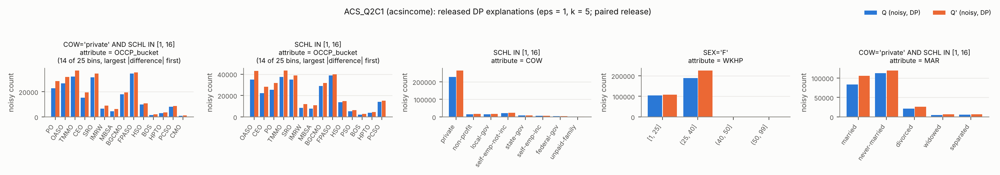

### ACS_Q2C2 — acsincome

* Q1 = `WKHP <= 40 AND SCHL <= 19 AND PINCP_bucket IN ('<20K', '20K-40K')` (|Q1| = 539,089)
* Q2 = `WKHP <= 39 AND SCHL <= 19 AND PINCP_bucket IN ('<20K', '20K-40K')` (|Q2| = 292,741; overlap 292,741)
* constraint: <= 33674 tuples with SEX = 'M' AND RELP = 1: 6.6% → 3.9%
* constraint: <= 36921 tuples with age_bucket = '30-60' AND MAR = 3: 7.2% → 5.5%
* |P| = 914, tau = 15, gamma = 150.3, Laplace scale per bin = 30.0 (sd of released difference 60.0)
* view stage: overlap of the retained views with the exact top-tau = 1.00
* single-atom views on the query attributes (exact rank by Use / coverage / Rep): `WKHP IN (25, 40]` #3 (0.292 / 0.68); `SCHL IN [1, 16]` #6 (0.271 / 0.61); `WKHP IN [1, 25]` #16 (0.207 / 0.57); `SCHL IN (18, 19]` #33 (0.136 / 0.57); `SCHL IN (16, 18]` #59 (0.092 / 0.55); `WKHP IN (40, 50]` #748 (0.000 / 0.58)

| round | view | attribute | bins clearing 2σ | exact |Q1| / |Q2| in view |
|---|---|---|---|---|
| 1 | `COW='private' AND SCHL IN [1, 16]` | OCCP_bucket | OASO, MBSA, SRO, TMMO, ETLO, HPTO, PO, FPASO, CEO, BGCMO, BOS, CMO, IMRW, HSO, PCSO, FS, ASESMO, PSO, AEO, CSSO, LO, LPSSO, FFFO, EW | 228,737 / 113,800 |
| 2 | `COW='private' AND WKHP IN (25, 40]` | RELP | reference-person, spouse, biological-child, Other, unmarried-partner, noninst-group-quarters, housemate-roommate, sibling, other-nonrelative | 283,028 / 91,028 |
| 3 | `RAC1P='White' AND WKHP IN (25, 40]` | OCCP_bucket | OASO, MBSA, SRO, TMMO, ETLO, HPTO, PO, FPASO, CEO, BGCMO, BOS, CMO, IMRW, HSO, PCSO, FS, ASESMO, PSO, AEO, CSSO, LO, LPSSO, FFFO, MSO, EW | 261,936 / 88,642 |
| 4 | `COW='private' AND WKHP IN (25, 40]` | RAC1P | White, Black, Asian, other-race, two-or-more, Other | 283,028 / 91,028 |
| 5 | `SCHL IN [1, 16]` | COW | private, non-profit, local-gov, self-emp-not-inc, state-gov, self-emp-inc, federal-gov, unpaid-family | 297,435 / 154,095 |

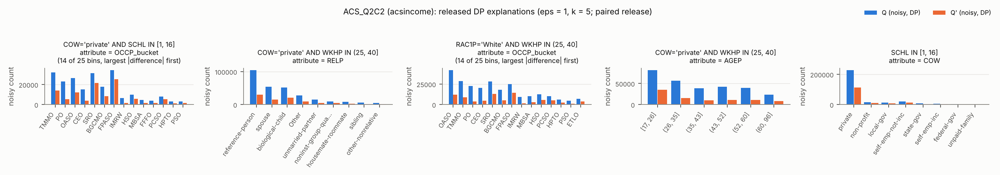

### ACS_Q2C3 — acsincome

* Q1 = `WKHP <= 40 AND SCHL <= 19 AND PINCP_bucket IN ('<20K', '20K-40K')` (|Q1| = 539,089)
* Q2 = `WKHP <= 38 AND SCHL <= 22 AND PINCP_bucket IN ('<20K', '20K-40K', '>60K')` (|Q2| = 450,201; overlap 291,024)
* constraint: >= 125492 tuples with SEX = 'F' AND MAR = 1: 22.2% → 28.7%
* constraint: <= 9628 tuples with SEX = 'M' AND RAC1P = 6: 1.9% → 1.9%
* |P| = 914, tau = 15, gamma = 150.3, Laplace scale per bin = 30.0 (sd of released difference 60.0)
* view stage: overlap of the retained views with the exact top-tau = 1.00
* single-atom views on the query attributes (exact rank by Use / coverage / Rep): `WKHP IN (25, 40]` #4 (0.336 / 0.68); `SCHL IN [1, 16]` #7 (0.274 / 0.61); `WKHP IN [1, 25]` #13 (0.258 / 0.57); `SCHL IN (18, 19]` #42 (0.139 / 0.57); `SCHL IN (16, 18]` #64 (0.093 / 0.55); `SCHL IN (19, 21]` #77 (0.071 / 0.62)

| round | view | attribute | bins clearing 2σ | exact |Q1| / |Q2| in view |
|---|---|---|---|---|
| 1 | `WKHP IN [1, 25]` | OCCP_bucket | OASO, MBSA, SRO, TMMO, ETLO, HPTO, PO, FPASO, CEO, BGCMO, BOS, CMO, IMRW, HSO, PCSO, FS, ASESMO, PSO, AEO, CSSO, LO, LPSSO, FFFO | 172,624 / 257,446 |
| 2 | `SCHL IN [1, 16]` | OCCP_bucket | OASO, MBSA, SRO, TMMO, ETLO, HPTO, PO, FPASO, CEO, BGCMO, BOS, CMO, IMRW, HSO, PCSO, FS, ASESMO, PSO, AEO, CSSO, LO, LPSSO, FFFO, MSO, EW | 297,435 / 158,573 |
| 3 | `SCHL IN [1, 16]` | RELP | reference-person, spouse, biological-child, Other, unmarried-partner, noninst-group-quarters, housemate-roommate, sibling, other-nonrelative | 297,435 / 158,573 |
| 4 | `WKHP IN [1, 25]` | COW | private, non-profit, local-gov, self-emp-not-inc, state-gov, self-emp-inc, federal-gov, unpaid-family | 172,624 / 257,446 |
| 5 | `WKHP IN [1, 25]` | AGEP | [17, 26], (26, 35], (35, 43], (43, 52], (52, 60], (60, 96] | 172,624 / 257,446 |

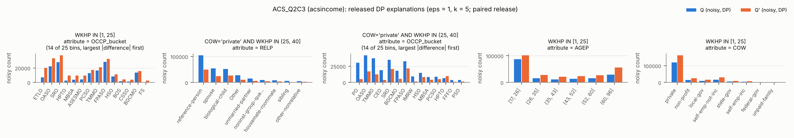

### ACS_Q3C4 — acsincome

* Q1 = `WKHP >= 60 AND SCHL <= 16 AND PINCP_bucket = '<20K'` (|Q1| = 4,367)
* Q2 = `WKHP >= 60 AND SCHL <= 16 AND PINCP_bucket IN ('<20K', '>60K')` (|Q2| = 13,177; overlap 4,367)
* constraint: >= 1307 tuples with SEX = 'F': 28.5% → 15.4%
* constraint: >= 521 tuples with RAC1P = 2: 11.4% → 7.3%
* |P| = 914, tau = 15, gamma = 150.3, Laplace scale per bin = 30.0 (sd of released difference 60.0)
* view stage: overlap of the retained views with the exact top-tau = 0.93
* single-atom views on the query attributes (exact rank by Use / coverage / Rep): `SCHL IN [1, 16]` #1 (0.011 / 0.61); `WKHP IN (50, 99]` #4 (0.011 / 0.54); `WKHP IN [1, 25]` #626 (0.000 / 0.57); `WKHP IN (25, 40]` #627 (0.000 / 0.68); `WKHP IN (40, 50]` #628 (0.000 / 0.58); `SCHL IN (16, 18]` #629 (0.000 / 0.55)

| round | view | attribute | bins clearing 2σ | exact |Q1| / |Q2| in view |
|---|---|---|---|---|
| 1 | `WKHP IN (50, 99] AND SCHL IN [1, 16]` | OCCP_bucket | OASO, MBSA, SRO, TMMO, PO, CEO, BGCMO, IMRW, PSO, FFFO, EW | 4,367 / 13,177 |
| 2 | `WKHP IN (50, 99] AND SCHL IN [1, 16]` | COW | private, non-profit, local-gov, self-emp-not-inc, state-gov, self-emp-inc, federal-gov | 4,367 / 13,177 |
| 3 | `SCHL IN [1, 16]` | WKHP | (50, 99] | 4,367 / 13,177 |
| 4 | `WKHP IN (50, 99] AND SCHL IN [1, 16]` | RELP | reference-person, spouse, Other, unmarried-partner | 4,367 / 13,177 |
| 5 | `WKHP IN (50, 99] AND SCHL IN [1, 16]` | AGEP | [17, 26], (26, 35], (35, 43], (43, 52], (52, 60], (60, 96] | 4,367 / 13,177 |

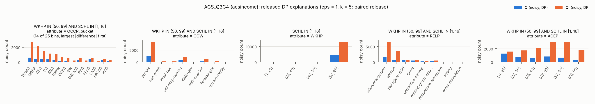

### ACS_Q3C5 — acsincome

* Q1 = `WKHP >= 60 AND SCHL <= 16 AND PINCP_bucket = '<20K'` (|Q1| = 4,367)
* Q2 = `WKHP >= 60 AND SCHL <= 15 AND PINCP_bucket = '<20K'` (|Q2| = 1,553; overlap 1,553)
* constraint: <= 2829 tuples with RAC1P = 1: 68.2% → 61.2%
* constraint: <= 2280 tuples with age_bucket = '30-60': 55.0% → 62.6%
* |P| = 914, tau = 15, gamma = 150.3, Laplace scale per bin = 30.0 (sd of released difference 60.0)
* view stage: overlap of the retained views with the exact top-tau = 0.93
* single-atom views on the query attributes (exact rank by Use / coverage / Rep): `SCHL IN [1, 16]` #1 (0.004 / 0.61); `WKHP IN (50, 99]` #2 (0.004 / 0.54); `WKHP IN [1, 25]` #615 (0.000 / 0.57); `WKHP IN (25, 40]` #616 (0.000 / 0.68); `WKHP IN (40, 50]` #617 (0.000 / 0.58); `SCHL IN (16, 18]` #618 (0.000 / 0.55)

| round | view | attribute | bins clearing 2σ | exact |Q1| / |Q2| in view |
|---|---|---|---|---|
| 1 | `WKHP IN (50, 99] AND SCHL IN [1, 16]` | OCCP_bucket | MBSA, SRO, TMMO, PO, FPASO, CEO, IMRW, PCSO, FFFO, MSO | 4,367 / 1,553 |
| 2 | `RAC1P='White' AND WKHP IN (50, 99]` | RELP | reference-person, spouse, biological-child, noninst-group-quarters | 2,978 / 950 |
| 3 | `SCHL IN [1, 16]` | OCCP_bucket | MBSA, SRO, TMMO, PO, FPASO, CEO, BGCMO, IMRW, HSO, PCSO, FFFO, MSO | 4,367 / 1,553 |
| 4 | `COW='private' AND WKHP IN (50, 99]` | MAR | married, never-married, divorced | 2,462 / 1,044 |
| 5 | `WKHP IN (50, 99] AND SCHL IN [1, 16]` | COW | private, non-profit, self-emp-not-inc, self-emp-inc, federal-gov | 4,367 / 1,553 |

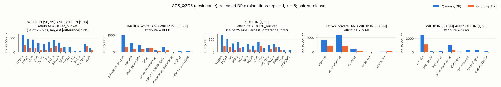

### ACS_Q3C6 — acsincome

* Q1 = `WKHP >= 60 AND SCHL <= 16 AND PINCP_bucket = '<20K'` (|Q1| = 4,367)
* Q2 = `WKHP >= 66 AND SCHL <= 21 AND PINCP_bucket = '<20K'` (|Q2| = 4,317; overlap 1,933)
* constraint: >= 521 tuples with RAC1P = 2: 11.4% → 12.1%
* constraint: <= 2280 tuples with age_bucket = '30-60': 55.0% → 52.8%
* |P| = 914, tau = 15, gamma = 150.3, Laplace scale per bin = 30.0 (sd of released difference 60.0)
* view stage: overlap of the retained views with the exact top-tau = 0.93
* single-atom views on the query attributes (exact rank by Use / coverage / Rep): `WKHP IN (50, 99]` #1 (0.005 / 0.54); `SCHL IN [1, 16]` #4 (0.004 / 0.61); `SCHL IN (19, 21]` #74 (0.001 / 0.62); `SCHL IN (18, 19]` #90 (0.001 / 0.57); `SCHL IN (16, 18]` #128 (0.000 / 0.55); `WKHP IN [1, 25]` #740 (0.000 / 0.57)

| round | view | attribute | bins clearing 2σ | exact |Q1| / |Q2| in view |
|---|---|---|---|---|
| 1 | `WKHP IN (50, 99] AND SCHL IN [1, 16]` | OCCP_bucket | MBSA, SRO, TMMO, PO, FPASO, CEO, IMRW, PCSO, FFFO | 4,367 / 1,933 |
| 2 | `WKHP IN (50, 99] AND SCHL IN [1, 16]` | RELP | reference-person, spouse, biological-child, Other, noninst-group-quarters | 4,367 / 1,933 |
| 3 | `WKHP IN (50, 99]` | OCCP_bucket | MBSA, TMMO, PO, CEO, FFFO | 4,367 / 4,317 |
| 4 | `RAC1P='White' AND WKHP IN (50, 99]` | OCCP_bucket | MBSA, CEO | 2,978 / 3,051 |
| 5 | `SEX='M'` | MAR | married | 3,123 / 2,839 |

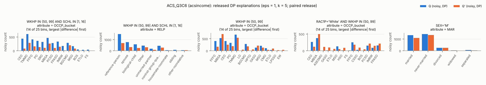

### ACS_Q4C7 — acsincome

* Q1 = `WKHP >= 60 AND SCHL >= 22 AND PINCP_bucket = '>60K' AND COW IN ('6', '7')` (|Q1| = 2,343)
* Q2 = `WKHP >= 60 AND SCHL >= 21 AND PINCP_bucket = '>60K' AND COW IN ('6', '7')` (|Q2| = 4,997; overlap 2,343)
* constraint: >= 552 tuples with SEX = 'F': 22.4% → 20.0%
* constraint: >= 97 tuples with RAC1P = 2: 3.9% → 3.1%
* constraint: >= 239 tuples with MAR = 3: 9.7% → 9.4%
* |P| = 914, tau = 15, gamma = 150.3, Laplace scale per bin = 30.0 (sd of released difference 60.0)
* view stage: overlap of the retained views with the exact top-tau = 0.87
* single-atom views on the query attributes (exact rank by Use / coverage / Rep): `WKHP IN (50, 99]` #2 (0.004 / 0.54); `SCHL IN (21, 24]` #12 (0.003 / 0.56); `COW='self-emp-inc'` #13 (0.003 / 0.52); `SCHL IN (19, 21]` #26 (0.002 / 0.62); `COW='self-emp-not-inc'` #35 (0.001 / 0.53); `COW='private'` #428 (0.000 / 0.70)

| round | view | attribute | bins clearing 2σ | exact |Q1| / |Q2| in view |
|---|---|---|---|---|
| 1 | `COW='self-emp-inc' AND WKHP IN (50, 99]` | OCCP_bucket | MBSA, SRO | 1,627 / 3,327 |
| 2 | `COW='self-emp-inc' AND WKHP IN (50, 99]` | PINCP_bucket | >60K | 1,627 / 3,327 |
| 3 | `SEX='M'` | OCCP_bucket | MBSA, SRO, CEO, BOS, FS | 1,818 / 3,998 |
| 4 | `MAR='married' AND RAC1P='White'` | OCCP_bucket | MBSA, SRO, BGCMO, BOS, ASESMO | 1,590 / 3,434 |
| 5 | `WKHP IN (50, 99]` | MAR | married, never-married, divorced | 2,343 / 4,997 |

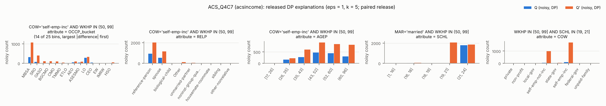

### ACS_Q4C8 — acsincome

* Q1 = `WKHP >= 60 AND SCHL >= 22 AND PINCP_bucket = '>60K' AND COW IN ('6', '7')` (|Q1| = 2,343)
* Q2 = `WKHP >= 60 AND SCHL >= 23 AND PINCP_bucket = '>60K' AND COW IN ('6', '7')` (|Q2| = 1,471; overlap 1,471)
* constraint: <= 1862 tuples with RAC1P = 1: 83.7% → 84.2%
* constraint: <= 1727 tuples with SEX = 'M': 77.6% → 78.6%
* |P| = 914, tau = 15, gamma = 150.3, Laplace scale per bin = 30.0 (sd of released difference 60.0)
* view stage: overlap of the retained views with the exact top-tau = 0.87
* single-atom views on the query attributes (exact rank by Use / coverage / Rep): `SCHL IN (21, 24]` #2 (0.002 / 0.56); `WKHP IN (50, 99]` #4 (0.002 / 0.54); `COW='self-emp-inc'` #17 (0.002 / 0.52); `COW='self-emp-not-inc'` #34 (0.001 / 0.53); `COW='private'` #357 (0.000 / 0.70); `COW='non-profit'` #358 (0.000 / 0.54)

| round | view | attribute | bins clearing 2σ | exact |Q1| / |Q2| in view |
|---|---|---|---|---|
| 1 | `COW='self-emp-inc' AND WKHP IN (50, 99]` | OCCP_bucket | MBSA, BOS | 1,627 / 1,032 |
| 2 | `WKHP IN (50, 99] AND SCHL IN (21, 24]` | AGEP | (35, 43], (43, 52], (52, 60], (60, 96] | 2,343 / 1,471 |
| 3 | `RAC1P='White'` | AGEP | (43, 52], (52, 60], (60, 96] | 1,960 / 1,239 |
| 4 | `RELP='reference-person'` | RAC1P | White, Asian | 1,451 / 897 |
| 5 | `WKHP IN (50, 99] AND SCHL IN (21, 24]` | COW | self-emp-not-inc, self-emp-inc | 2,343 / 1,471 |

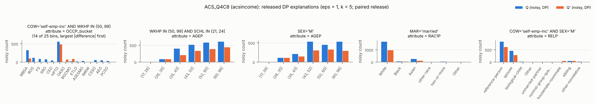

### I1 — ipums

* Q1 = `SEX = 'Male'` (|Q1| = 556,230)
* Q2 = `SEX = 'Female'` (|Q2| = 590,322; overlap 0)
* |P| = 1,070, tau = 15, gamma = 143.6, Laplace scale per bin = 30.0 (sd of released difference 60.0)
* view stage: overlap of the retained views with the exact top-tau = 1.00

| round | view | attribute | bins clearing 2σ | exact |Q1| / |Q2| in view |
|---|---|---|---|---|
| 1 | `MARST='Married, spouse present' AND CLASSWKR='Wage/salary, private'` | EDUC | High school diploma or equivalent, Bachelor's degree, Some college but no degree, Master's degree, Associate's degree, academic program, Associate's degree, occupational/vocational program, Grade 11, Grade 10, Grade 9, Grades 7 or 8, Doctorate degree, 12th grade, no diploma, Grades 5 or 6, Professional school degree, Grades 1, 2, 3, or 4, None or preschool | 176,490 / 143,322 |
| 2 | `RACE='White'` | CLASSWKR | Wage/salary, private, NIU, Local government employee, Self-employed, not incorporated, State government employee, Self-employed, incorporated, Federal government employee, Armed forces | 443,312 / 455,969 |
| 3 | `MARST='Married, spouse present' AND RACE='White'` | INCTOT | [1, 9001], (9001, 18000], (18000, 28600], (28600, 42360], (42360, 66685], (66685, 199999] | 265,614 / 245,216 |
| 4 | `CLASSWKR='NIU'` | RELATE | Head/householder, Spouse, Child, Unmarried partner, Opposite sex spouse, Parent, Housemate/roomate, Other relatives, n.s. | 136,325 / 197,533 |
| 5 | `MARST='Married, spouse present' AND RACE='White'` | EDUC | High school diploma or equivalent, Bachelor's degree, Some college but no degree, Master's degree, Associate's degree, academic program, Associate's degree, occupational/vocational program, Grade 11, Grade 10, Grade 9, Grades 7 or 8, Doctorate degree, 12th grade, no diploma, Grades 5 or 6, Professional school degree, Grades 1, 2, 3, or 4, None or preschool | 265,614 / 245,216 |

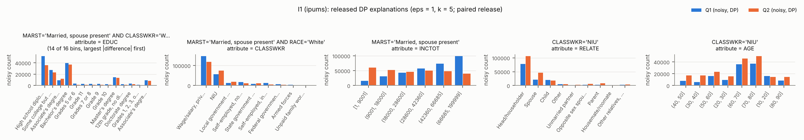

### I2 — ipums

* Q1 = `RELATE = 'Spouse'` (|Q1| = 263,032)
* Q2 = `RELATE = 'Head/householder'` (|Q2| = 600,801; overlap 0)
* |P| = 783, tau = 15, gamma = 143.6, Laplace scale per bin = 30.0 (sd of released difference 60.0)
* view stage: overlap of the retained views with the exact top-tau = 1.00

| round | view | attribute | bins clearing 2σ | exact |Q1| / |Q2| in view |
|---|---|---|---|---|
| 1 | `SEX='Male' AND CITIZEN='Born in U.S'` | EDUC | High school diploma or equivalent, Bachelor's degree, Some college but no degree, Master's degree, Associate's degree, academic program, Associate's degree, occupational/vocational program, Grade 11, Grade 10, Grade 9, Grades 7 or 8, Doctorate degree, 12th grade, no diploma, Grades 5 or 6, Professional school degree, Grades 1, 2, 3, or 4, None or preschool | 89,105 / 250,642 |
| 2 | `SEX='Male'` | MARST | Married, spouse present, Never married/single, Divorced, Widowed, Separated, Married, spouse absent | 109,670 / 305,130 |
| 3 | `SEX='Male' AND RACE='White'` | AGE | (40, 50], (30, 40], (50, 60], (20, 30], (60, 70], (70, 80], (10, 20], (80, 90] | 92,051 / 243,801 |
| 4 | `SEX='Male'` | EDUC | High school diploma or equivalent, Bachelor's degree, Some college but no degree, Master's degree, Associate's degree, academic program, Associate's degree, occupational/vocational program, Grade 11, Grade 10, Grade 9, Grades 7 or 8, Doctorate degree, 12th grade, no diploma, Grades 5 or 6, Professional school degree, Grades 1, 2, 3, or 4, None or preschool | 109,670 / 305,130 |
| 5 | `SEX='Male' AND CITIZEN='Born in U.S'` | CLASSWKR | Wage/salary, private, NIU, Local government employee, Self-employed, not incorporated, State government employee, Self-employed, incorporated, Federal government employee, Armed forces | 89,105 / 250,642 |

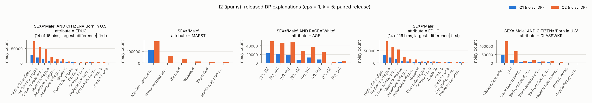

### I3 — ipums

* Q1 = `RELATE = 'Spouse'` (|Q1| = 263,032)
* Q2 = `RELATE = 'Unmarried partner'` (|Q2| = 31,495; overlap 0)
* |P| = 783, tau = 15, gamma = 143.6, Laplace scale per bin = 30.0 (sd of released difference 60.0)
* view stage: overlap of the retained views with the exact top-tau = 1.00

| round | view | attribute | bins clearing 2σ | exact |Q1| / |Q2| in view |
|---|---|---|---|---|
| 1 | `SEX='Female' AND MARST='Married, spouse present'` | EDUC | High school diploma or equivalent, Bachelor's degree, Some college but no degree, Master's degree, Associate's degree, academic program, Associate's degree, occupational/vocational program, Grade 11, Grade 10, Grade 9, Grades 7 or 8, Doctorate degree, 12th grade, no diploma, Grades 5 or 6, Professional school degree, Grades 1, 2, 3, or 4, None or preschool | 153,362 / 0 |
| 2 | `SEX='Female' AND MARST='Married, spouse present'` | CLASSWKR | Wage/salary, private, NIU, Local government employee, Self-employed, not incorporated, State government employee, Self-employed, incorporated, Federal government employee, Armed forces, Unpaid family worker | 153,362 / 0 |
| 3 | `MARST='Married, spouse present' AND RACE='White'` | EDUC | High school diploma or equivalent, Bachelor's degree, Some college but no degree, Master's degree, Associate's degree, academic program, Associate's degree, occupational/vocational program, Grade 11, Grade 10, Grade 9, Grades 7 or 8, Doctorate degree, 12th grade, no diploma, Grades 5 or 6, Professional school degree, Grades 1, 2, 3, or 4, None or preschool | 219,425 / 0 |
| 4 | `MARST='Married, spouse present' AND RACE='White'` | AGE | (40, 50], (30, 40], (50, 60], (20, 30], (60, 70], (70, 80], (10, 20], (80, 90] | 219,425 / 0 |
| 5 | `SEX='Female' AND MARST='Married, spouse present'` | AGE | (40, 50], (30, 40], (50, 60], (20, 30], (60, 70], (70, 80], (10, 20], (80, 90] | 153,362 / 0 |

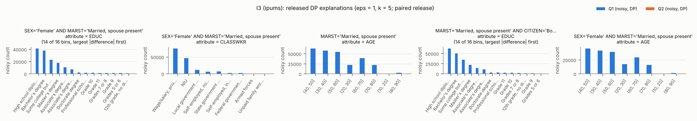

### I4 — ipums

* Q1 = `RELATE = 'Head/householder'` (|Q1| = 600,801)
* Q2 = `RELATE = 'Child'` (|Q2| = 124,068; overlap 0)
* |P| = 783, tau = 15, gamma = 143.6, Laplace scale per bin = 30.0 (sd of released difference 60.0)
* view stage: overlap of the retained views with the exact top-tau = 1.00

| round | view | attribute | bins clearing 2σ | exact |Q1| / |Q2| in view |
|---|---|---|---|---|
| 1 | `MARST='Married, spouse present' AND RACE='White'` | EDUC | High school diploma or equivalent, Bachelor's degree, Some college but no degree, Master's degree, Associate's degree, academic program, Associate's degree, occupational/vocational program, Grade 11, Grade 10, Grade 9, Grades 7 or 8, Doctorate degree, 12th grade, no diploma, Grades 5 or 6, Professional school degree, Grades 1, 2, 3, or 4, None or preschool | 250,941 / 2,749 |
| 2 | `RACE='White'` | AGE | (40, 50], (30, 40], (50, 60], (20, 30], (60, 70], (70, 80], (10, 20], (80, 90] | 466,837 / 94,317 |
| 3 | `SEX='Male'` | CLASSWKR | Wage/salary, private, NIU, Local government employee, Self-employed, not incorporated, State government employee, Self-employed, incorporated, Federal government employee, Armed forces | 305,130 / 65,460 |
| 4 | `SEX='Female' AND CITIZEN='Born in U.S'` | MARST | Married, spouse present, Never married/single, Divorced, Widowed, Separated, Married, spouse absent | 251,381 / 53,692 |
| 5 | `MARST='Married, spouse present'` | EDUC | High school diploma or equivalent, Bachelor's degree, Some college but no degree, Master's degree, Associate's degree, academic program, Associate's degree, occupational/vocational program, Grade 11, Grade 10, Grade 9, Grades 7 or 8, Doctorate degree, 12th grade, no diploma, Grades 5 or 6, Professional school degree, Grades 1, 2, 3, or 4, None or preschool | 300,508 / 3,637 |

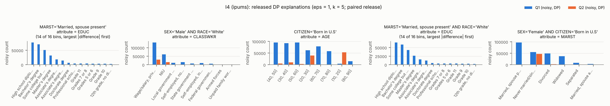

### I5 — ipums

* Q1 = `RELATE = 'Head/householder'` (|Q1| = 600,801)
* Q2 = `RELATE = 'Parent'` (|Q2| = 23,629; overlap 0)
* |P| = 783, tau = 15, gamma = 143.6, Laplace scale per bin = 30.0 (sd of released difference 60.0)
* view stage: overlap of the retained views with the exact top-tau = 1.00

| round | view | attribute | bins clearing 2σ | exact |Q1| / |Q2| in view |
|---|---|---|---|---|
| 1 | `SEX='Male'` | EDUC | High school diploma or equivalent, Bachelor's degree, Some college but no degree, Master's degree, Associate's degree, academic program, Associate's degree, occupational/vocational program, Grade 11, Grade 10, Grade 9, Grades 7 or 8, Doctorate degree, 12th grade, no diploma, Grades 5 or 6, Professional school degree, Grades 1, 2, 3, or 4, None or preschool | 305,130 / 7,970 |
| 2 | `SEX='Male' AND CITIZEN='Born in U.S'` | CLASSWKR | Wage/salary, private, NIU, Local government employee, Self-employed, not incorporated, State government employee, Self-employed, incorporated, Federal government employee, Armed forces | 250,642 / 4,085 |
| 3 | `CITIZEN='Born in U.S'` | AGE | (40, 50], (30, 40], (50, 60], (20, 30], (60, 70], (70, 80], (10, 20], (80, 90] | 502,023 / 13,694 |
| 4 | `SEX='Female'` | EDUC | High school diploma or equivalent, Bachelor's degree, Some college but no degree, Master's degree, Associate's degree, academic program, Associate's degree, occupational/vocational program, Grade 11, Grade 10, Grade 9, Grades 7 or 8, Doctorate degree, 12th grade, no diploma, Grades 5 or 6, Professional school degree, Grades 1, 2, 3, or 4, None or preschool | 295,671 / 15,659 |
| 5 | `SEX='Female' AND RACE='White'` | MARST | Married, spouse present, Never married/single, Divorced, Widowed, Separated, Married, spouse absent | 223,036 / 10,386 |

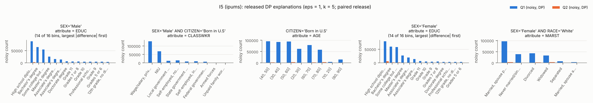

### I6 — ipums

* Q1 = `MARST = 'Married, spouse present'` (|Q1| = 615,671)
* Q2 = `MARST = 'Never married/single'` (|Q2| = 302,721; overlap 0)
* |P| = 894, tau = 15, gamma = 143.6, Laplace scale per bin = 30.0 (sd of released difference 60.0)
* view stage: overlap of the retained views with the exact top-tau = 1.00

| round | view | attribute | bins clearing 2σ | exact |Q1| / |Q2| in view |
|---|---|---|---|---|
| 1 | `SEX='Male' AND CITIZEN='Born in U.S'` | RELATE | Head/householder, Spouse, Child, Other, Unmarried partner, Opposite sex spouse, Parent, Housemate/roomate | 254,941 / 132,669 |
| 2 | `SEX='Male' AND RACE='White'` | EDUC | High school diploma or equivalent, Bachelor's degree, Some college but no degree, Master's degree, Associate's degree, academic program, Associate's degree, occupational/vocational program, Grade 11, Grade 10, Grade 9, Grades 7 or 8, Doctorate degree, 12th grade, no diploma, Grades 5 or 6, Professional school degree, Grades 1, 2, 3, or 4, None or preschool | 265,614 / 115,135 |
| 3 | `SEX='Male'` | AGE | (40, 50], (30, 40], (50, 60], (20, 30], (60, 70], (70, 80], (10, 20], (80, 90] | 319,729 / 155,518 |
| 4 | `RELATE='Head/householder' AND RACE='White'` | CLASSWKR | Wage/salary, private, NIU, Local government employee, Self-employed, not incorporated, State government employee, Self-employed, incorporated, Federal government employee, Armed forces, Unpaid family worker | 250,941 / 82,399 |
| 5 | `CITIZEN='Born in U.S'` | RELATE | Head/householder, Spouse, Child, Other, Unmarried partner, Opposite sex spouse, Parent, Housemate/roomate, Other relatives, n.s. | 496,930 / 261,601 |

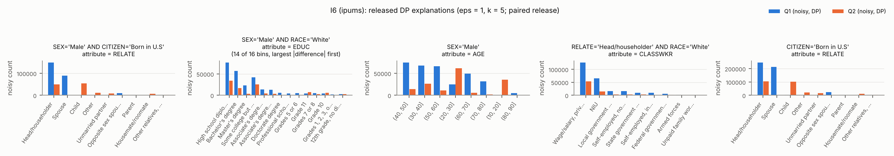

### I7 — ipums

* Q1 = `MARST = 'Divorced'` (|Q1| = 121,129)
* Q2 = `MARST = 'Never married/single'` (|Q2| = 302,721; overlap 0)
* |P| = 894, tau = 15, gamma = 143.6, Laplace scale per bin = 30.0 (sd of released difference 60.0)
* view stage: overlap of the retained views with the exact top-tau = 1.00

| round | view | attribute | bins clearing 2σ | exact |Q1| / |Q2| in view |
|---|---|---|---|---|
| 1 | `CITIZEN='Born in U.S' AND CLASSWKR='Wage/salary, private'` | EDUC | High school diploma or equivalent, Bachelor's degree, Some college but no degree, Master's degree, Associate's degree, academic program, Associate's degree, occupational/vocational program, Grade 11, Grade 10, Grade 9, Grades 7 or 8, Doctorate degree, 12th grade, no diploma, Grades 5 or 6, Professional school degree, None or preschool | 52,792 / 163,627 |
| 2 | `SEX='Female' AND CITIZEN='Born in U.S'` | RELATE | Head/householder, Child, Other, Unmarried partner, Parent, Housemate/roomate, Other relatives, n.s. | 62,285 / 128,932 |
| 3 | `RACE='White'` | AGE | (40, 50], (30, 40], (50, 60], (20, 30], (60, 70], (70, 80], (10, 20], (80, 90] | 94,847 / 215,381 |
| 4 | `CITIZEN='Born in U.S'` | RACE | White, Black, Asian only, Other, American Indian/Aleut/Eskimo, White-American Indian | 105,627 / 261,601 |
| 5 | `CITIZEN='Born in U.S'` | EDUC | High school diploma or equivalent, Bachelor's degree, Some college but no degree, Master's degree, Associate's degree, academic program, Associate's degree, occupational/vocational program, Grade 11, Grade 10, Grade 9, Grades 7 or 8, Doctorate degree, 12th grade, no diploma, Grades 5 or 6, Professional school degree, None or preschool | 105,627 / 261,601 |

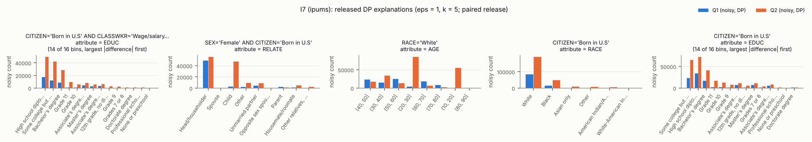

### I8 — ipums

* Q1 = `RACE = 'White'` (|Q1| = 899,281)
* Q2 = `RACE = 'Black'` (|Q2| = 136,119; overlap 0)
* |P| = 894, tau = 15, gamma = 143.6, Laplace scale per bin = 30.0 (sd of released difference 60.0)
* view stage: overlap of the retained views with the exact top-tau = 1.00

| round | view | attribute | bins clearing 2σ | exact |Q1| / |Q2| in view |
|---|---|---|---|---|
| 1 | `MARST='Married, spouse present'` | EDUC | High school diploma or equivalent, Bachelor's degree, Some college but no degree, Master's degree, Associate's degree, academic program, Associate's degree, occupational/vocational program, Grade 11, Grade 10, Grade 9, Grades 7 or 8, Doctorate degree, 12th grade, no diploma, Grades 5 or 6, Professional school degree, Grades 1, 2, 3, or 4, None or preschool | 510,830 / 46,386 |
| 2 | `RELATE='Head/householder' AND CITIZEN='Born in U.S'` | CLASSWKR | Wage/salary, private, NIU, Local government employee, Self-employed, not incorporated, State government employee, Self-employed, incorporated, Federal government employee, Armed forces | 403,737 / 71,261 |
| 3 | `SEX='Male' AND CLASSWKR='Wage/salary, private'` | RELATE | Head/householder, Spouse, Child, Other, Unmarried partner, Opposite sex spouse, Parent, Housemate/roomate, Other relatives, n.s. | 253,321 / 31,052 |
| 4 | `MARST='Married, spouse present' AND CLASSWKR='Wage/salary, private'` | EDUC | High school diploma or equivalent, Bachelor's degree, Some college but no degree, Master's degree, Associate's degree, academic program, Associate's degree, occupational/vocational program, Grade 11, Grade 10, Grade 9, Grades 7 or 8, Doctorate degree, 12th grade, no diploma, Grades 5 or 6, Professional school degree, Grades 1, 2, 3, or 4, None or preschool | 264,716 / 22,968 |
| 5 | `SEX='Female' AND CITIZEN='Born in U.S'` | AGE | (40, 50], (30, 40], (50, 60], (20, 30], (60, 70], (70, 80], (10, 20], (80, 90] | 397,350 / 67,389 |

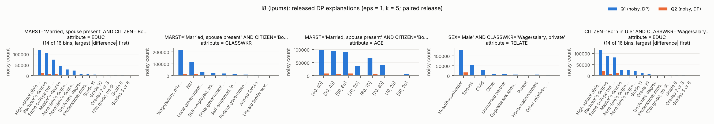

### I9 — ipums

* Q1 = `RACE = 'Asian only'` (|Q1| = 67,414)
* Q2 = `RACE = 'White'` (|Q2| = 899,281; overlap 0)
* |P| = 894, tau = 15, gamma = 143.6, Laplace scale per bin = 30.0 (sd of released difference 60.0)
* view stage: overlap of the retained views with the exact top-tau = 1.00

| round | view | attribute | bins clearing 2σ | exact |Q1| / |Q2| in view |
|---|---|---|---|---|
| 1 | `MARST='Married, spouse present' AND CITIZEN='Born in U.S'` | EDUC | High school diploma or equivalent, Bachelor's degree, Some college but no degree, Master's degree, Associate's degree, academic program, Associate's degree, occupational/vocational program, Grade 11, Grade 10, Grade 9, Grades 7 or 8, Doctorate degree, 12th grade, no diploma, Grades 5 or 6, Professional school degree, Grades 1, 2, 3, or 4 | 7,891 / 436,207 |
| 2 | `MARST='Married, spouse present' AND CITIZEN='Born in U.S'` | CLASSWKR | Wage/salary, private, NIU, Local government employee, Self-employed, not incorporated, State government employee, Self-employed, incorporated, Federal government employee, Armed forces, Unpaid family worker | 7,891 / 436,207 |
| 3 | `SEX='Female' AND CITIZEN='Born in U.S'` | RELATE | Head/householder, Spouse, Child, Other, Unmarried partner, Opposite sex spouse, Parent, Housemate/roomate, Other relatives, n.s. | 9,544 / 397,350 |
| 4 | `SEX='Male' AND CITIZEN='Born in U.S'` | AGE | (40, 50], (30, 40], (50, 60], (20, 30], (60, 70], (70, 80], (10, 20], (80, 90] | 9,351 / 376,797 |
| 5 | `CITIZEN='Born in U.S'` | EDUC | High school diploma or equivalent, Bachelor's degree, Some college but no degree, Master's degree, Associate's degree, academic program, Associate's degree, occupational/vocational program, Grade 11, Grade 10, Grade 9, Grades 7 or 8, Doctorate degree, 12th grade, no diploma, Grades 5 or 6, Professional school degree, Grades 1, 2, 3, or 4, None or preschool | 18,895 / 774,147 |

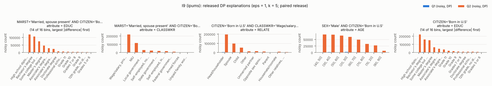

### I10 — ipums

* Q1 = `CITIZEN = 'Born in U.S'` (|Q1| = 949,180)
* Q2 = `CITIZEN = 'Not a citizen'` (|Q2| = 89,876; overlap 0)
* |P| = 935, tau = 15, gamma = 143.6, Laplace scale per bin = 30.0 (sd of released difference 60.0)
* view stage: overlap of the retained views with the exact top-tau = 0.93

| round | view | attribute | bins clearing 2σ | exact |Q1| / |Q2| in view |
|---|---|---|---|---|
| 1 | `SEX='Female' AND RACE='White'` | EDUC | High school diploma or equivalent, Bachelor's degree, Some college but no degree, Master's degree, Associate's degree, academic program, Associate's degree, occupational/vocational program, Grade 11, Grade 10, Grade 9, Grades 7 or 8, Doctorate degree, 12th grade, no diploma, Grades 5 or 6, Professional school degree, Grades 1, 2, 3, or 4, None or preschool | 397,350 / 26,189 |
| 2 | `MARST='Married, spouse present' AND RACE='White'` | CLASSWKR | Wage/salary, private, NIU, Local government employee, Self-employed, not incorporated, State government employee, Self-employed, incorporated, Federal government employee, Armed forces, Unpaid family worker | 436,207 / 35,709 |
| 3 | `RACE='White'` | AGE | (40, 50], (30, 40], (50, 60], (20, 30], (60, 70], (70, 80], (10, 20], (80, 90] | 774,147 / 62,210 |
| 4 | `CLASSWKR='NIU'` | RELATE | Head/householder, Spouse, Child, Other, Unmarried partner, Opposite sex spouse, Parent, Housemate/roomate, Other relatives, n.s. | 287,120 / 15,710 |
| 5 | `CLASSWKR='NIU'` | EDUC | High school diploma or equivalent, Bachelor's degree, Some college but no degree, Master's degree, Associate's degree, academic program, Associate's degree, occupational/vocational program, Grade 11, Grade 10, Grade 9, Grades 7 or 8, Doctorate degree, 12th grade, no diploma, Grades 5 or 6, Professional school degree | 287,120 / 15,710 |

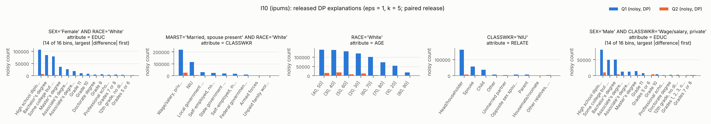

### I11 — ipums

* Q1 = `CITIZEN = 'Naturalized citizen'` (|Q1| = 88,951)
* Q2 = `CITIZEN = 'Born in U.S'` (|Q2| = 949,180; overlap 0)
* |P| = 935, tau = 15, gamma = 143.6, Laplace scale per bin = 30.0 (sd of released difference 60.0)
* view stage: overlap of the retained views with the exact top-tau = 1.00

| round | view | attribute | bins clearing 2σ | exact |Q1| / |Q2| in view |
|---|---|---|---|---|
| 1 | `RACE='White'` | EDUC | High school diploma or equivalent, Bachelor's degree, Some college but no degree, Master's degree, Associate's degree, academic program, Associate's degree, occupational/vocational program, Grade 11, Grade 10, Grade 9, Grades 7 or 8, Doctorate degree, 12th grade, no diploma, Grades 5 or 6, Professional school degree, Grades 1, 2, 3, or 4, None or preschool | 49,167 / 774,147 |
| 2 | `SEX='Male'` | CLASSWKR | Wage/salary, private, NIU, Local government employee, Self-employed, not incorporated, State government employee, Self-employed, incorporated, Federal government employee, Armed forces | 41,909 / 455,229 |
| 3 | `SEX='Female'` | AGE | (40, 50], (30, 40], (50, 60], (20, 30], (60, 70], (70, 80], (10, 20], (80, 90] | 47,042 / 493,951 |
| 4 | `SEX='Male' AND RACE='White'` | RELATE | Head/householder, Spouse, Child, Other, Unmarried partner, Opposite sex spouse, Parent, Housemate/roomate, Other relatives, n.s. | 23,829 / 376,797 |
| 5 | `CLASSWKR='NIU'` | EDUC | High school diploma or equivalent, Bachelor's degree, Some college but no degree, Master's degree, Associate's degree, academic program, Associate's degree, occupational/vocational program, Grade 11, Grade 10, Grade 9, Grades 7 or 8, Doctorate degree, 12th grade, no diploma, Grades 5 or 6, Professional school degree, Grades 1, 2, 3, or 4, None or preschool | 24,981 / 287,120 |

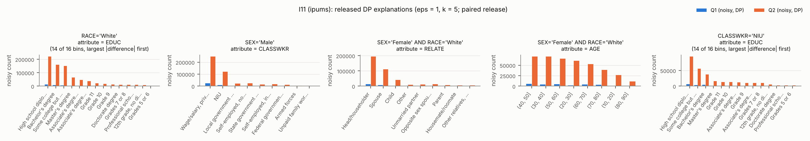

### I12 — ipums

* Q1 = `CLASSWKR = 'Wage/salary, private'` (|Q1| = 608,462)
* Q2 = `CLASSWKR = 'Self-employed, not incorporated'` (|Q2| = 50,383; overlap 0)
* |P| = 783, tau = 15, gamma = 143.6, Laplace scale per bin = 30.0 (sd of released difference 60.0)
* view stage: overlap of the retained views with the exact top-tau = 1.00

| round | view | attribute | bins clearing 2σ | exact |Q1| / |Q2| in view |
|---|---|---|---|---|
| 1 | `SEX='Male'` | EDUC | High school diploma or equivalent, Bachelor's degree, Some college but no degree, Master's degree, Associate's degree, academic program, Associate's degree, occupational/vocational program, Grade 11, Grade 10, Grade 9, Grades 7 or 8, Doctorate degree, 12th grade, no diploma, Grades 5 or 6, Professional school degree, Grades 1, 2, 3, or 4, None or preschool | 315,451 / 30,030 |
| 2 | `SEX='Female' AND RACE='White'` | RELATE | Head/householder, Spouse, Child, Other, Unmarried partner, Opposite sex spouse, Parent, Housemate/roomate, Other relatives, n.s. | 226,073 / 17,157 |
| 3 | `MARST='Married, spouse present' AND CITIZEN='Born in U.S'` | AGE | (40, 50], (30, 40], (50, 60], (20, 30], (60, 70], (70, 80], (10, 20] | 246,972 / 26,349 |
| 4 | `MARST='Married, spouse present'` | EDUC | High school diploma or equivalent, Bachelor's degree, Some college but no degree, Master's degree, Associate's degree, academic program, Associate's degree, occupational/vocational program, Grade 11, Grade 10, Grade 9, Grades 7 or 8, Doctorate degree, 12th grade, no diploma, Grades 5 or 6, Professional school degree, Grades 1, 2, 3, or 4, None or preschool | 319,812 / 33,322 |
| 5 | `RACE='White' AND CITIZEN='Born in U.S'` | INCTOT | [1, 9001], (9001, 18000], (18000, 28600], (28600, 42360], (42360, 66685], (66685, 199999] | 401,367 / 35,441 |

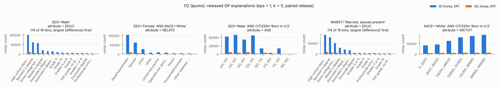

### I13 — ipums

* Q1 = `CLASSWKR = 'Federal government employee'` (|Q1| = 23,005)
* Q2 = `CLASSWKR = 'State government employee'` (|Q2| = 40,551; overlap 0)
* |P| = 783, tau = 15, gamma = 143.6, Laplace scale per bin = 30.0 (sd of released difference 60.0)
* view stage: overlap of the retained views with the exact top-tau = 1.00

| round | view | attribute | bins clearing 2σ | exact |Q1| / |Q2| in view |
|---|---|---|---|---|
| 1 | `RACE='White'` | MARST | Married, spouse present, Never married/single, Divorced, Widowed, Separated | 15,527 / 30,773 |
| 2 | `SEX='Male'` | RACE | White, American Indian/Aleut/Eskimo | 12,476 / 15,756 |
| 3 | `SEX='Male' AND CITIZEN='Born in U.S'` | AGE | (40, 50], (30, 40], (50, 60], (20, 30], (60, 70], (10, 20] | 10,802 / 13,783 |
| 4 | `SEX='Female'` | RACE | White, Black, Asian only, Other, American Indian/Aleut/Eskimo, White-American Indian | 10,529 / 24,795 |
| 5 | `MARST='Married, spouse present' AND CITIZEN='Born in U.S'` | RELATE | Head/householder, Spouse, Opposite sex spouse | 11,996 / 21,897 |

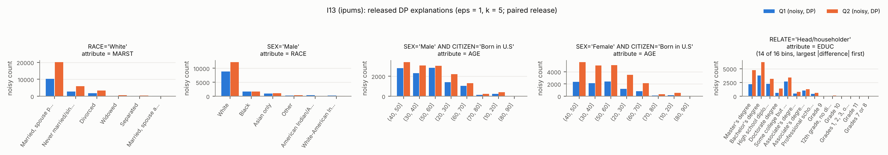

### I14 — ipums

* Q1 = `AGE = '(40, 50]'` (|Q1| = 214,313)
* Q2 = `AGE = '(30, 40]'` (|Q2| = 213,553; overlap 0)
* |P| = 818, tau = 15, gamma = 143.6, Laplace scale per bin = 30.0 (sd of released difference 60.0)
* view stage: overlap of the retained views with the exact top-tau = 1.00

| round | view | attribute | bins clearing 2σ | exact |Q1| / |Q2| in view |
|---|---|---|---|---|
| 1 | `CLASSWKR='Wage/salary, private'` | RELATE | Head/householder, Spouse, Child, Other, Unmarried partner, Opposite sex spouse, Parent, Housemate/roomate, Other relatives, n.s. | 135,834 / 144,954 |
| 2 | `RACE='White' AND CLASSWKR='Wage/salary, private'` | RELATE | Head/householder, Spouse, Child, Other, Unmarried partner, Parent, Housemate/roomate, Other relatives, n.s. | 107,716 / 113,719 |
| 3 | `CITIZEN='Born in U.S' AND CLASSWKR='Wage/salary, private'` | SEX | Female, Male | 102,954 / 111,570 |
| 4 | `SEX='Male'` | CLASSWKR | Wage/salary, private, NIU, Local government employee, Self-employed, not incorporated, State government employee, Self-employed, incorporated, Federal government employee, Armed forces | 105,508 / 105,183 |
| 5 | `RELATE='Head/householder' AND CITIZEN='Born in U.S'` | CLASSWKR | Wage/salary, private, NIU, Local government employee, Self-employed, not incorporated, State government employee, Self-employed, incorporated, Federal government employee, Armed forces | 95,454 / 92,363 |

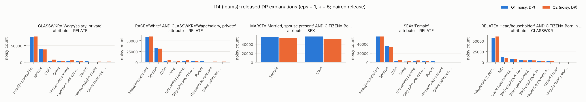

### I15 — ipums

* Q1 = `AGE = '(60, 70]'` (|Q1| = 146,860)
* Q2 = `AGE = '(20, 30]'` (|Q2| = 181,255; overlap 0)
* |P| = 818, tau = 15, gamma = 143.6, Laplace scale per bin = 30.0 (sd of released difference 60.0)
* view stage: overlap of the retained views with the exact top-tau = 1.00

| round | view | attribute | bins clearing 2σ | exact |Q1| / |Q2| in view |
|---|---|---|---|---|
| 1 | `RACE='White' AND CITIZEN='Born in U.S'` | RELATE | Head/householder, Spouse, Child, Other, Unmarried partner, Opposite sex spouse, Parent, Housemate/roomate, Other relatives, n.s. | 101,614 / 119,851 |
| 2 | `RACE='White' AND CITIZEN='Born in U.S'` | EDUC | High school diploma or equivalent, Bachelor's degree, Some college but no degree, Master's degree, Associate's degree, academic program, Associate's degree, occupational/vocational program, Grade 11, Grade 9, Grades 7 or 8, Doctorate degree, 12th grade, no diploma, Grades 5 or 6, Professional school degree, Grades 1, 2, 3, or 4 | 101,614 / 119,851 |
| 3 | `CITIZEN='Born in U.S' AND CLASSWKR='Wage/salary, private'` | MARST | Married, spouse present, Never married/single, Divorced, Widowed, Separated, Married, spouse absent | 34,584 / 110,284 |
| 4 | `RACE='White'` | CLASSWKR | Wage/salary, private, NIU, Local government employee, Self-employed, not incorporated, State government employee, Self-employed, incorporated, Federal government employee, Armed forces | 114,882 / 137,600 |
| 5 | `CITIZEN='Born in U.S' AND CLASSWKR='Wage/salary, private'` | RELATE | Head/householder, Spouse, Child, Other, Unmarried partner, Parent, Housemate/roomate, Other relatives, n.s. | 34,584 / 110,284 |

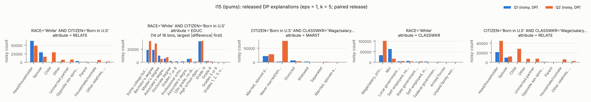

### I16 — ipums

* Q1 = `EDUC = 'Bachelor''s degree'` (|Q1| = 221,181)
* Q2 = `EDUC = 'High school diploma or equivalent'` (|Q2| = 327,032; overlap 0)
* |P| = 1,170, tau = 15, gamma = 143.6, Laplace scale per bin = 30.0 (sd of released difference 60.0)
* view stage: overlap of the retained views with the exact top-tau = 1.00

| round | view | attribute | bins clearing 2σ | exact |Q1| / |Q2| in view |
|---|---|---|---|---|
| 1 | `MARST='Married, spouse present' AND CITIZEN='Born in U.S'` | RELATE | Head/householder, Spouse, Child, Other, Opposite sex spouse, Parent, Other relatives, n.s. | 117,821 / 138,504 |
| 2 | `RACE='White' AND CITIZEN='Born in U.S'` | INCTOT | [1, 9001], (9001, 18000], (18000, 28600], (28600, 42360], (42360, 66685], (66685, 199999] | 159,729 / 220,858 |
| 3 | `RACE='White' AND CLASSWKR='Wage/salary, private'` | RELATE | Head/householder, Spouse, Child, Other, Unmarried partner, Opposite sex spouse, Parent, Housemate/roomate, Other relatives, n.s. | 99,082 / 138,611 |
| 4 | `CITIZEN='Born in U.S'` | AGE | (40, 50], (30, 40], (50, 60], (20, 30], (60, 70], (70, 80], (10, 20], (80, 90] | 186,262 / 276,055 |
| 5 | `SEX='Male'` | MARST | Married, spouse present, Never married/single, Divorced, Widowed, Separated, Married, spouse absent | 102,575 / 167,730 |

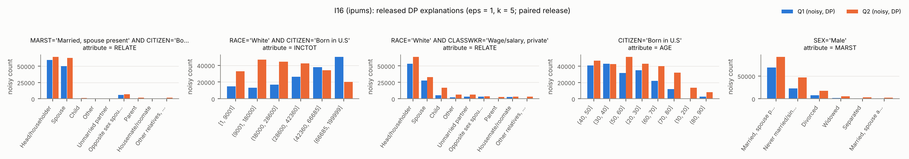

### I17 — ipums

* Q1 = `EDUC = 'Master''s degree'` (|Q1| = 90,627)
* Q2 = `EDUC = 'Bachelor''s degree'` (|Q2| = 221,181; overlap 0)
* |P| = 1,170, tau = 15, gamma = 143.6, Laplace scale per bin = 30.0 (sd of released difference 60.0)
* view stage: overlap of the retained views with the exact top-tau = 1.00

| round | view | attribute | bins clearing 2σ | exact |Q1| / |Q2| in view |
|---|---|---|---|---|
| 1 | `SEX='Female'` | RELATE | Head/householder, Spouse, Child, Other, Unmarried partner, Opposite sex spouse, Parent, Housemate/roomate, Other relatives, n.s. | 51,948 / 118,606 |
| 2 | `MARST='Married, spouse present' AND CITIZEN='Born in U.S'` | AGE | (40, 50], (30, 40], (50, 60], (20, 30], (60, 70], (70, 80], (80, 90] | 51,839 / 117,821 |
| 3 | `MARST='Married, spouse present'` | INCTOT | [1, 9001], (9001, 18000], (18000, 28600], (28600, 42360], (42360, 66685], (66685, 199999] | 63,384 / 140,958 |
| 4 | `MARST='Married, spouse present' AND CITIZEN='Born in U.S'` | CLASSWKR | Wage/salary, private, NIU, Local government employee, Self-employed, not incorporated, State government employee, Self-employed, incorporated, Federal government employee, Armed forces | 51,839 / 117,821 |
| 5 | `CLASSWKR='Wage/salary, private'` | RACE | White, Black, Asian only, Other, American Indian/Aleut/Eskimo, White-American Indian | 40,645 / 124,675 |

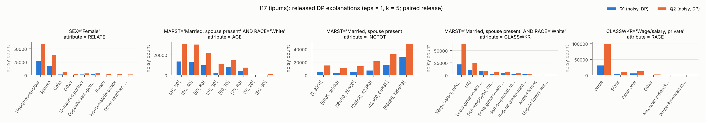

