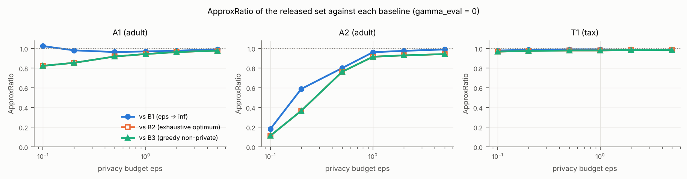
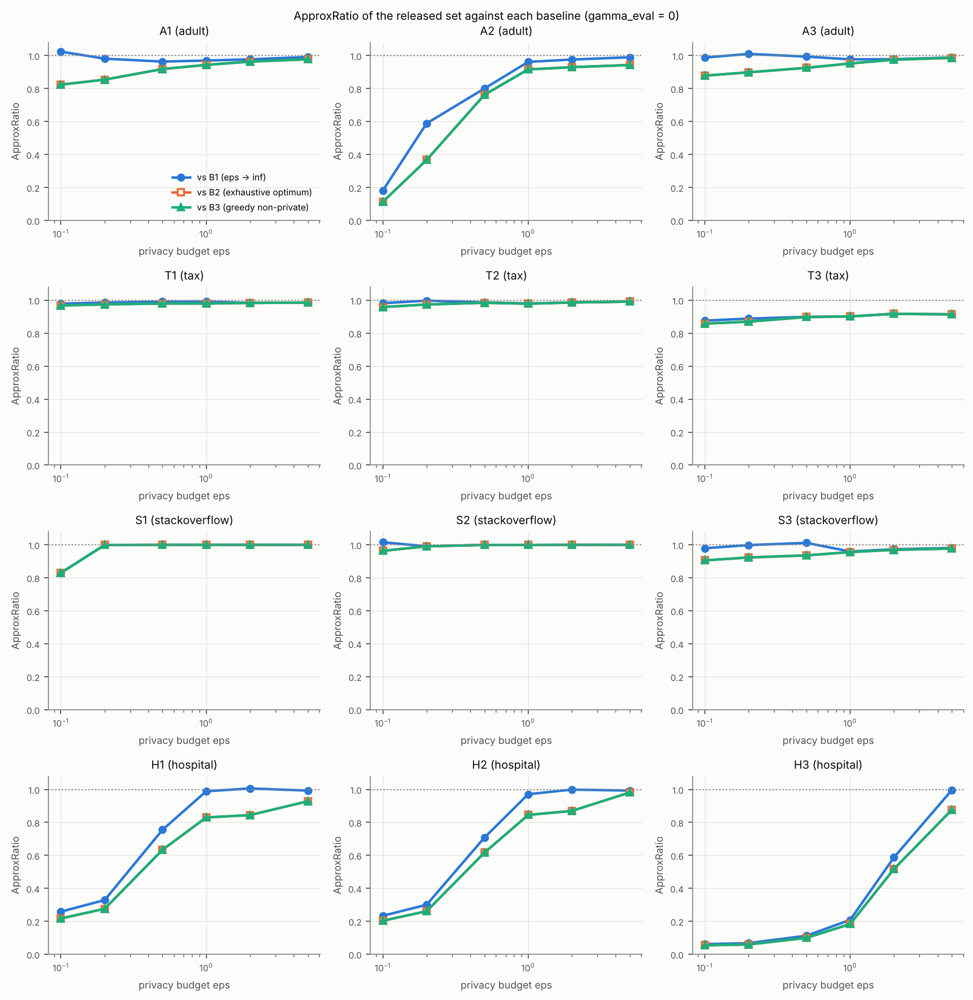
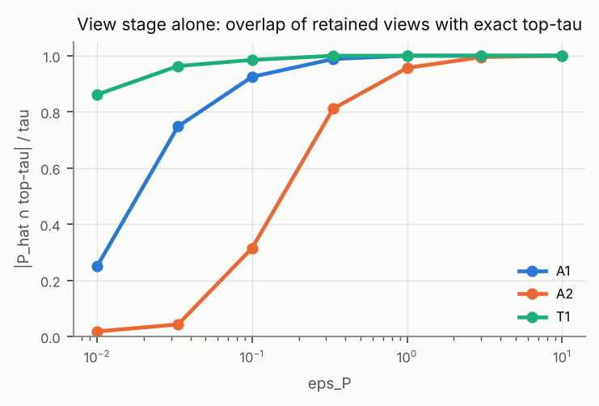
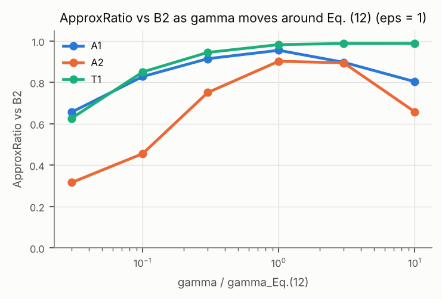
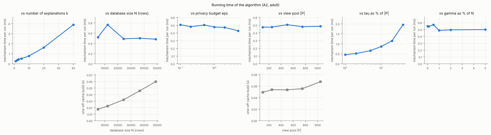
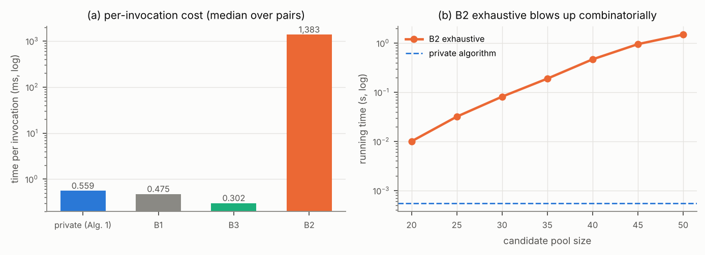

# Results: Private Query Difference Explanations — reproduction

Generated by `pqde all` (see README). All released quantities are differentially private; fields named `exact_*` in the JSON files are non-private diagnostics used only to check statements.

## Table 2 — the twelve query pairs

| pair | dataset | synthetic | Q1 | Q2 | |Q1| | |Q2| | |P| | tau | gamma |
|---|---|---|---|---|---|---|---|---|---|
| A1 | adult | False | occupation = 'Craft-repair' AND hoursPerWeek >= 40 | hoursPerWeek >= 40 | 5447 | 37155 | 1048 | 15 | 150.3 |
| A2 | adult | False | education IN ('Bachelors', 'Masters') AND hoursPerWeek >= 50 | education = 'Masters' AND hoursPerWeek >= 30 | 3055 | 2453 | 1048 | 15 | 150.3 |
| A3 | adult | False | maritalStatus = 'Married-civ-spouse' AND hoursPerWeek >= 45 | maritalStatus IN ('Divorced', 'Married-civ-spouse', 'Never-married') AND hoursPerWeek >= 38 | 8216 | 35446 | 1048 | 15 | 150.3 |
| T1 | tax | False | MaritalStatus = 'M' AND Rate <= 5 | Rate <= 5 | 57164 | 114957 | 1792 | 15 | 147.2 |
| T2 | tax | False | MaritalStatus = 'S' AND HasChild = 'N' AND Salary >= 50000 | MaritalStatus = 'S' AND Salary >= 50000 | 27694 | 55195 | 1792 | 15 | 147.2 |
| T3 | tax | False | Salary >= 60000 AND Rate <= 2 | Salary >= 60000 AND Rate <= 3.9 | 18893 | 31709 | 1792 | 15 | 147.2 |
| S1 | stackoverflow | True | YearsCodePro >= 10 | YearsCodePro < 4 | 20749 | 21205 | 1180 | 15 | 150.3 |
| S2 | stackoverflow | True | WorkRemote = 'Fully remote' | WorkRemote = 'On-site' | 26288 | 9117 | 1180 | 15 | 150.3 |
| S3 | stackoverflow | True | JobSat > 5 AND UsingAI = 'Yes' | JobSat > 5 AND UsingAI = 'No' | 33359 | 8816 | 1180 | 15 | 150.3 |
| H1 | hospital | False | HospitalType = 'acute care hospitals' | Q_Sigma(HospitalType = 'acute care hospitals') | 968 | 93 | 502 | 15 | 150.3 |
| H2 | hospital | False | EmergencyService = 'yes' | Q_Sigma(EmergencyService = 'yes') | 830 | 91 | 502 | 15 | 150.3 |
| H3 | hospital | False | HospitalOwner = 'government - hospital district or authority' | Q_Sigma(HospitalOwner = 'government - hospital district or authority') | 198 | 54 | 502 | 15 | 150.3 |

## E1 — case studies (ε = 1, k = 5, one run per pair)

### A1 — adult

* Q1 = `occupation = 'Craft-repair' AND hoursPerWeek >= 40` (|Q1| = 5,447)
* Q2 = `hoursPerWeek >= 40` (|Q2| = 37,155; overlap 5,447)
* constraint: >= 25% with gender = 'Female': 4.7% → 26.9% — paper: 0.047 → 0.269
* |P| = 1,048, tau = 15, gamma = 150.3, Laplace scale per bin = 30.0 (sd of released difference 60.0)
* view stage: overlap of the retained views with the exact top-tau = 1.00
* single-atom views on the query attributes (exact rank by Use / coverage / Rep): `hoursPerWeek IN (32, 40]` #6 (0.541 / 0.67); `occupation='Craft-repair'` #16 (0.223 / 0.56); `hoursPerWeek IN (40, 50]` #17 (0.208 / 0.58); `hoursPerWeek IN (50, 99]` #35 (0.123 / 0.55); `occupation='Exec-managerial'` #37 (0.111 / 0.56); `occupation='Prof-specialty'` #42 (0.100 / 0.56)

| round | view | attribute | bins clearing 2σ | exact |Q1| / |Q2| in view |
|---|---|---|---|---|
| 1 | `hoursPerWeek IN (32, 40]` | occupation | Prof-specialty, Exec-managerial, Adm-clerical, Sales, Other-service, Machine-op-inspct, NA, Transport-moving, Handlers-cleaners, Farming-fishing, Tech-support, Protective-serv | 3,614 / 22,803 |
| 2 | `hoursPerWeek IN (32, 40]` | education | HS-grad, Some-college, Bachelors, Masters, Assoc-voc, 11th, Assoc-acdm, 10th, 7th-8th, Prof-school, 9th, 12th, Doctorate, 5th-6th, 1st-4th | 3,614 / 22,803 |
| 3 | `race='White'` | workclass | Private, Self-emp-not-inc, Local-gov, NA, State-gov, Self-emp-inc, Federal-gov | 4,907 / 31,903 |
| 4 | `gender='Male' AND hoursPerWeek IN (32, 40]` | occupation | Prof-specialty, Craft-repair, Exec-managerial, Adm-clerical, Sales, Other-service, Machine-op-inspct, NA, Transport-moving, Handlers-cleaners, Farming-fishing, Tech-support, Protective-serv | 3,426 / 15,428 |
| 5 | `hoursPerWeek IN (32, 40]` | age | [17, 24], (24, 31], (31, 37], (37, 44], (44, 53], (53, 90] | 3,614 / 22,803 |

### A2 — adult

* Q1 = `education IN ('Bachelors', 'Masters') AND hoursPerWeek >= 50` (|Q1| = 3,055)
* Q2 = `education = 'Masters' AND hoursPerWeek >= 30` (|Q2| = 2,453; overlap 874)
* constraint: >= 25% with gender = 'Female': 19.5% → 30.6% — paper: 0.195 → 0.306
* |P| = 1,048, tau = 15, gamma = 150.3, Laplace scale per bin = 30.0 (sd of released difference 60.0)
* view stage: overlap of the retained views with the exact top-tau = 0.80
* single-atom views on the query attributes (exact rank by Use / coverage / Rep): `education='Masters'` #6 (0.068 / 0.53); `hoursPerWeek IN (40, 50]` #9 (0.047 / 0.58); `education='Bachelors'` #10 (0.045 / 0.57); `hoursPerWeek IN (50, 99]` #15 (0.041 / 0.55); `hoursPerWeek IN (32, 40]` #27 (0.024 / 0.67); `hoursPerWeek IN [1, 32]` #160 (0.001 / 0.57)

| round | view | attribute | bins clearing 2σ | exact |Q1| / |Q2| in view |
|---|---|---|---|---|
| 1 | `education='Masters'` | age | (24, 31], (31, 37], (37, 44], (44, 53], (53, 90] | 874 / 2,453 |
| 2 | `education='Masters' AND gender='Male'` | workclass | Private, Local-gov, State-gov | 690 / 1,702 |
| 3 | `education='Masters'` | occupation | Prof-specialty, Exec-managerial | 874 / 2,453 |
| 4 | `education='Masters'` | maritalStatus | Married-civ-spouse, Never-married, Divorced | 874 / 2,453 |
| 5 | `education='Masters' AND race='White'` | hoursPerWeek | [1, 32], (32, 40], (40, 50] | 813 / 2,174 |

### A3 — adult

* Q1 = `maritalStatus = 'Married-civ-spouse' AND hoursPerWeek >= 45` (|Q1| = 8,216)
* Q2 = `maritalStatus IN ('Divorced', 'Married-civ-spouse', 'Never-married') AND hoursPerWeek >= 38` (|Q2| = 35,446; overlap 8,216)
* constraint: >= 25% with gender = 'Female': 5.0% → 25.2%
* Q' found by the refinement search (predicate distance 0.738, 637 refinements evaluated)
* |P| = 1,048, tau = 15, gamma = 150.3, Laplace scale per bin = 30.0 (sd of released difference 60.0)
* view stage: overlap of the retained views with the exact top-tau = 1.00
* single-atom views on the query attributes (exact rank by Use / coverage / Rep): `hoursPerWeek IN (32, 40]` #7 (0.446 / 0.67); `hoursPerWeek IN (40, 50]` #12 (0.272 / 0.58); `hoursPerWeek IN (50, 99]` #22 (0.176 / 0.55); `hoursPerWeek IN [1, 32]` #886 (0.000 / 0.57)

| round | view | attribute | bins clearing 2σ | exact |Q1| / |Q2| in view |
|---|---|---|---|---|
| 1 | `gender='Male' AND hoursPerWeek IN (32, 40]` | education | HS-grad, Some-college, Bachelors, Masters, Assoc-voc, 11th, Assoc-acdm, 10th, 7th-8th, Prof-school, 9th, 12th, 5th-6th | 0 / 15,125 |
| 2 | `hoursPerWeek IN (32, 40]` | occupation | Prof-specialty, Craft-repair, Exec-managerial, Adm-clerical, Sales, Other-service, Machine-op-inspct, NA, Transport-moving, Handlers-cleaners, Farming-fishing, Tech-support, Protective-serv, Armed-Forces | 0 / 21,771 |
| 3 | `gender='Male' AND hoursPerWeek IN (32, 40]` | workclass | Private, Self-emp-not-inc, Local-gov, NA, State-gov, Self-emp-inc, Federal-gov | 0 / 15,125 |
| 4 | `race='White' AND hoursPerWeek IN (32, 40]` | education | HS-grad, Some-college, Bachelors, Masters, Assoc-voc, 11th, Assoc-acdm, 10th, 7th-8th, Prof-school, 9th, 12th, 5th-6th | 0 / 18,168 |
| 5 | `workclass='Private' AND hoursPerWeek IN (32, 40]` | age | [17, 24], (24, 31], (31, 37], (37, 44], (44, 53], (53, 90] | 0 / 15,869 |

### T1 — tax

* Q1 = `MaritalStatus = 'M' AND Rate <= 5` (|Q1| = 57,164)
* Q2 = `Rate <= 5` (|Q2| = 114,957; overlap 57,164)
* constraint: >= 30% with HasChild = 'Y': 49.9% → 49.8% — paper: 0.035 → 0.501
* |P| = 1,792, tau = 15, gamma = 147.2, Laplace scale per bin = 30.0 (sd of released difference 60.0)
* view stage: overlap of the retained views with the exact top-tau = 1.00
* single-atom views on the query attributes (exact rank by Use / coverage / Rep): `MaritalStatus='M'` #5 (0.572 / 0.67); `Rate IN [0, 3.07]` #8 (0.503 / 0.63); `MaritalStatus='S'` #25 (0.289 / 0.67); `Rate IN (3.07, 4.75]` #37 (0.256 / 0.57); `Rate IN (4.75, 5.95]` #89 (0.101 / 0.57); `Rate IN (5.95, 7]` #1076 (0.000 / 0.59)

| round | view | attribute | bins clearing 2σ | exact |Q1| / |Q2| in view |
|---|---|---|---|---|
| 1 | `MarriedExemp IN [0, 174]` | State | PR, MT, KY, VT, NY, OH, NM, PA, CT, WV, RI, ND, IL, DC, MS, WI, TN, AL, KS, NH, ID, CO, CA, AK, AR, ME, IA, MD, AZ, FL, TX, WY, VA, IN, NJ, HI, NC, WA, NV, NE, SD, LA, DE, MI | 29,112 / 86,905 |
| 2 | `MarriedExemp IN [0, 174] AND ChildExemp IN [0, 103]` | State | PR, KY, VT, NY, OH, NM, PA, CT, WV, RI, ND, IL, DC, MS, WI, TN, AL, MN, KS, NH, ID, CO, CA, AK, AR, IA, MD, AZ, FL, TX, WY, IN, NJ, HI, WA, NV, NE, SD, DE, MI | 27,902 / 71,526 |
| 3 | `Rate IN [0, 3.07]` | State | PR, MT, OK, KY, OH, NM, PA, RI, ND, IL, TN, NH, CA, AK, AR, IA, AZ, FL, TX, WY, NJ, HI, WA, NV, SD, LA, DE | 33,447 / 67,229 |
| 4 | `Rate IN [0, 3.07]` | Salary | [5000, 20000], (20000, 35000], (35000, 50000], (50000, 70000], (70000, 85000], (85000, 100000] | 33,447 / 67,229 |
| 5 | `Rate IN [0, 3.07]` | SingleExemp | [0, 87], (87, 2100], (2100, 12750] | 33,447 / 67,229 |

### T2 — tax

* Q1 = `MaritalStatus = 'S' AND HasChild = 'N' AND Salary >= 50000` (|Q1| = 27,694)
* Q2 = `MaritalStatus = 'S' AND Salary >= 50000` (|Q2| = 55,195; overlap 27,694)
* constraint: >= 30% with HasChild = 'Y': 0.0% → 49.8%
* Q' found by the refinement search (predicate distance 1.000, 188 refinements evaluated)
* |P| = 1,792, tau = 15, gamma = 147.2, Laplace scale per bin = 30.0 (sd of released difference 60.0)
* view stage: overlap of the retained views with the exact top-tau = 1.00
* single-atom views on the query attributes (exact rank by Use / coverage / Rep): `MaritalStatus='S'` #2 (0.414 / 0.67); `HasChild='N'` #7 (0.277 / 0.67); `HasChild='Y'` #21 (0.138 / 0.67); `Salary IN (50000, 70000]` #23 (0.150 / 0.58); `Salary IN (85000, 100000]` #42 (0.113 / 0.57); `Salary IN (70000, 85000]` #43 (0.113 / 0.57)

| round | view | attribute | bins clearing 2σ | exact |Q1| / |Q2| in view |
|---|---|---|---|---|
| 1 | `MaritalStatus='S' AND MarriedExemp IN [0, 174]` | State | PR, MT, OK, MO, KY, VT, UT, NY, OH, NM, PA, SC, GA, CT, WV, RI, ND, IL, DC, MS, WI, TN, AL, MN, KS, NH, ID, CO, CA, AK, AR, ME, IA, MD, AZ, FL, MA, TX, WY, VA, IN, NJ, HI, NC, WA, NV, NE, OR, SD, LA, DE, MI | 27,694 / 55,195 |
| 2 | `MaritalStatus='S'` | State | PR, MT, OK, MO, KY, VT, UT, NY, OH, NM, PA, SC, GA, CT, WV, RI, ND, IL, DC, MS, WI, TN, AL, MN, KS, NH, ID, CO, CA, AK, AR, ME, IA, MD, AZ, FL, MA, TX, WY, VA, IN, NJ, HI, NC, WA, NV, NE, OR, SD, LA, DE, MI | 27,694 / 55,195 |
| 3 | `MarriedExemp IN [0, 174]` | State | PR, MT, OK, MO, KY, VT, UT, NY, OH, NM, PA, SC, GA, CT, WV, RI, ND, IL, DC, MS, WI, TN, AL, MN, KS, NH, ID, CO, CA, AK, AR, ME, IA, MD, AZ, FL, MA, TX, WY, VA, IN, NJ, HI, NC, WA, NV, NE, OR, SD, LA, DE, MI | 27,694 / 55,195 |
| 4 | `Gender='F' AND MaritalStatus='S'` | State | PR, MT, OK, MO, KY, VT, UT, NY, OH, NM, PA, SC, GA, CT, WV, RI, ND, IL, DC, MS, WI, TN, AL, MN, KS, NH, ID, CO, CA, AK, AR, ME, IA, MD, AZ, FL, MA, TX, WY, VA, IN, NJ, HI, NC, WA, NV, NE, SD, LA, DE, MI | 13,931 / 27,742 |
| 5 | `MaritalStatus='S' AND MarriedExemp IN [0, 174]` | Salary | (35000, 50000], (50000, 70000], (70000, 85000], (85000, 100000] | 27,694 / 55,195 |

### T3 — tax

* Q1 = `Salary >= 60000 AND Rate <= 2` (|Q1| = 18,893)
* Q2 = `Salary >= 60000 AND Rate <= 3.9` (|Q2| = 31,709; overlap 18,893)
* constraint: >= 40% with Rate > 0: 0.0% → 40.4%
* Q' found by the refinement search (predicate distance 0.204, 860 refinements evaluated)
* |P| = 1,792, tau = 15, gamma = 147.2, Laplace scale per bin = 30.0 (sd of released difference 60.0)
* view stage: overlap of the retained views with the exact top-tau = 0.93
* single-atom views on the query attributes (exact rank by Use / coverage / Rep): `Rate IN [0, 3.07]` #4 (0.228 / 0.63); `Salary IN (50000, 70000]` #41 (0.085 / 0.58); `Salary IN (70000, 85000]` #42 (0.085 / 0.57); `Salary IN (85000, 100000]` #43 (0.083 / 0.57); `Rate IN (3.07, 4.75]` #86 (0.025 / 0.57); `Salary IN [5000, 20000]` #470 (0.000 / 0.58)

| round | view | attribute | bins clearing 2σ | exact |Q1| / |Q2| in view |
|---|---|---|---|---|
| 1 | `MaritalStatus='S'` | State | OH, PA, CT, ND, IL, ID, AZ, IN, NJ, NE, MI | 9,455 / 15,919 |
| 2 | `HasChild='N'` | State | OH, PA, CT, ND, IL, MD, AZ, IN, NJ, MI | 9,445 / 15,821 |
| 3 | `MaritalStatus='S'` | HasChild | N, Y | 9,455 / 15,919 |
| 4 | `Rate IN [0, 3.07]` | MarriedExemp | [0, 174], (174, 4200], (4200, 24500] | 18,893 / 26,630 |
| 5 | `MarriedExemp IN [0, 174]` | Salary | (50000, 70000], (70000, 85000], (85000, 100000] | 18,893 / 26,223 |

### S1 — stackoverflow **(synthetic data)**

* Q1 = `YearsCodePro >= 10` (|Q1| = 20,749)
* Q2 = `YearsCodePro < 4` (|Q2| = 21,205; overlap 0)
* |P| = 1,180, tau = 15, gamma = 150.3, Laplace scale per bin = 30.0 (sd of released difference 60.0)
* view stage: overlap of the retained views with the exact top-tau = 0.87
* single-atom views on the query attributes (exact rank by Use / coverage / Rep): `YearsCodePro IN [0, 2]` #9 (0.233 / 0.59); `YearsCodePro IN (9, 16]` #21 (0.166 / 0.57); `YearsCodePro IN (16, 51]` #28 (0.152 / 0.57); `YearsCodePro IN (2, 4]` #66 (0.091 / 0.57); `YearsCodePro IN (4, 6]` #1086 (0.000 / 0.56); `YearsCodePro IN (6, 9]` #1087 (0.000 / 0.56)

| round | view | attribute | bins clearing 2σ | exact |Q1| / |Q2| in view |
|---|---|---|---|---|
| 1 | `YearsCodePro IN [0, 2]` | Country | Other, USA, Germany, India, UK, Ukraine, Canada, France, Brazil, Poland | 0 / 15,250 |
| 2 | `YearsCodePro IN [0, 2]` | DevType | Dev, full-stack, Other, Dev, back-end, Dev, front-end, Dev, desktop or enterprise applications, Dev, mobile, Data scientist or machine learning specialist, Engineering manager | 0 / 15,250 |
| 3 | `YearsCodePro IN [0, 2]` | EdLevel | Bachelor, Master, Some college, Secondary, Doctoral/Prof, Other, Associate | 0 / 15,250 |
| 4 | `YearsCodePro IN [0, 2]` | OrgSize | 10-99, 100-999, 10k+, 1k-10k, 2-9, 1, Unknown | 0 / 15,250 |
| 5 | `YearsCodePro IN [0, 2]` | JobSat | [0, 5], (5, 6], (6, 7], (7, 8], (8, 9], (9, 10] | 0 / 15,250 |

### S2 — stackoverflow **(synthetic data)**

* Q1 = `WorkRemote = 'Fully remote'` (|Q1| = 26,288)
* Q2 = `WorkRemote = 'On-site'` (|Q2| = 9,117; overlap 0)
* |P| = 1,180, tau = 15, gamma = 150.3, Laplace scale per bin = 30.0 (sd of released difference 60.0)
* view stage: overlap of the retained views with the exact top-tau = 0.93
* single-atom views on the query attributes (exact rank by Use / coverage / Rep): `WorkRemote='Fully remote'` #1 (0.402 / 0.64); `WorkRemote='On-site'` #24 (0.139 / 0.56); `WorkRemote='Hybrid'` #1129 (0.000 / 0.66)

| round | view | attribute | bins clearing 2σ | exact |Q1| / |Q2| in view |
|---|---|---|---|---|
| 1 | `WorkRemote='Fully remote'` | Country | Other, USA, Germany, India, UK, Ukraine, Canada, France, Brazil, Poland | 26,288 / 0 |
| 2 | `WorkRemote='Fully remote'` | EdLevel | Bachelor, Master, Some college, Secondary, Doctoral/Prof, Other, Associate, Primary | 26,288 / 0 |
| 3 | `WorkRemote='Fully remote' AND EdLevel='Bachelor'` | DevType | Dev, full-stack, Other, Dev, back-end, Dev, front-end, Dev, desktop or enterprise applications, Dev, mobile, Data scientist or machine learning specialist, Engineering manager | 11,009 / 0 |
| 4 | `WorkRemote='Fully remote' AND UsesPython='No'` | OrgSize | 10-99, 100-999, 10k+, 1k-10k, 2-9, 1, Unknown | 16,557 / 0 |
| 5 | `WorkRemote='Fully remote' AND UsesPython='No'` | YearsCodePro | [0, 2], (2, 4], (4, 6], (6, 9], (9, 16], (16, 51] | 16,557 / 0 |

### S3 — stackoverflow **(synthetic data)**

* Q1 = `JobSat > 5 AND UsingAI = 'Yes'` (|Q1| = 33,359)
* Q2 = `JobSat > 5 AND UsingAI = 'No'` (|Q2| = 8,816; overlap 0)
* |P| = 1,180, tau = 15, gamma = 150.3, Laplace scale per bin = 30.0 (sd of released difference 60.0)
* view stage: overlap of the retained views with the exact top-tau = 1.00
* single-atom views on the query attributes (exact rank by Use / coverage / Rep): `UsingAI='Yes'` #1 (0.510 / 0.70); `JobSat IN (6, 7]` #23 (0.162 / 0.58); `JobSat IN (5, 6]` #27 (0.147 / 0.57); `JobSat IN (7, 8]` #28 (0.145 / 0.57); `UsingAI='No'` #29 (0.135 / 0.58); `JobSat IN (8, 9]` #61 (0.100 / 0.55)

| round | view | attribute | bins clearing 2σ | exact |Q1| / |Q2| in view |
|---|---|---|---|---|
| 1 | `WorkRemote='Fully remote' AND UsingAI='Yes'` | Country | Other, USA, Germany, India, UK, Ukraine, Canada, France, Brazil, Poland | 14,792 / 0 |
| 2 | `WorkRemote='Fully remote' AND UsingAI='Yes'` | DevType | Dev, full-stack, Other, Dev, back-end, Dev, front-end, Dev, desktop or enterprise applications, Dev, mobile, Data scientist or machine learning specialist, Engineering manager | 14,792 / 0 |
| 3 | `UsingAI='Yes' AND UsesPython='No'` | EdLevel | Bachelor, Master, Some college, Secondary, Doctoral/Prof, Other, Associate, Primary | 21,078 / 0 |
| 4 | `UsingAI='Yes'` | OrgSize | 10-99, 100-999, 10k+, 1k-10k, 2-9, 1, Unknown | 33,359 / 0 |
| 5 | `WorkRemote='Fully remote' AND UsingAI='Yes'` | YearsCodePro | [0, 2], (2, 4], (4, 6], (6, 9], (9, 16], (16, 51] | 14,792 / 0 |

### H1 — hospital

* Q1 = `HospitalType = 'acute care hospitals'` (|Q1| = 968)
* Q2 = `Q_Sigma(HospitalType = 'acute care hospitals')` (|Q2| = 93; overlap 93)
* conflict hypergraph: 902 of 1000 tuples on 2170 edges
* |P| = 502, tau = 15, gamma = 150.3, Laplace scale per bin = 30.0 (sd of released difference 60.0)
* view stage: overlap of the retained views with the exact top-tau = 0.13

| round | view | attribute | bins clearing 2σ | exact |Q1| / |Q2| in view |
|---|---|---|---|---|
| 1 | `State='al'` | City | oneonta, opelika | 923 / 89 |
| 2 | `State='al'` | MeasureCode | scip-inf-3 | 923 / 89 |
| 3 | `State='al'` | CountyName | clarke, cullman, morgan | 923 / 89 |
| 4 | `State='al'` | Score | [0, 82], (91, 96], (99, 100], NA | 923 / 89 |
| 5 | `State='al'` | HospitalOwner | government - state, proprietary, voluntary non-profit - other | 923 / 89 |

### H2 — hospital

* Q1 = `EmergencyService = 'yes'` (|Q1| = 830)
* Q2 = `Q_Sigma(EmergencyService = 'yes')` (|Q2| = 91; overlap 91)
* selection rule: `EmergencyService = 'yes'`, |Q| = 830, Q_Sigma drops 89%, most uneven over `City` (TVD 0.10)
* conflict hypergraph: 902 of 1000 tuples on 2170 edges
* |P| = 502, tau = 15, gamma = 150.3, Laplace scale per bin = 30.0 (sd of released difference 60.0)
* view stage: overlap of the retained views with the exact top-tau = 0.20
* single-atom views on the query attributes (exact rank by Use / coverage / Rep): `EmergencyService='yes'` #1 (0.921 / 0.73); `EmergencyService='no'` #373 (0.000 / 0.56); `EmergencyService='Other'` #374 (0.000 / 0.51)

| round | view | attribute | bins clearing 2σ | exact |Q1| / |Q2| in view |
|---|---|---|---|---|
| 1 | `EmergencyService='yes'` | MeasureCode | — | 830 / 91 |
| 2 | `EmergencyService='yes'` | CountyName | marshall, mobile | 830 / 91 |
| 3 | `EmergencyService='yes'` | City | clanton, cullman | 830 / 91 |
| 4 | `State='al' AND EmergencyService='yes'` | Sample | (210, 1421] | 789 / 89 |
| 5 | `EmergencyService='yes'` | HospitalOwner | proprietary, voluntary non-profit - other, voluntary non-profit - private | 830 / 91 |

### H3 — hospital

* Q1 = `HospitalOwner = 'government - hospital district or authority'` (|Q1| = 198)
* Q2 = `Q_Sigma(HospitalOwner = 'government - hospital district or authority')` (|Q2| = 54; overlap 54)
* selection rule: `HospitalOwner = 'government - hospital district or authority'`, |Q| = 198, Q_Sigma drops 73%, most uneven over `CountyName` (TVD 0.27)
* conflict hypergraph: 902 of 1000 tuples on 2170 edges
* |P| = 502, tau = 15, gamma = 150.3, Laplace scale per bin = 30.0 (sd of released difference 60.0)
* view stage: overlap of the retained views with the exact top-tau = 0.07
* single-atom views on the query attributes (exact rank by Use / coverage / Rep): `HospitalOwner='government - hospital district or authority'` #4 (0.252 / 0.58); `HospitalOwner='government - federal'` #198 (0.000 / 0.52); `HospitalOwner='government - local'` #199 (0.000 / 0.51); `HospitalOwner='government - state'` #200 (0.000 / 0.52); `HospitalOwner='proprietary'` #201 (0.000 / 0.59); `HospitalOwner='voluntary non-profit - church'` #202 (0.000 / 0.53)

| round | view | attribute | bins clearing 2σ | exact |Q1| / |Q2| in view |
|---|---|---|---|---|
| 1 | `State='Other' AND HospitalOwner='Other'` | HospitalType | — | 0 / 0 |
| 2 | `EmergencyService='yes'` | HospitalOwner | government - hospital district or authority | 193 / 52 |
| 3 | `EmergencyService='yes'` | Condition | — | 193 / 52 |
| 4 | `EmergencyService='yes'` | City | — | 193 / 52 |
| 5 | `EmergencyService='yes'` | CountyName | de kalb, lauderdale | 193 / 52 |

## E2 — ApproxRatio against B1–B3 (Table 3, Figure 6)

Mean over 40 trials; metric F_λ with γ_eval = 0.

| pair | eps=1 B1 | eps=1 B2 | eps=1 B3 | eps=5 B1 | eps=5 B2 | eps=5 B3 |
|---|---|---|---|---|---|---|
| A1 | 0.970 | 0.944 | 0.944 | 0.992 | 0.978 | 0.978 |
| A2 | 0.962 | 0.916 | 0.916 | 0.990 | 0.943 | 0.943 |
| A3 | 0.977 | 0.952 | 0.952 | 0.988 | 0.987 | 0.987 |
| T1 | 0.991 | 0.980 | 0.980 | 0.986 | 0.986 | 0.986 |
| T2 | 0.981 | 0.979 | 0.979 | 0.992 | 0.992 | 0.992 |
| T3 | 0.901 | 0.901 | 0.901 | 0.914 | 0.914 | 0.914 |
| S1 | 1.000 | 1.000 | 1.000 | 1.000 | 1.000 | 1.000 |
| S2 | 0.999 | 0.999 | 0.999 | 1.000 | 1.000 | 1.000 |
| S3 | 0.960 | 0.956 | 0.956 | 0.981 | 0.977 | 0.977 |
| H1 | 0.989 | 0.830 | 0.830 | 0.993 | 0.928 | 0.928 |
| H2 | 0.971 | 0.845 | 0.845 | 0.993 | 0.982 | 0.982 |
| H3 | 0.209 | 0.184 | 0.184 | 0.995 | 0.876 | 0.876 |

B2 (exhaustive) equals B3 (greedy) on every pair, as Proposition 7.1 predicts: A1: yes, A2: yes, A3: yes, T1: yes, T2: yes, T3: yes, S1: yes, S2: yes, S3: yes, H1: yes, H2: yes, H3: yes

## E3 — what drives accuracy

**Margins** (round-1 candidates of the exact top-τ views):

| pair | gamma | smoothed_margin_abs | smoothed_margin_rel | unsmoothed_margin_rel | em_resolution | margin_over_resolution | use_gap_over_scale |
|---|---|---|---|---|---|---|---|
| A1 | 150.3 | 0.234 | 0.024 | 0.04023 | 0.9588 | 0.244 | 2.25 |
| A2 | 150.3 | 0.01907 | 0.007912 | 0.03231 | 0.9619 | 0.01982 | 0.3089 |
| T1 | 147.2 | 0.8017 | 0.03814 | 0.002581 | 0.959 | 0.836 | 7.707 |

**Bins vs γ:**

| dataset | pair | N | nonempty_bins | median_nonempty_bin | gamma_default | share_bins_below_gamma_default | share_bins_below_gamma_0.5%N | share_bins_below_gamma_5.0%N |
|---|---|---|---|---|---|---|---|---|
| adult | A1 | 48842 | 36480 | 20 | 150 | 0.794 | 0.848 | 0.982 |
| tax | T1 | 200000 | 29671 | 898 | 147 | 0.0453 | 0.652 | 0.953 |

**View stage alone** (overlap of retained views with the exact top-τ, vs ε_P):

| eps_P | A1 | A2 | T1 |
|---|---|---|---|
| 0.010 | 0.250 | 0.018 | 0.862 |
| 0.033 | 0.748 | 0.043 | 0.963 |
| 0.100 | 0.925 | 0.315 | 0.985 |
| 0.333 | 0.988 | 0.812 | 1.000 |
| 1.000 | 1.000 | 0.957 | 1.000 |
| 3.000 | 1.000 | 0.995 | 1.000 |
| 10.000 | 1.000 | 1.000 | 1.000 |

**Smoothing γ** (ApproxRatio vs B2, ε = 1):

| γ / γ_Eq.12 | A1 | A2 | T1 |
|---|---|---|---|
| 0.030 | 0.656 | 0.316 | 0.627 |
| 0.100 | 0.828 | 0.456 | 0.851 |
| 0.300 | 0.915 | 0.751 | 0.945 |
| 1.000 | 0.955 | 0.902 | 0.983 |
| 3.000 | 0.897 | 0.895 | 0.988 |
| 10.000 | 0.804 | 0.658 | 0.989 |

**Budget split** (ε_P/ε_S/ε_H, ApproxRatio vs B2, ε = 1):

| split | A1 | A2 | T1 |
|---|---|---|---|
| 0.05/0.60/0.35 | 0.972 | 0.383 | 0.984 |
| 0.10/0.55/0.35 | 0.959 | 0.606 | 0.982 |
| 0.20/0.40/0.40 | 0.954 | 0.935 | 0.984 |
| 0.33/0.33/0.33 | 0.945 | 0.875 | 0.985 |
| 0.50/0.25/0.25 | 0.932 | 0.845 | 0.983 |

## E4 — running time (Figure 7)

time vs k:

| k | mechanism_ms |
|---|---|
| 1 | 0.2643 |
| 2 | 0.3683 |
| 3 | 0.4542 |
| 5 | 0.5211 |
| 10 | 0.7806 |
| 20 | 1.62 |
| 40 | 3.897 |

time vs N:

| pair | N | build_s | mechanism_ms |
|---|---|---|---|
| A2 | 4884 | 0.01762 | 0.5227 |
| A2 | 12210 | 0.02243 | 0.7658 |
| A2 | 24421 | 0.03216 | 0.4894 |
| A2 | 36632 | 0.04587 | 0.5023 |
| A2 | 48842 | 0.05981 | 0.4816 |

time vs P:

| P | build_s | mechanism_ms |
|---|---|---|
| 100 | 0.04936 | 0.4741 |
| 250 | 0.05378 | 0.4763 |
| 500 | 0.05355 | 0.5067 |
| 750 | 0.05562 | 0.4813 |
| 1048 | 0.06777 | 0.4858 |

time vs N on tax (rows re-sampled from the 200k benchmark file):

| pair | N | build_s | mechanism_ms |
|---|---|---|---|
| T1 | 50000 | 0.1992 | 0.5308 |
| T1 | 100000 | 0.384 | 0.5299 |
| T1 | 200000 | 0.7062 | 0.9291 |
| T1 | 350000 | 1.197 | 0.5626 |
| T1 | 500000 | 1.763 | 0.4965 |

## E5 — cost of privacy in running time (Figure 8)

| pair | dataset | synthetic | N | |P| | cache_build_s | private_ms | B1_ms | B3_ms | B2_ms | B2_pool | end_to_end_s |
|---|---|---|---|---|---|---|---|---|---|---|---|
| A1 | adult | False | 48842 | 1048 | 0.08166 | 0.545 | 0.4719 | 0.2867 | 1369 | 50 | 0.0822 |
| A2 | adult | False | 48842 | 1048 | 0.06116 | 0.5691 | 0.4981 | 0.3391 | 1673 | 50 | 0.06173 |
| A3 | adult | False | 48842 | 1048 | 0.09906 | 0.5444 | 0.4788 | 0.3071 | 1530 | 50 | 0.09961 |
| T1 | tax | False | 200000 | 1792 | 0.6437 | 0.5798 | 0.4604 | 0.2686 | 978.2 | 45 | 0.6442 |
| T2 | tax | False | 200000 | 1792 | 0.5084 | 0.5815 | 0.5012 | 0.3125 | 944.5 | 45 | 0.509 |
| T3 | tax | False | 200000 | 1792 | 0.4637 | 0.5752 | 0.4812 | 0.279 | 806.8 | 45 | 0.4643 |
| S1 | stackoverflow | True | 65437 | 1180 | 0.2165 | 0.5305 | 0.449 | 0.296 | 1539 | 50 | 0.2171 |
| S2 | stackoverflow | True | 65437 | 1180 | 0.2384 | 0.5576 | 0.4642 | 0.313 | 1341 | 50 | 0.239 |
| S3 | stackoverflow | True | 65437 | 1180 | 0.2096 | 0.5103 | 0.4422 | 0.2895 | 1396 | 50 | 0.2101 |
| H1 | hospital | False | 1000 | 502 | 0.01294 | 0.5607 | 0.5041 | 0.3192 | 1431 | 50 | 0.01351 |
| H2 | hospital | False | 1000 | 502 | 0.01303 | 0.5453 | 0.4687 | 0.289 | 1470 | 50 | 0.01358 |
| H3 | hospital | False | 1000 | 502 | 0.01252 | 0.5728 | 0.4805 | 0.3135 | 1358 | 50 | 0.0131 |

B2 growth with the candidate pool:

| pair | pool_size | subsets | seconds | private_s |
|---|---|---|---|---|
| A2 | 20 | 15504 | 0.01003 | 0.0005567 |
| A2 | 25 | 53130 | 0.03185 | 0.0005567 |
| A2 | 30 | 142506 | 0.0812 | 0.0005567 |
| A2 | 35 | 324632 | 0.189 | 0.0005567 |
| A2 | 40 | 658008 | 0.4668 | 0.0005567 |
| A2 | 45 | 1221759 | 0.9504 | 0.0005567 |
| A2 | 50 | 2118760 | 1.489 | 0.0005567 |

