# Results: Private Query Difference Explanations

Generated from the raw data of each experiment (`pqde plot <exp>` rebuilds the figures). Every experiment varies one parameter and keeps the others at the defaults of `configs/experiments.yaml`; all experiments use the original statistics route of Section 4.2. Released quantities are differentially private; `exact_*` fields are non-private diagnostics used only to check statements.

## The query pairs

| pair | dataset | synthetic | Q1 | Q2 | |Q1| | |Q2| | |P| | tau | gamma |
|---|---|---|---|---|---|---|---|---|---|
| A1 | adult | False | occupation = 'Craft-repair' AND hoursPerWeek >= 40 | hoursPerWeek >= 40 | 5447 | 37155 | 1048 | 15 | 150.3 |
| A2 | adult | False | education IN ('Bachelors', 'Masters') AND hoursPerWeek >= 50 | education = 'Masters' AND hoursPerWeek >= 30 | 3055 | 2453 | 1048 | 15 | 150.3 |
| A3 | adult | False | maritalStatus = 'Married-civ-spouse' AND hoursPerWeek >= 45 | maritalStatus IN ('Divorced', 'Married-civ-spouse', 'Never-married') AND hoursPerWeek >= 38 | 8216 | 35446 | 1048 | 15 | 150.3 |
| T1 | tax | False | MaritalStatus = 'M' AND Rate <= 5 | Rate <= 5 | 57164 | 114957 | 1792 | 15 | 147.2 |
| T2 | tax | False | MaritalStatus = 'S' AND HasChild = 'N' AND Salary >= 50000 | MaritalStatus = 'S' AND Salary >= 50000 | 27694 | 55195 | 1792 | 15 | 147.2 |
| T3 | tax | False | Salary >= 60000 AND Rate <= 2 | Salary >= 60000 AND Rate <= 3.9 | 18893 | 31709 | 1792 | 15 | 147.2 |
| S1 | stackoverflow | True | YearsCodePro >= 10 | YearsCodePro < 4 | 20749 | 21205 | 1180 | 15 | 150.3 |
| S2 | stackoverflow | True | WorkRemote = 'Fully remote' | WorkRemote = 'On-site' | 26288 | 9117 | 1180 | 15 | 150.3 |
| S3 | stackoverflow | True | JobSat > 5 AND UsingAI = 'Yes' | JobSat > 5 AND UsingAI = 'No' | 33359 | 8816 | 1180 | 15 | 150.3 |
| H1 | hospital | False | HospitalType = 'acute care hospitals' | Q_Sigma(HospitalType = 'acute care hospitals') | 968 | 93 | 502 | 15 | 150.3 |
| H2 | hospital | False | EmergencyService = 'yes' | Q_Sigma(EmergencyService = 'yes') | 830 | 91 | 502 | 15 | 150.3 |
| H3 | hospital | False | HospitalOwner = 'government - hospital district or authority' | Q_Sigma(HospitalOwner = 'government - hospital district or authority') | 198 | 54 | 502 | 15 | 150.3 |
| R1 | adult | False | education IN ('Masters', 'Doctorate', 'Prof-school') AND hoursPerWeek >= 50 | education IN ('Doctorate', 'Masters', 'Prof-school', 'Some-college') AND hoursPerWeek >= 35 | 1554 | 12064 | 1048 | 15 | 150.3 |
| R2 | adult | False | occupation = 'Prof-specialty' AND maritalStatus = 'Married-civ-spouse' | occupation IN ('Other-service', 'Prof-specialty') AND maritalStatus IN ('Married-civ-spouse', 'Never-married') | 3182 | 8561 | 1048 | 15 | 150.3 |
| R3 | adult | False | maritalStatus = 'Married-civ-spouse' AND age >= 40 | maritalStatus IN ('Divorced', 'Married-civ-spouse', 'Widowed') AND age >= 61 | 12932 | 3296 | 1048 | 15 | 150.3 |
| R4 | adult | False | occupation = 'Prof-specialty' AND hoursPerWeek >= 50 | occupation IN ('Other-service', 'Prof-specialty') AND hoursPerWeek >= 30 | 1681 | 9186 | 1048 | 15 | 150.3 |
| R5 | tax | False | Salary <= 30000 AND Rate <= 2 | Salary <= 30000 AND Rate <= 3.2016153 | 16774 | 25621 | 1792 | 15 | 147.2 |
| R6 | tax | False | MaritalStatus = 'S' AND HasChild = 'N' AND Salary >= 50000 | MaritalStatus = 'S' AND Salary >= 50000 | 27694 | 55195 | 1792 | 15 | 147.2 |
| C1 | tax_dirty | False | State IN ('AL', 'AR', 'GA', 'MS', 'TN') | Q_Sigma(State IN ('AL', 'AR', 'GA', 'MS', 'TN')) | 19515 | 12290 | 1977 | 15 | 147.2 |
| C2 | tax_dirty | False | State IN ('NJ', 'NY', 'PA', 'CT', 'MA') | Q_Sigma(State IN ('NJ', 'NY', 'PA', 'CT', 'MA')) | 19466 | 15342 | 1977 | 15 | 147.2 |
| C3 | tax_dirty | False | Salary >= 70000 | Q_Sigma(Salary >= 70000) | 70104 | 63650 | 1977 | 15 | 147.2 |
| C4 | hospital | False | HospitalType = 'acute care hospitals' | Q_Sigma(HospitalType = 'acute care hospitals') | 968 | 93 | 502 | 15 | 150.3 |

## E2 — accuracy vs ε

Mean over 40 private runs per point.

**ApproxRatio** (F_λ with γ_eval = 0) against B1, B2, B3:

| pair | eps=1 ratio B1 | eps=1 ratio B2 | eps=1 ratio B3 | eps=5 ratio B1 | eps=5 ratio B2 | eps=5 ratio B3 |
|---|---|---|---|---|---|---|
| A1 | 0.975 | 0.948 | 0.948 | 0.993 | 0.979 | 0.979 |
| A2 | 0.943 | 0.898 | 0.898 | 0.988 | 0.941 | 0.941 |
| A3 | 0.977 | 0.953 | 0.953 | 0.990 | 0.988 | 0.988 |
| T1 | 0.994 | 0.983 | 0.983 | 0.987 | 0.987 | 0.987 |
| T2 | 0.989 | 0.987 | 0.987 | 0.990 | 0.990 | 0.990 |
| T3 | 0.898 | 0.898 | 0.898 | 0.903 | 0.903 | 0.903 |
| S1 | 1.000 | 1.000 | 1.000 | 1.000 | 1.000 | 1.000 |
| S2 | 1.000 | 1.000 | 1.000 | 1.000 | 1.000 | 1.000 |
| S3 | 0.964 | 0.960 | 0.960 | 0.985 | 0.981 | 0.981 |
| H1 | 0.978 | 0.821 | 0.821 | 0.990 | 0.925 | 0.925 |
| H2 | 0.969 | 0.843 | 0.843 | 0.992 | 0.981 | 0.981 |
| H3 | 0.253 | 0.223 | 0.223 | 0.979 | 0.862 | 0.862 |
| R1 | 0.990 | 0.964 | 0.964 | 0.990 | 0.990 | 0.990 |
| R2 | 1.226 | 0.940 | 0.940 | 0.924 | 0.880 | 0.880 |
| R3 | 0.966 | 0.931 | 0.931 | 0.960 | 0.959 | 0.959 |
| R4 | 1.058 | 0.979 | 0.979 | 1.029 | 0.956 | 0.956 |
| R5 | 0.974 | 0.968 | 0.968 | 0.993 | 0.987 | 0.987 |
| R6 | 0.985 | 0.983 | 0.983 | 0.988 | 0.987 | 0.987 |
| C1 | 0.687 | 0.687 | 0.687 | 0.778 | 0.777 | 0.777 |
| C2 | 0.851 | 0.850 | 0.850 | 0.876 | 0.876 | 0.876 |
| C3 | 0.875 | 0.790 | 0.790 | 0.846 | 0.846 | 0.846 |
| C4 | 0.979 | 0.822 | 0.822 | 0.995 | 0.930 | 0.930 |

**Set agreement** with the baselines (precision@k = share of the k released explanations that the baseline also returns; Jaccard on the (view, attribute) sets):

| pair | eps=1 precision_at_k B1 | eps=1 precision_at_k B2 | eps=1 precision_at_k B3 | eps=1 jaccard B1 | eps=1 jaccard B2 | eps=1 jaccard B3 | eps=5 precision_at_k B1 | eps=5 precision_at_k B2 | eps=5 precision_at_k B3 | eps=5 jaccard B1 | eps=5 jaccard B2 | eps=5 jaccard B3 |
|---|---|---|---|---|---|---|---|---|---|---|---|---|
| A1 | 0.575 | 0.430 | 0.430 | 0.422 | 0.284 | 0.284 | 0.665 | 0.580 | 0.580 | 0.520 | 0.433 | 0.433 |
| A2 | 0.615 | 0.505 | 0.505 | 0.479 | 0.359 | 0.359 | 0.665 | 0.575 | 0.575 | 0.528 | 0.419 | 0.419 |
| A3 | 0.480 | 0.395 | 0.395 | 0.342 | 0.265 | 0.265 | 0.640 | 0.600 | 0.600 | 0.486 | 0.451 | 0.451 |
| T1 | 0.735 | 0.710 | 0.710 | 0.607 | 0.579 | 0.579 | 0.785 | 0.785 | 0.785 | 0.686 | 0.686 | 0.686 |
| T2 | 0.625 | 0.635 | 0.635 | 0.463 | 0.479 | 0.479 | 0.680 | 0.660 | 0.660 | 0.524 | 0.505 | 0.505 |
| T3 | 0.185 | 0.185 | 0.185 | 0.110 | 0.110 | 0.110 | 0.205 | 0.205 | 0.205 | 0.123 | 0.123 | 0.123 |
| S1 | 0.995 | 0.995 | 0.995 | 0.992 | 0.992 | 0.992 | 1.000 | 1.000 | 1.000 | 1.000 | 1.000 | 1.000 |
| S2 | 0.525 | 0.520 | 0.520 | 0.393 | 0.378 | 0.378 | 0.315 | 0.320 | 0.320 | 0.207 | 0.214 | 0.214 |
| S3 | 0.445 | 0.410 | 0.410 | 0.315 | 0.283 | 0.283 | 0.665 | 0.650 | 0.650 | 0.526 | 0.508 | 0.508 |
| H1 | 0.730 | 0.170 | 0.170 | 0.652 | 0.094 | 0.094 | 0.815 | 0.200 | 0.200 | 0.711 | 0.111 | 0.111 |
| H2 | 0.530 | 0.250 | 0.250 | 0.437 | 0.152 | 0.152 | 0.920 | 0.395 | 0.395 | 0.871 | 0.247 | 0.247 |
| H3 | 0.040 | 0.030 | 0.030 | 0.027 | 0.017 | 0.017 | 0.285 | 0.190 | 0.190 | 0.196 | 0.110 | 0.110 |
| R1 | 0.790 | 0.760 | 0.760 | 0.680 | 0.644 | 0.644 | 0.920 | 0.920 | 0.920 | 0.869 | 0.869 | 0.869 |
| R2 | 0.240 | 0.165 | 0.165 | 0.153 | 0.101 | 0.101 | 0.400 | 0.280 | 0.280 | 0.271 | 0.178 | 0.178 |
| R3 | 0.435 | 0.410 | 0.410 | 0.296 | 0.272 | 0.272 | 0.465 | 0.430 | 0.430 | 0.327 | 0.288 | 0.288 |
| R4 | 0.355 | 0.130 | 0.130 | 0.259 | 0.076 | 0.076 | 0.445 | 0.315 | 0.315 | 0.329 | 0.204 | 0.204 |
| R5 | 0.690 | 0.615 | 0.615 | 0.548 | 0.461 | 0.461 | 0.640 | 0.645 | 0.645 | 0.490 | 0.493 | 0.493 |
| R6 | 0.585 | 0.595 | 0.595 | 0.427 | 0.435 | 0.435 | 0.665 | 0.655 | 0.655 | 0.510 | 0.496 | 0.496 |
| C1 | 0.230 | 0.190 | 0.190 | 0.139 | 0.113 | 0.113 | 0.355 | 0.345 | 0.345 | 0.227 | 0.227 | 0.227 |
| C2 | 0.135 | 0.150 | 0.150 | 0.078 | 0.088 | 0.088 | 0.120 | 0.100 | 0.100 | 0.070 | 0.056 | 0.056 |
| C3 | 0.225 | 0.240 | 0.240 | 0.134 | 0.145 | 0.145 | 0.335 | 0.335 | 0.335 | 0.215 | 0.215 | 0.215 |
| C4 | 0.770 | 0.175 | 0.175 | 0.668 | 0.097 | 0.097 | 0.870 | 0.200 | 0.200 | 0.798 | 0.111 | 0.111 |

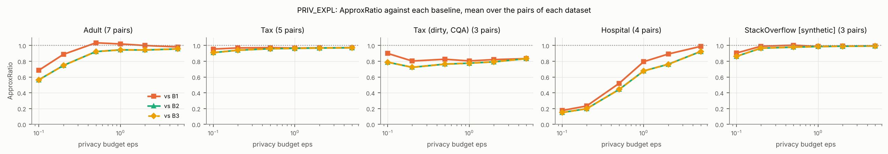

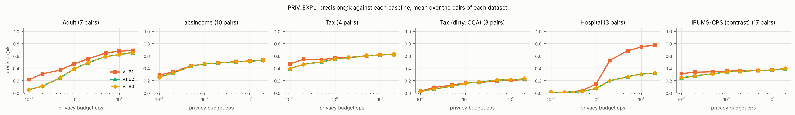

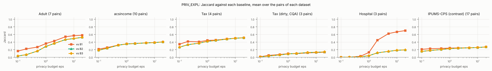

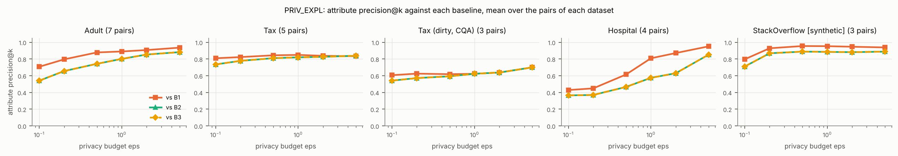

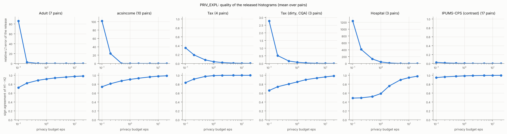

Per-pair panels: `e2/eps_<metric>_by_pair.png`.

## E6 — accuracy vs γ

ApproxRatio against B2; columns are γ / γ_Eq.(12) (0 = unsmoothed):

| pair | x0 | x0.03 | x0.1 | x0.3 | x1 | x3 | x10 | x30 |
|---|---|---|---|---|---|---|---|---|
| A1 | 0.524 | 0.683 | 0.839 | 0.894 | 0.943 | 0.897 | 0.804 | 0.785 |
| A2 | 0.199 | 0.285 | 0.488 | 0.753 | 0.912 | 0.830 | 0.648 | 0.427 |
| A3 | 0.421 | 0.559 | 0.771 | 0.913 | 0.955 | 0.924 | 0.889 | 0.889 |
| T1 | 0.353 | 0.620 | 0.836 | 0.942 | 0.981 | 0.988 | 0.989 | 0.971 |
| T2 | 0.251 | 0.555 | 0.809 | 0.926 | 0.986 | 0.984 | 0.977 | 0.934 |
| T3 | 0.337 | 0.440 | 0.604 | 0.782 | 0.915 | 0.990 | 0.980 | 0.978 |
| S1 | 0.194 | 0.292 | 0.636 | 0.968 | 1.000 | 1.000 | 1.000 | 0.886 |
| S2 | 0.450 | 0.568 | 0.840 | 0.982 | 1.000 | 1.000 | 0.949 | 0.949 |
| S3 | 0.515 | 0.595 | 0.781 | 0.910 | 0.952 | 0.926 | 0.924 | 0.879 |
| H1 | 0.322 | 0.666 | 0.842 | 0.855 | 0.825 | 0.824 | 0.811 | 0.736 |
| H2 | 0.353 | 0.680 | 0.847 | 0.889 | 0.846 | 0.841 | 0.816 | 0.744 |
| H3 | 0.100 | 0.147 | 0.190 | 0.207 | 0.248 | 0.243 | 0.243 | 0.252 |
| R1 | 0.322 | 0.462 | 0.710 | 0.917 | 0.957 | 0.889 | 0.784 | 0.703 |
| R2 | 0.395 | 0.474 | 0.546 | 0.787 | 0.972 | 0.916 | 0.838 | 0.613 |
| R3 | 0.451 | 0.494 | 0.612 | 0.796 | 0.949 | 0.948 | 0.927 | 0.867 |
| R4 | 0.363 | 0.502 | 0.649 | 0.931 | 1.048 | 1.046 | 0.918 | 0.686 |
| R5 | 0.281 | 0.559 | 0.789 | 0.919 | 0.977 | 0.953 | 0.894 | 0.924 |
| R6 | 0.243 | 0.543 | 0.809 | 0.922 | 0.983 | 0.987 | 0.977 | 0.937 |
| C1 | 0.303 | 0.345 | 0.439 | 0.574 | 0.687 | 0.758 | 0.738 | 0.736 |
| C2 | 0.417 | 0.450 | 0.487 | 0.705 | 0.864 | 0.936 | 0.966 | 0.968 |
| C3 | 0.237 | 0.266 | 0.377 | 0.704 | 0.779 | 0.815 | 0.820 | 0.474 |
| C4 | 0.282 | 0.695 | 0.825 | 0.848 | 0.810 | 0.808 | 0.792 | 0.688 |

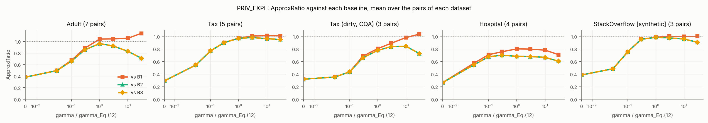

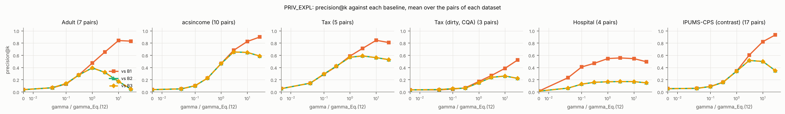

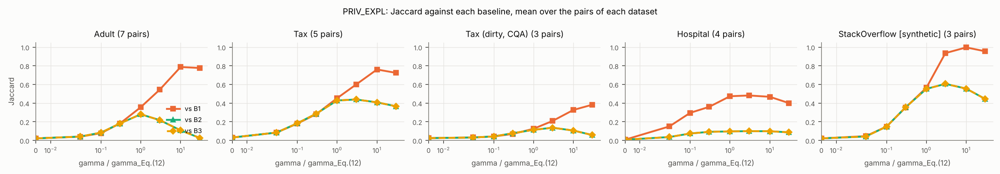

## E3 — what drives accuracy

**Margins** (round-1 candidates of the exact top-τ views):

| pair | gamma | smoothed_margin_abs | smoothed_margin_rel | unsmoothed_margin_rel | em_resolution | margin_over_resolution | use_gap_over_scale |
|---|---|---|---|---|---|---|---|
| A1 | 150.3 | 0.234 | 0.024 | 0.04023 | 0.9588 | 0.244 | 2.25 |
| A2 | 150.3 | 0.01907 | 0.007912 | 0.03231 | 0.9619 | 0.01982 | 0.3089 |
| A3 | 150.3 | 0.02585 | 0.002557 | 0.01256 | 0.9588 | 0.02696 | 0.6848 |
| T1 | 147.2 | 0.8017 | 0.03814 | 0.002581 | 0.959 | 0.836 | 7.707 |
| T2 | 147.2 | 0 | 0 | 0 | 0.9536 | 0 | 2.069 |
| T3 | 147.2 | 0.0001729 | 5.524e-05 | 0.004667 | 0.9554 | 0.000181 | 0 |
| S1 | 150.3 | 1.447 | 0.1718 | 0.2 | 0.9635 | 1.501 | 0.6629 |
| S2 | 150.3 | 0.3862 | 0.04271 | 0 | 0.9604 | 0.4022 | 0.6993 |
| S3 | 150.3 | 0.05546 | 0.007668 | 0.07899 | 0.9619 | 0.05765 | 0.3469 |
| H1 | 150.3 | 0.1594 | 0.03445 | 0.001361 | 0.9619 | 0.1657 | 0.005713 |
| H2 | 150.3 | 0.02682 | 0.006559 | 0.006561 | 0.9588 | 0.02797 | 0.05197 |
| H3 | 150.3 | 0.01794 | 0.01968 | 0.005264 | 0.9588 | 0.01871 | 0.00516 |
| R1 | 150.3 | 0.6249 | 0.07031 | 0.2154 | 0.9572 | 0.6528 | 2.133 |
| R2 | 150.3 | 0.03657 | 0.01902 | 0.007083 | 0.9588 | 0.03814 | 1.101 |
| R3 | 150.3 | 0.03404 | 0.008871 | 0.06334 | 0.9588 | 0.0355 | 0.2574 |
| R4 | 150.3 | 0.2488 | 0.06033 | 0.01056 | 0.9588 | 0.2595 | 0.4138 |
| R5 | 147.2 | 1.662 | 0.141 | 0.1205 | 0.9518 | 1.746 | 0.6153 |
| R6 | 147.2 | 0 | 0 | 0 | 0.9536 | 0 | 2.069 |
| C1 | 147.2 | 0.0008522 | 0.000443 | 0 | 0.959 | 0.0008886 | 0.383 |
| C2 | 147.2 | 0.0001755 | 0.0001808 | 0 | 0.959 | 0.000183 | 9.897 |
| C3 | 147.2 | 2.06 | 0.5314 | 0.6188 | 0.9608 | 2.144 | 0.5823 |
| C4 | 150.3 | 0.1594 | 0.03445 | 0.001361 | 0.9619 | 0.1657 | 0.005713 |

**Bins vs γ:**

| dataset | pair | N | nonempty_bins | median_nonempty_bin | gamma_default | share_bins_below_gamma_default | share_bins_below_gamma_0.5%N | share_bins_below_gamma_5.0%N |
|---|---|---|---|---|---|---|---|---|
| adult | A1 | 48842 | 36480 | 20 | 150 | 0.794 | 0.848 | 0.982 |
| tax | T1 | 200000 | 29671 | 898 | 147 | 0.0453 | 0.652 | 0.953 |
| tax_dirty | C1 | 200000 | 31417 | 737 | 147 | 0.0942 | 0.67 | 0.955 |
| hospital | H1 | 1000 | 19849 | 3 | 150 | 0.996 | 0.6 | 0.978 |
| stackoverflow | S1 | 65437 | 53680 | 135 | 150 | 0.525 | 0.699 | 0.98 |

**View stage alone** — overlap of the retained views with the exact top-τ, vs ε_P:

| eps_P | A1 | A2 | A3 | T1 | T2 | T3 | S1 | S2 | S3 | H1 | H2 | H3 | R1 | R2 | R3 | R4 | R5 | R6 | C1 | C2 | C3 | C4 |
|---|---|---|---|---|---|---|---|---|---|---|---|---|---|---|---|---|---|---|---|---|---|---|
| 0.010 | 0.250 | 0.018 | 0.210 | 0.862 | 0.673 | 0.437 | 0.092 | 0.083 | 0.110 | 0.047 | 0.033 | 0.038 | 0.035 | 0.022 | 0.050 | 0.025 | 0.257 | 0.677 | 0.062 | 0.072 | 0.838 | 0.028 |
| 0.033 | 0.748 | 0.043 | 0.717 | 0.963 | 0.955 | 0.807 | 0.610 | 0.565 | 0.673 | 0.037 | 0.025 | 0.035 | 0.235 | 0.177 | 0.322 | 0.138 | 0.827 | 0.958 | 0.672 | 0.762 | 0.965 | 0.032 |
| 0.100 | 0.925 | 0.315 | 0.938 | 0.985 | 0.987 | 0.855 | 0.847 | 0.863 | 0.935 | 0.058 | 0.060 | 0.025 | 0.813 | 0.728 | 0.757 | 0.687 | 0.882 | 0.975 | 0.942 | 0.978 | 0.978 | 0.057 |
| 0.333 | 0.988 | 0.812 | 0.975 | 1.000 | 0.993 | 0.890 | 0.937 | 0.968 | 0.963 | 0.190 | 0.198 | 0.075 | 0.990 | 0.958 | 0.912 | 0.947 | 0.923 | 0.990 | 0.973 | 1.000 | 0.973 | 0.208 |
| 1.000 | 1.000 | 0.957 | 0.990 | 1.000 | 1.000 | 0.940 | 0.988 | 0.995 | 0.987 | 0.357 | 0.360 | 0.183 | 1.000 | 0.998 | 0.967 | 0.977 | 0.973 | 0.998 | 0.987 | 1.000 | 0.987 | 0.368 |
| 3.000 | 1.000 | 0.995 | 1.000 | 1.000 | 1.000 | 0.967 | 0.998 | 1.000 | 0.998 | 0.802 | 0.775 | 0.477 | 1.000 | 1.000 | 0.993 | 1.000 | 1.000 | 1.000 | 0.997 | 1.000 | 1.000 | 0.800 |
| 10.000 | 1.000 | 1.000 | 1.000 | 1.000 | 1.000 | 0.970 | 1.000 | 1.000 | 1.000 | 0.928 | 0.952 | 0.790 | 1.000 | 1.000 | 1.000 | 1.000 | 1.000 | 1.000 | 1.000 | 1.000 | 1.000 | 0.932 |

**Budget split** — ApproxRatio vs B2 (ε = 1):

| split | A1 | A2 | A3 | T1 | T2 | T3 | S1 | S2 | S3 | H1 | H2 | H3 | R1 | R2 | R3 | R4 | R5 | R6 | C1 | C2 | C3 | C4 |
|---|---|---|---|---|---|---|---|---|---|---|---|---|---|---|---|---|---|---|---|---|---|---|
| 0.33/0.33/0.33 | 0.945 | 0.875 | 0.953 | 0.985 | 0.986 | 0.907 | 1.000 | 1.000 | 0.959 | 0.830 | 0.839 | 0.165 | 0.959 | 1.065 | 0.935 | 1.018 | 0.975 | 0.987 | 0.675 | 0.855 | 0.787 | 0.823 |
| 0.10/0.55/0.35 | 0.959 | 0.606 | 0.974 | 0.982 | 0.988 | 0.907 | 0.999 | 1.000 | 0.968 | 0.635 | 0.672 | 0.169 | 0.880 | 1.067 | 0.939 | 1.026 | 0.983 | 0.988 | 0.714 | 0.848 | 0.805 | 0.625 |
| 0.20/0.40/0.40 | 0.954 | 0.935 | 0.961 | 0.984 | 0.985 | 0.883 | 1.000 | 1.000 | 0.958 | 0.750 | 0.688 | 0.220 | 0.967 | 1.185 | 0.943 | 1.003 | 0.982 | 0.985 | 0.688 | 0.876 | 0.792 | 0.702 |
| 0.50/0.25/0.25 | 0.932 | 0.845 | 0.948 | 0.983 | 0.977 | 0.898 | 1.000 | 0.999 | 0.945 | 0.825 | 0.845 | 0.192 | 0.938 | 0.840 | 0.930 | 0.962 | 0.971 | 0.987 | 0.684 | 0.858 | 0.797 | 0.820 |
| 0.05/0.60/0.35 | 0.972 | 0.383 | 0.976 | 0.984 | 0.988 | 0.929 | 0.999 | 1.000 | 0.951 | 0.635 | 0.646 | 0.223 | 0.746 | 0.942 | 0.930 | 0.895 | 0.983 | 0.989 | 0.772 | 0.881 | 0.729 | 0.662 |

**Budget split** — precision@k vs B2 (ε = 1):

| split | A1 | A2 | A3 | T1 | T2 | T3 | S1 | S2 | S3 | H1 | H2 | H3 | R1 | R2 | R3 | R4 | R5 | R6 | C1 | C2 | C3 | C4 |
|---|---|---|---|---|---|---|---|---|---|---|---|---|---|---|---|---|---|---|---|---|---|---|
| 0.33/0.33/0.33 | 0.435 | 0.470 | 0.430 | 0.750 | 0.635 | 0.170 | 0.995 | 0.575 | 0.405 | 0.175 | 0.240 | 0.010 | 0.730 | 0.155 | 0.440 | 0.115 | 0.655 | 0.640 | 0.205 | 0.150 | 0.175 | 0.175 |
| 0.10/0.55/0.35 | 0.390 | 0.180 | 0.570 | 0.705 | 0.605 | 0.190 | 0.870 | 0.495 | 0.530 | 0.035 | 0.085 | 0.005 | 0.370 | 0.185 | 0.395 | 0.100 | 0.700 | 0.585 | 0.210 | 0.155 | 0.170 | 0.040 |
| 0.20/0.40/0.40 | 0.430 | 0.600 | 0.485 | 0.740 | 0.580 | 0.170 | 0.980 | 0.485 | 0.405 | 0.095 | 0.130 | 0.025 | 0.785 | 0.145 | 0.400 | 0.110 | 0.660 | 0.595 | 0.170 | 0.125 | 0.200 | 0.040 |
| 0.50/0.25/0.25 | 0.350 | 0.475 | 0.400 | 0.715 | 0.585 | 0.210 | 1.000 | 0.625 | 0.265 | 0.170 | 0.225 | 0.015 | 0.640 | 0.185 | 0.420 | 0.145 | 0.645 | 0.650 | 0.210 | 0.105 | 0.220 | 0.195 |
| 0.05/0.60/0.35 | 0.465 | 0.080 | 0.570 | 0.685 | 0.615 | 0.225 | 0.745 | 0.425 | 0.345 | 0.090 | 0.045 | 0.010 | 0.165 | 0.180 | 0.485 | 0.040 | 0.685 | 0.595 | 0.175 | 0.150 | 0.175 | 0.045 |

## E4 — end-to-end running time

PRIV_EXPL, B1, B2, B3 on the original route; OPT_PRIV_EXPL = PRIV_EXPL with O1 + O3. Time limit 60.0 s per run (✕ = timeout). Mean over the pairs of each dataset of the median over 2 repeats.

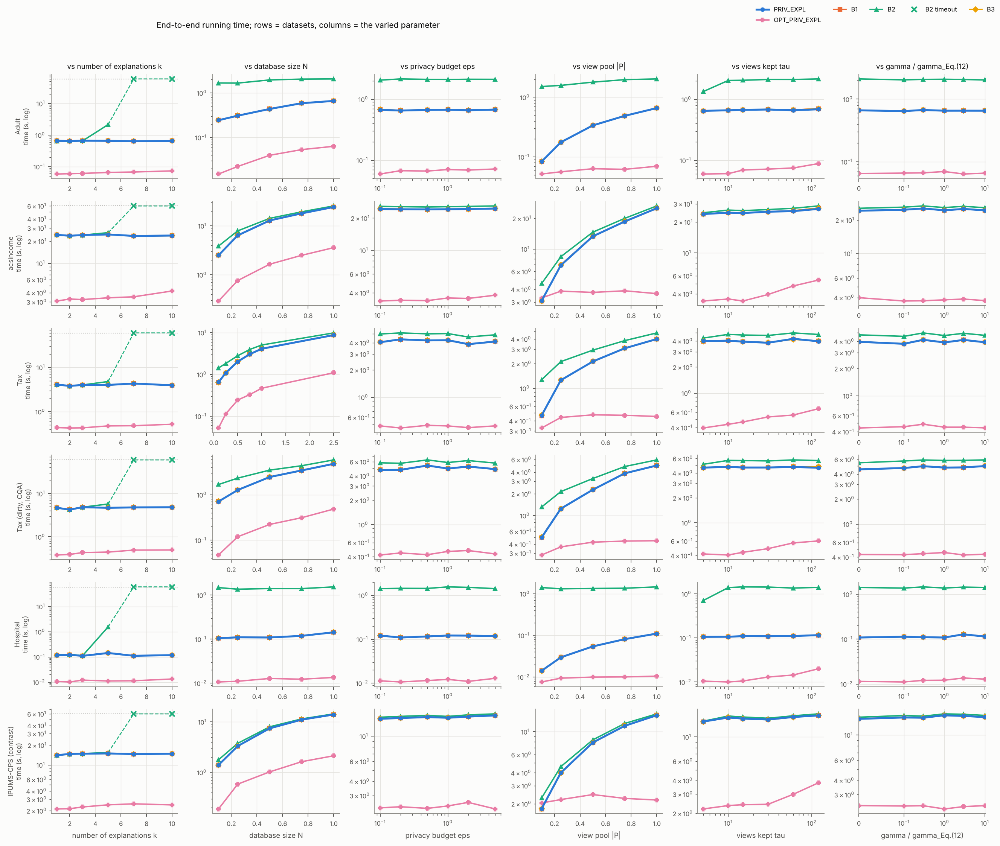

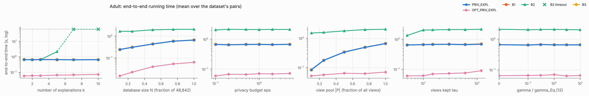

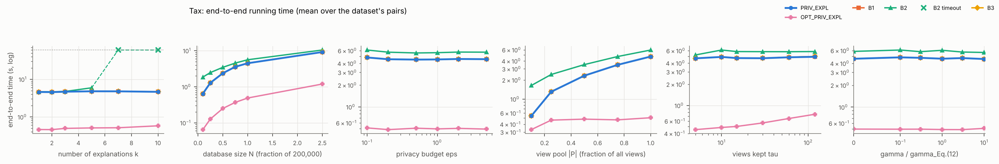

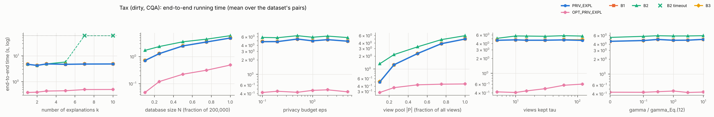

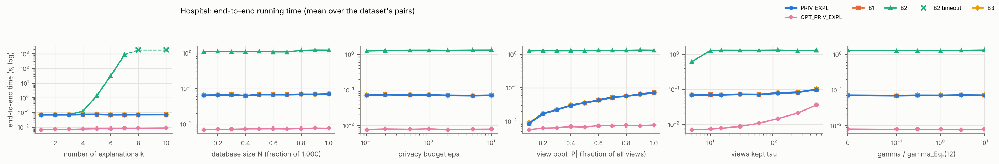

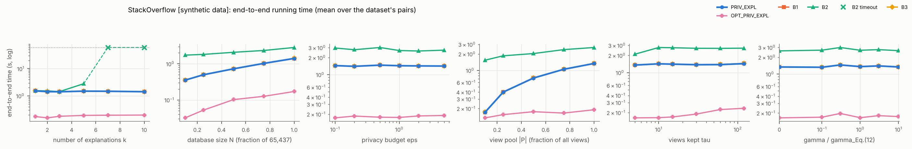

## E5 — cost per pair at the defaults, B2 growth, optimisations

End-to-end seconds per pair (`speedup OPT` = PRIV_EXPL / OPT_PRIV_EXPL):

| dataset | pair | PRIV_EXPL | OPT_PRIV_EXPL | B1 | B2 | B3 | speedup OPT |
|---|---|---|---|---|---|---|---|
| adult | A1 | 0.8681 | 0.08327 | 0.8544 | 2.267 | 0.8565 | 10.42 |
| adult | A2 | 0.7555 | 0.06025 | 0.7544 | 2.025 | 0.7535 | 12.54 |
| adult | A3 | 0.8127 | 0.09206 | 0.8155 | 2.167 | 0.8134 | 8.828 |
| adult | R1 | 0.7208 | 0.06882 | 0.7208 | 2.006 | 0.7208 | 10.47 |
| adult | R2 | 0.8604 | 0.08077 | 0.8633 | 2.408 | 0.8605 | 10.65 |
| adult | R3 | 0.8496 | 0.07464 | 0.8496 | 2.494 | 0.8406 | 11.38 |
| adult | R4 | 0.8931 | 0.09038 | 0.8948 | 2.029 | 0.8921 | 9.881 |
| tax | T1 | 5.066 | 0.5771 | 5.053 | 5.975 | 5.038 | 8.777 |
| tax | T2 | 4.642 | 0.4741 | 4.642 | 5.322 | 4.639 | 9.79 |
| tax | T3 | 4.465 | 0.4631 | 4.467 | 5.208 | 4.461 | 9.643 |
| tax | R5 | 4.54 | 0.4509 | 4.537 | 5.25 | 4.541 | 10.07 |
| tax | R6 | 4.498 | 0.4873 | 4.498 | 5.269 | 4.499 | 9.23 |
| tax_dirty | C1 | 4.576 | 0.4667 | 4.576 | 5.526 | 4.58 | 9.804 |
| tax_dirty | C2 | 4.817 | 0.4877 | 4.822 | 4.958 | 4.823 | 9.879 |
| tax_dirty | C3 | 4.575 | 0.5341 | 4.575 | 5.478 | 4.571 | 8.566 |
| hospital | H1 | 0.1224 | 0.01234 | 0.1218 | 1.712 | 0.1214 | 9.913 |
| hospital | H2 | 0.1222 | 0.01289 | 0.1223 | 1.509 | 0.1221 | 9.484 |
| hospital | H3 | 0.1433 | 0.02005 | 0.1436 | 1.633 | 0.143 | 7.146 |
| hospital | C4 | 0.1089 | 0.0117 | 0.109 | 1.388 | 0.1088 | 9.308 |
| stackoverflow | S1 | 1.322 | 0.1616 | 1.32 | 2.693 | 1.32 | 8.18 |
| stackoverflow | S2 | 1.294 | 0.1541 | 1.293 | 2.6 | 1.292 | 8.396 |
| stackoverflow | S3 | 1.442 | 0.171 | 1.44 | 2.832 | 1.441 | 8.431 |

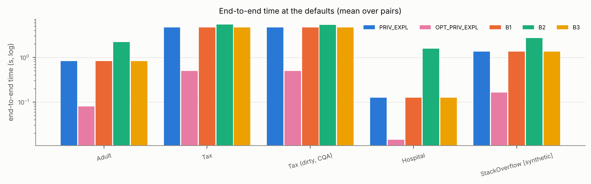

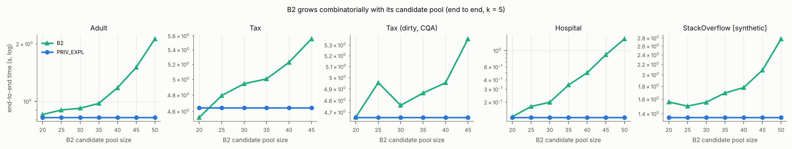

**Statistics routes** (PRIV_EXPL end to end, mean over pairs, seconds):

| dataset | O1 | O1 + O3 (OPT_PRIV_EXPL) | original (Sec. 4.2) |
|---|---|---|---|
| adult | 0.08459 | 0.08168 | 0.7398 |
| hospital | 0.01614 | 0.01368 | 0.1444 |
| stackoverflow | 0.2231 | 0.1819 | 1.402 |
| tax | 0.5395 | 0.5093 | 4.559 |
| tax_dirty | 0.476 | 0.4824 | 4.501 |

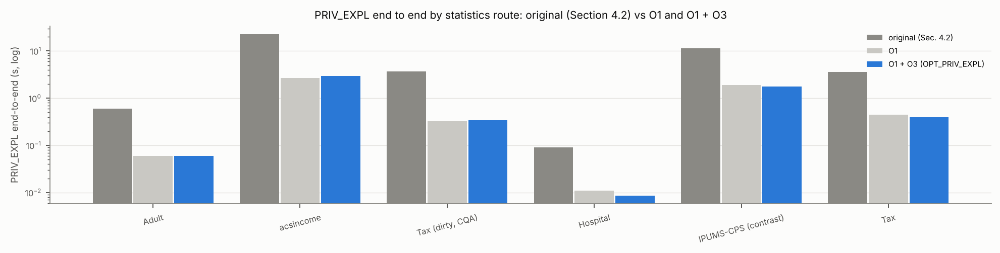

**OPT_PRIV_EXPL releases exactly what PRIV_EXPL releases** (same randomness):

| dataset | pair | runs | identical_runs | max_abs_use_diff |
|---|---|---|---|---|
| adult | A1 | 5 | 5 | 1.11e-16 |
| adult | A2 | 5 | 5 | 1.39e-17 |
| adult | A3 | 5 | 5 | 1.11e-16 |
| adult | R1 | 5 | 5 | 2.78e-17 |
| adult | R2 | 5 | 5 | 2.78e-17 |
| adult | R3 | 5 | 5 | 2.78e-17 |
| adult | R4 | 5 | 5 | 1.39e-17 |
| tax | T1 | 5 | 5 | 5.55e-17 |
| tax | T2 | 5 | 5 | 1.39e-17 |
| tax | T3 | 5 | 5 | 2.78e-17 |
| tax | R5 | 5 | 5 | 2.78e-17 |
| tax | R6 | 5 | 5 | 1.39e-17 |
| tax_dirty | C1 | 5 | 5 | 1.39e-17 |
| tax_dirty | C2 | 5 | 5 | 1.39e-17 |
| tax_dirty | C3 | 5 | 5 | 5.55e-17 |
| hospital | H1 | 5 | 5 | 1.11e-16 |
| hospital | H2 | 5 | 5 | 1.11e-16 |
| hospital | H3 | 5 | 5 | 2.78e-17 |
| hospital | C4 | 5 | 5 | 1.11e-16 |
| stackoverflow | S1 | 5 | 5 | 2.78e-17 |
| stackoverflow | S2 | 5 | 5 | 2.78e-17 |
| stackoverflow | S3 | 5 | 5 | 2.78e-17 |

## E1 — one release per pair (ε = 1, k = 5)

### A1 — adult

* Q1 = `occupation = 'Craft-repair' AND hoursPerWeek >= 40` (|Q1| = 5,447)
* Q2 = `hoursPerWeek >= 40` (|Q2| = 37,155; overlap 5,447)
* constraint: >= 25% with gender = 'Female': 4.7% → 26.9% — paper: 0.047 → 0.269
* |P| = 1,048, tau = 15, gamma = 150.3, Laplace scale per bin = 30.0 (sd of released difference 60.0)
* view stage: overlap of the retained views with the exact top-tau = 1.00
* single-atom views on the query attributes (exact rank by Use / coverage / Rep): `hoursPerWeek IN (32, 40]` #6 (0.541 / 0.67); `occupation='Craft-repair'` #16 (0.223 / 0.56); `hoursPerWeek IN (40, 50]` #17 (0.208 / 0.58); `hoursPerWeek IN (50, 99]` #35 (0.123 / 0.55); `occupation='Exec-managerial'` #37 (0.111 / 0.56); `occupation='Prof-specialty'` #42 (0.100 / 0.56)

| round | view | attribute | bins clearing 2σ | exact |Q1| / |Q2| in view |
|---|---|---|---|---|
| 1 | `hoursPerWeek IN (32, 40]` | occupation | Prof-specialty, Exec-managerial, Adm-clerical, Sales, Other-service, Machine-op-inspct, NA, Transport-moving, Handlers-cleaners, Farming-fishing, Tech-support, Protective-serv | 3,614 / 22,803 |
| 2 | `hoursPerWeek IN (32, 40]` | education | HS-grad, Some-college, Bachelors, Masters, Assoc-voc, 11th, Assoc-acdm, 10th, 7th-8th, Prof-school, 9th, 12th, Doctorate, 5th-6th, 1st-4th | 3,614 / 22,803 |
| 3 | `race='White'` | workclass | Private, Self-emp-not-inc, Local-gov, NA, State-gov, Self-emp-inc, Federal-gov | 4,907 / 31,903 |
| 4 | `gender='Male' AND hoursPerWeek IN (32, 40]` | occupation | Prof-specialty, Craft-repair, Exec-managerial, Adm-clerical, Sales, Other-service, Machine-op-inspct, NA, Transport-moving, Handlers-cleaners, Farming-fishing, Tech-support, Protective-serv | 3,426 / 15,428 |
| 5 | `hoursPerWeek IN (32, 40]` | age | [17, 24], (24, 31], (31, 37], (37, 44], (44, 53], (53, 90] | 3,614 / 22,803 |

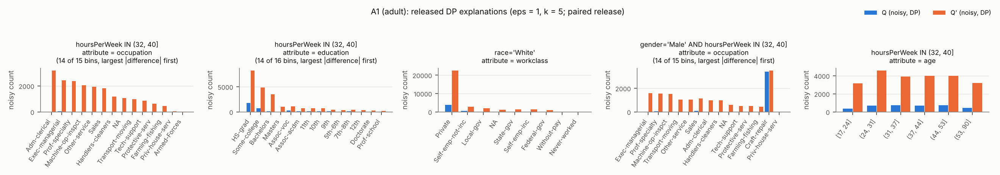

### A2 — adult

* Q1 = `education IN ('Bachelors', 'Masters') AND hoursPerWeek >= 50` (|Q1| = 3,055)
* Q2 = `education = 'Masters' AND hoursPerWeek >= 30` (|Q2| = 2,453; overlap 874)
* constraint: >= 25% with gender = 'Female': 19.5% → 30.6% — paper: 0.195 → 0.306
* |P| = 1,048, tau = 15, gamma = 150.3, Laplace scale per bin = 30.0 (sd of released difference 60.0)
* view stage: overlap of the retained views with the exact top-tau = 0.80
* single-atom views on the query attributes (exact rank by Use / coverage / Rep): `education='Masters'` #6 (0.068 / 0.53); `hoursPerWeek IN (40, 50]` #9 (0.047 / 0.58); `education='Bachelors'` #10 (0.045 / 0.57); `hoursPerWeek IN (50, 99]` #15 (0.041 / 0.55); `hoursPerWeek IN (32, 40]` #27 (0.024 / 0.67); `hoursPerWeek IN [1, 32]` #160 (0.001 / 0.57)

| round | view | attribute | bins clearing 2σ | exact |Q1| / |Q2| in view |
|---|---|---|---|---|
| 1 | `education='Masters'` | age | (24, 31], (31, 37], (37, 44], (44, 53], (53, 90] | 874 / 2,453 |
| 2 | `education='Masters' AND gender='Male'` | workclass | Private, Local-gov, State-gov | 690 / 1,702 |
| 3 | `education='Masters'` | occupation | Prof-specialty, Exec-managerial | 874 / 2,453 |
| 4 | `education='Masters'` | maritalStatus | Married-civ-spouse, Never-married, Divorced | 874 / 2,453 |
| 5 | `education='Masters' AND race='White'` | hoursPerWeek | [1, 32], (32, 40], (40, 50] | 813 / 2,174 |

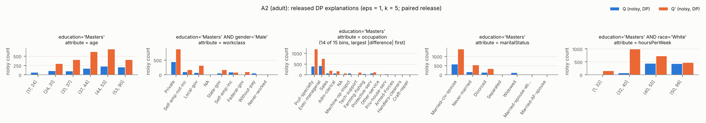

### A3 — adult

* Q1 = `maritalStatus = 'Married-civ-spouse' AND hoursPerWeek >= 45` (|Q1| = 8,216)
* Q2 = `maritalStatus IN ('Divorced', 'Married-civ-spouse', 'Never-married') AND hoursPerWeek >= 38` (|Q2| = 35,446; overlap 8,216)
* constraint: >= 25% with gender = 'Female': 5.0% → 25.2%
* Q' found by the refinement search (predicate distance 0.738, 637 refinements evaluated)
* |P| = 1,048, tau = 15, gamma = 150.3, Laplace scale per bin = 30.0 (sd of released difference 60.0)
* view stage: overlap of the retained views with the exact top-tau = 1.00
* single-atom views on the query attributes (exact rank by Use / coverage / Rep): `hoursPerWeek IN (32, 40]` #7 (0.446 / 0.67); `hoursPerWeek IN (40, 50]` #12 (0.272 / 0.58); `hoursPerWeek IN (50, 99]` #22 (0.176 / 0.55); `hoursPerWeek IN [1, 32]` #886 (0.000 / 0.57)

| round | view | attribute | bins clearing 2σ | exact |Q1| / |Q2| in view |
|---|---|---|---|---|
| 1 | `gender='Male' AND hoursPerWeek IN (32, 40]` | education | HS-grad, Some-college, Bachelors, Masters, Assoc-voc, 11th, Assoc-acdm, 10th, 7th-8th, Prof-school, 9th, 12th, 5th-6th | 0 / 15,125 |
| 2 | `hoursPerWeek IN (32, 40]` | occupation | Prof-specialty, Craft-repair, Exec-managerial, Adm-clerical, Sales, Other-service, Machine-op-inspct, NA, Transport-moving, Handlers-cleaners, Farming-fishing, Tech-support, Protective-serv, Armed-Forces | 0 / 21,771 |
| 3 | `gender='Male' AND hoursPerWeek IN (32, 40]` | workclass | Private, Self-emp-not-inc, Local-gov, NA, State-gov, Self-emp-inc, Federal-gov | 0 / 15,125 |
| 4 | `race='White' AND hoursPerWeek IN (32, 40]` | education | HS-grad, Some-college, Bachelors, Masters, Assoc-voc, 11th, Assoc-acdm, 10th, 7th-8th, Prof-school, 9th, 12th, 5th-6th | 0 / 18,168 |
| 5 | `workclass='Private' AND hoursPerWeek IN (32, 40]` | age | [17, 24], (24, 31], (31, 37], (37, 44], (44, 53], (53, 90] | 0 / 15,869 |

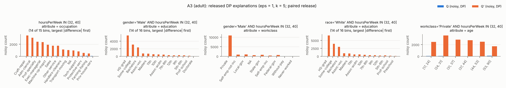

### T1 — tax

* Q1 = `MaritalStatus = 'M' AND Rate <= 5` (|Q1| = 57,164)
* Q2 = `Rate <= 5` (|Q2| = 114,957; overlap 57,164)
* constraint: >= 30% with HasChild = 'Y': 49.9% → 49.8% — paper: 0.035 → 0.501
* |P| = 1,792, tau = 15, gamma = 147.2, Laplace scale per bin = 30.0 (sd of released difference 60.0)
* view stage: overlap of the retained views with the exact top-tau = 1.00
* single-atom views on the query attributes (exact rank by Use / coverage / Rep): `MaritalStatus='M'` #5 (0.572 / 0.67); `Rate IN [0, 3.07]` #8 (0.503 / 0.63); `MaritalStatus='S'` #26 (0.289 / 0.67); `Rate IN (3.07, 4.75]` #37 (0.256 / 0.57); `Rate IN (4.75, 5.95]` #89 (0.101 / 0.57); `Rate IN (5.95, 7]` #1076 (0.000 / 0.59)

| round | view | attribute | bins clearing 2σ | exact |Q1| / |Q2| in view |
|---|---|---|---|---|
| 1 | `MarriedExemp IN [0, 174]` | State | PR, MT, KY, VT, NY, OH, NM, PA, CT, WV, RI, ND, IL, DC, MS, WI, TN, AL, KS, NH, ID, CO, CA, AK, AR, ME, IA, MD, AZ, FL, TX, WY, VA, IN, NJ, HI, NC, WA, NV, NE, SD, LA, DE, MI | 29,112 / 86,905 |
| 2 | `MarriedExemp IN [0, 174] AND ChildExemp IN [0, 103]` | State | PR, KY, VT, NY, OH, NM, PA, CT, WV, RI, ND, IL, DC, MS, WI, TN, AL, MN, KS, NH, ID, CO, CA, AK, AR, IA, MD, AZ, FL, TX, WY, IN, NJ, HI, WA, NV, NE, SD, DE, MI | 27,902 / 71,526 |
| 3 | `Rate IN [0, 3.07]` | State | PR, MT, OK, KY, OH, NM, PA, RI, ND, IL, TN, NH, CA, AK, AR, IA, AZ, FL, TX, WY, NJ, HI, WA, NV, SD, LA, DE | 33,447 / 67,229 |
| 4 | `Rate IN [0, 3.07]` | Salary | [5000, 20000], (20000, 35000], (35000, 50000], (50000, 70000], (70000, 85000], (85000, 100000] | 33,447 / 67,229 |
| 5 | `Rate IN [0, 3.07]` | SingleExemp | [0, 87], (87, 2100], (2100, 12750] | 33,447 / 67,229 |

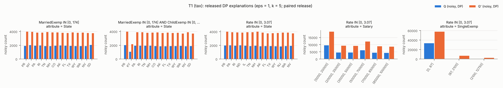

### T2 — tax

* Q1 = `MaritalStatus = 'S' AND HasChild = 'N' AND Salary >= 50000` (|Q1| = 27,694)
* Q2 = `MaritalStatus = 'S' AND Salary >= 50000` (|Q2| = 55,195; overlap 27,694)
* constraint: >= 30% with HasChild = 'Y': 0.0% → 49.8%
* Q' found by the refinement search (predicate distance 1.000, 188 refinements evaluated)
* |P| = 1,792, tau = 15, gamma = 147.2, Laplace scale per bin = 30.0 (sd of released difference 60.0)
* view stage: overlap of the retained views with the exact top-tau = 1.00
* single-atom views on the query attributes (exact rank by Use / coverage / Rep): `MaritalStatus='S'` #2 (0.414 / 0.67); `HasChild='N'` #7 (0.277 / 0.67); `HasChild='Y'` #21 (0.138 / 0.67); `Salary IN (50000, 70000]` #23 (0.150 / 0.58); `Salary IN (85000, 100000]` #42 (0.113 / 0.57); `Salary IN (70000, 85000]` #43 (0.113 / 0.57)

| round | view | attribute | bins clearing 2σ | exact |Q1| / |Q2| in view |
|---|---|---|---|---|
| 1 | `MaritalStatus='S' AND MarriedExemp IN [0, 174]` | State | PR, MT, OK, MO, KY, VT, UT, NY, OH, NM, PA, SC, GA, CT, WV, RI, ND, IL, DC, MS, WI, TN, AL, MN, KS, NH, ID, CO, CA, AK, AR, ME, IA, MD, AZ, FL, MA, TX, WY, VA, IN, NJ, HI, NC, WA, NV, NE, OR, SD, LA, DE, MI | 27,694 / 55,195 |
| 2 | `MaritalStatus='S'` | State | PR, MT, OK, MO, KY, VT, UT, NY, OH, NM, PA, SC, GA, CT, WV, RI, ND, IL, DC, MS, WI, TN, AL, MN, KS, NH, ID, CO, CA, AK, AR, ME, IA, MD, AZ, FL, MA, TX, WY, VA, IN, NJ, HI, NC, WA, NV, NE, OR, SD, LA, DE, MI | 27,694 / 55,195 |
| 3 | `MarriedExemp IN [0, 174]` | State | PR, MT, OK, MO, KY, VT, UT, NY, OH, NM, PA, SC, GA, CT, WV, RI, ND, IL, DC, MS, WI, TN, AL, MN, KS, NH, ID, CO, CA, AK, AR, ME, IA, MD, AZ, FL, MA, TX, WY, VA, IN, NJ, HI, NC, WA, NV, NE, OR, SD, LA, DE, MI | 27,694 / 55,195 |
| 4 | `Gender='F' AND MaritalStatus='S'` | State | PR, MT, OK, MO, KY, VT, UT, NY, OH, NM, PA, SC, GA, CT, WV, RI, ND, IL, DC, MS, WI, TN, AL, MN, KS, NH, ID, CO, CA, AK, AR, ME, IA, MD, AZ, FL, MA, TX, WY, VA, IN, NJ, HI, NC, WA, NV, NE, SD, LA, DE, MI | 13,931 / 27,742 |
| 5 | `MaritalStatus='S' AND MarriedExemp IN [0, 174]` | Salary | (35000, 50000], (50000, 70000], (70000, 85000], (85000, 100000] | 27,694 / 55,195 |

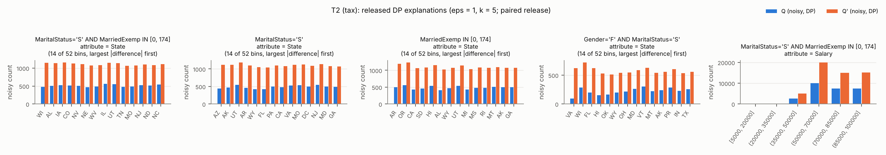

### T3 — tax

* Q1 = `Salary >= 60000 AND Rate <= 2` (|Q1| = 18,893)
* Q2 = `Salary >= 60000 AND Rate <= 3.9` (|Q2| = 31,709; overlap 18,893)
* constraint: >= 40% with Rate > 0: 0.0% → 40.4%
* Q' found by the refinement search (predicate distance 0.204, 860 refinements evaluated)
* |P| = 1,792, tau = 15, gamma = 147.2, Laplace scale per bin = 30.0 (sd of released difference 60.0)
* view stage: overlap of the retained views with the exact top-tau = 0.93
* single-atom views on the query attributes (exact rank by Use / coverage / Rep): `Rate IN [0, 3.07]` #4 (0.228 / 0.63); `Salary IN (50000, 70000]` #41 (0.085 / 0.58); `Salary IN (70000, 85000]` #42 (0.085 / 0.57); `Salary IN (85000, 100000]` #43 (0.083 / 0.57); `Rate IN (3.07, 4.75]` #86 (0.025 / 0.57); `Salary IN [5000, 20000]` #470 (0.000 / 0.58)

| round | view | attribute | bins clearing 2σ | exact |Q1| / |Q2| in view |
|---|---|---|---|---|
| 1 | `MaritalStatus='S'` | State | OH, PA, CT, ND, IL, ID, AZ, IN, NJ, NE, MI | 9,455 / 15,919 |
| 2 | `HasChild='N'` | State | OH, PA, CT, ND, IL, MD, AZ, IN, NJ, MI | 9,445 / 15,821 |
| 3 | `MaritalStatus='S'` | HasChild | N, Y | 9,455 / 15,919 |
| 4 | `Rate IN [0, 3.07]` | MarriedExemp | [0, 174], (174, 4200], (4200, 24500] | 18,893 / 26,630 |
| 5 | `MarriedExemp IN [0, 174]` | Salary | (50000, 70000], (70000, 85000], (85000, 100000] | 18,893 / 26,223 |

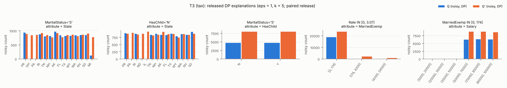

### S1 — stackoverflow **(synthetic data)**

* Q1 = `YearsCodePro >= 10` (|Q1| = 20,749)
* Q2 = `YearsCodePro < 4` (|Q2| = 21,205; overlap 0)
* |P| = 1,180, tau = 15, gamma = 150.3, Laplace scale per bin = 30.0 (sd of released difference 60.0)
* view stage: overlap of the retained views with the exact top-tau = 0.87
* single-atom views on the query attributes (exact rank by Use / coverage / Rep): `YearsCodePro IN [0, 2]` #9 (0.233 / 0.59); `YearsCodePro IN (9, 16]` #21 (0.166 / 0.57); `YearsCodePro IN (16, 51]` #28 (0.152 / 0.57); `YearsCodePro IN (2, 4]` #66 (0.091 / 0.57); `YearsCodePro IN (4, 6]` #1086 (0.000 / 0.56); `YearsCodePro IN (6, 9]` #1087 (0.000 / 0.56)

| round | view | attribute | bins clearing 2σ | exact |Q1| / |Q2| in view |
|---|---|---|---|---|
| 1 | `YearsCodePro IN [0, 2]` | Country | Other, USA, Germany, India, UK, Ukraine, Canada, France, Brazil, Poland | 0 / 15,250 |
| 2 | `YearsCodePro IN [0, 2]` | DevType | Dev, full-stack, Other, Dev, back-end, Dev, front-end, Dev, desktop or enterprise applications, Dev, mobile, Data scientist or machine learning specialist, Engineering manager | 0 / 15,250 |
| 3 | `YearsCodePro IN [0, 2]` | EdLevel | Bachelor, Master, Some college, Secondary, Doctoral/Prof, Other, Associate | 0 / 15,250 |
| 4 | `YearsCodePro IN [0, 2]` | OrgSize | 10-99, 100-999, 10k+, 1k-10k, 2-9, 1, Unknown | 0 / 15,250 |
| 5 | `YearsCodePro IN [0, 2]` | JobSat | [0, 5], (5, 6], (6, 7], (7, 8], (8, 9], (9, 10] | 0 / 15,250 |

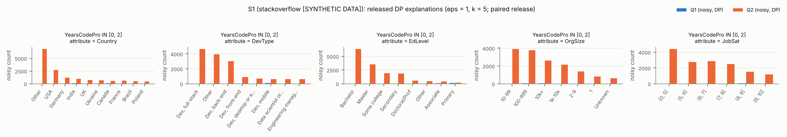

### S2 — stackoverflow **(synthetic data)**

* Q1 = `WorkRemote = 'Fully remote'` (|Q1| = 26,288)
* Q2 = `WorkRemote = 'On-site'` (|Q2| = 9,117; overlap 0)
* |P| = 1,180, tau = 15, gamma = 150.3, Laplace scale per bin = 30.0 (sd of released difference 60.0)
* view stage: overlap of the retained views with the exact top-tau = 0.93
* single-atom views on the query attributes (exact rank by Use / coverage / Rep): `WorkRemote='Fully remote'` #1 (0.402 / 0.64); `WorkRemote='On-site'` #24 (0.139 / 0.56); `WorkRemote='Hybrid'` #1129 (0.000 / 0.66)

| round | view | attribute | bins clearing 2σ | exact |Q1| / |Q2| in view |
|---|---|---|---|---|
| 1 | `WorkRemote='Fully remote'` | Country | Other, USA, Germany, India, UK, Ukraine, Canada, France, Brazil, Poland | 26,288 / 0 |
| 2 | `WorkRemote='Fully remote'` | EdLevel | Bachelor, Master, Some college, Secondary, Doctoral/Prof, Other, Associate, Primary | 26,288 / 0 |
| 3 | `WorkRemote='Fully remote' AND EdLevel='Bachelor'` | DevType | Dev, full-stack, Other, Dev, back-end, Dev, front-end, Dev, desktop or enterprise applications, Dev, mobile, Data scientist or machine learning specialist, Engineering manager | 11,009 / 0 |
| 4 | `WorkRemote='Fully remote' AND UsesPython='No'` | OrgSize | 10-99, 100-999, 10k+, 1k-10k, 2-9, 1, Unknown | 16,557 / 0 |
| 5 | `WorkRemote='Fully remote' AND UsesPython='No'` | YearsCodePro | [0, 2], (2, 4], (4, 6], (6, 9], (9, 16], (16, 51] | 16,557 / 0 |

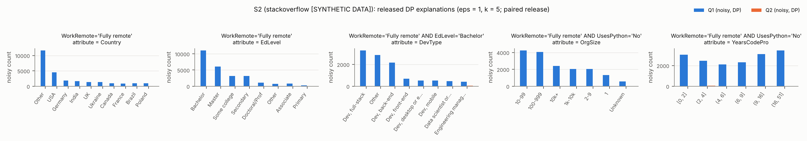

### S3 — stackoverflow **(synthetic data)**

* Q1 = `JobSat > 5 AND UsingAI = 'Yes'` (|Q1| = 33,359)
* Q2 = `JobSat > 5 AND UsingAI = 'No'` (|Q2| = 8,816; overlap 0)
* |P| = 1,180, tau = 15, gamma = 150.3, Laplace scale per bin = 30.0 (sd of released difference 60.0)
* view stage: overlap of the retained views with the exact top-tau = 1.00
* single-atom views on the query attributes (exact rank by Use / coverage / Rep): `UsingAI='Yes'` #1 (0.510 / 0.70); `JobSat IN (6, 7]` #23 (0.162 / 0.58); `JobSat IN (5, 6]` #27 (0.147 / 0.57); `JobSat IN (7, 8]` #28 (0.145 / 0.57); `UsingAI='No'` #29 (0.135 / 0.58); `JobSat IN (8, 9]` #61 (0.100 / 0.55)

| round | view | attribute | bins clearing 2σ | exact |Q1| / |Q2| in view |
|---|---|---|---|---|
| 1 | `WorkRemote='Fully remote' AND UsingAI='Yes'` | Country | Other, USA, Germany, India, UK, Ukraine, Canada, France, Brazil, Poland | 14,792 / 0 |
| 2 | `WorkRemote='Fully remote' AND UsingAI='Yes'` | DevType | Dev, full-stack, Other, Dev, back-end, Dev, front-end, Dev, desktop or enterprise applications, Dev, mobile, Data scientist or machine learning specialist, Engineering manager | 14,792 / 0 |
| 3 | `UsingAI='Yes' AND UsesPython='No'` | EdLevel | Bachelor, Master, Some college, Secondary, Doctoral/Prof, Other, Associate, Primary | 21,078 / 0 |
| 4 | `UsingAI='Yes'` | OrgSize | 10-99, 100-999, 10k+, 1k-10k, 2-9, 1, Unknown | 33,359 / 0 |
| 5 | `WorkRemote='Fully remote' AND UsingAI='Yes'` | YearsCodePro | [0, 2], (2, 4], (4, 6], (6, 9], (9, 16], (16, 51] | 14,792 / 0 |

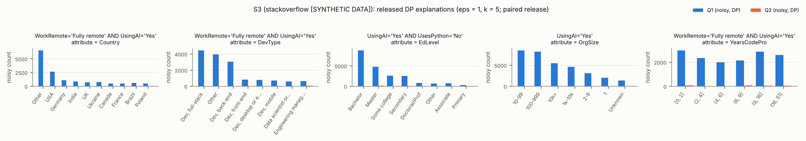

### H1 — hospital

* Q1 = `HospitalType = 'acute care hospitals'` (|Q1| = 968)
* Q2 = `Q_Sigma(HospitalType = 'acute care hospitals')` (|Q2| = 93; overlap 93)
* conflict hypergraph: 902 of 1000 tuples on 2170 edges
* |P| = 502, tau = 15, gamma = 150.3, Laplace scale per bin = 30.0 (sd of released difference 60.0)
* view stage: overlap of the retained views with the exact top-tau = 0.13

| round | view | attribute | bins clearing 2σ | exact |Q1| / |Q2| in view |
|---|---|---|---|---|
| 1 | `State='al'` | City | oneonta, opelika | 923 / 89 |
| 2 | `State='al'` | MeasureCode | scip-inf-3 | 923 / 89 |
| 3 | `State='al'` | CountyName | clarke, cullman, morgan | 923 / 89 |
| 4 | `State='al'` | Score | [0, 82], (91, 96], (99, 100], NA | 923 / 89 |
| 5 | `State='al'` | HospitalOwner | government - state, proprietary, voluntary non-profit - other | 923 / 89 |

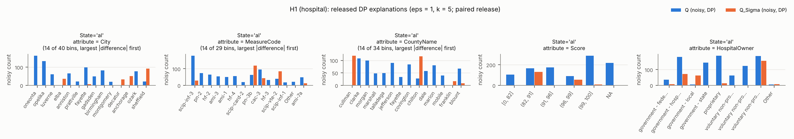

### H2 — hospital

* Q1 = `EmergencyService = 'yes'` (|Q1| = 830)
* Q2 = `Q_Sigma(EmergencyService = 'yes')` (|Q2| = 91; overlap 91)
* selection rule: `EmergencyService = 'yes'`, |Q| = 830, Q_Sigma drops 89%, most uneven over `City` (TVD 0.10)
* conflict hypergraph: 902 of 1000 tuples on 2170 edges
* |P| = 502, tau = 15, gamma = 150.3, Laplace scale per bin = 30.0 (sd of released difference 60.0)
* view stage: overlap of the retained views with the exact top-tau = 0.20
* single-atom views on the query attributes (exact rank by Use / coverage / Rep): `EmergencyService='yes'` #1 (0.921 / 0.73); `EmergencyService='no'` #373 (0.000 / 0.56); `EmergencyService='Other'` #374 (0.000 / 0.51)

| round | view | attribute | bins clearing 2σ | exact |Q1| / |Q2| in view |
|---|---|---|---|---|
| 1 | `EmergencyService='yes'` | MeasureCode | — | 830 / 91 |
| 2 | `EmergencyService='yes'` | CountyName | marshall, mobile | 830 / 91 |
| 3 | `EmergencyService='yes'` | City | clanton, cullman | 830 / 91 |
| 4 | `State='al' AND EmergencyService='yes'` | Sample | (210, 1421] | 789 / 89 |
| 5 | `EmergencyService='yes'` | HospitalOwner | proprietary, voluntary non-profit - other, voluntary non-profit - private | 830 / 91 |

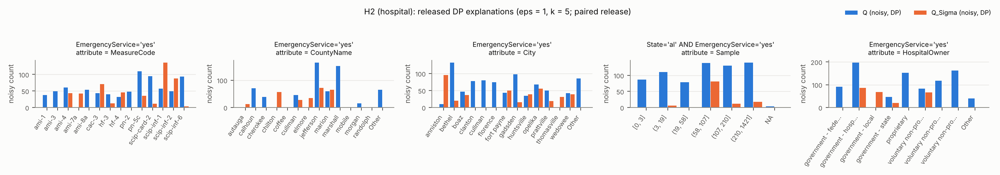

### H3 — hospital

* Q1 = `HospitalOwner = 'government - hospital district or authority'` (|Q1| = 198)
* Q2 = `Q_Sigma(HospitalOwner = 'government - hospital district or authority')` (|Q2| = 54; overlap 54)
* selection rule: `HospitalOwner = 'government - hospital district or authority'`, |Q| = 198, Q_Sigma drops 73%, most uneven over `CountyName` (TVD 0.27)
* conflict hypergraph: 902 of 1000 tuples on 2170 edges
* |P| = 502, tau = 15, gamma = 150.3, Laplace scale per bin = 30.0 (sd of released difference 60.0)
* view stage: overlap of the retained views with the exact top-tau = 0.07
* single-atom views on the query attributes (exact rank by Use / coverage / Rep): `HospitalOwner='government - hospital district or authority'` #4 (0.252 / 0.58); `HospitalOwner='government - federal'` #198 (0.000 / 0.52); `HospitalOwner='government - local'` #199 (0.000 / 0.51); `HospitalOwner='government - state'` #200 (0.000 / 0.52); `HospitalOwner='proprietary'` #201 (0.000 / 0.59); `HospitalOwner='voluntary non-profit - church'` #202 (0.000 / 0.53)

| round | view | attribute | bins clearing 2σ | exact |Q1| / |Q2| in view |
|---|---|---|---|---|
| 1 | `State='Other' AND HospitalOwner='Other'` | HospitalType | — | 0 / 0 |
| 2 | `EmergencyService='yes'` | HospitalOwner | government - hospital district or authority | 193 / 52 |
| 3 | `EmergencyService='yes'` | Condition | — | 193 / 52 |
| 4 | `EmergencyService='yes'` | City | — | 193 / 52 |
| 5 | `EmergencyService='yes'` | CountyName | de kalb, lauderdale | 193 / 52 |

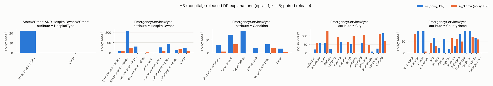

### R1 — adult

* Q1 = `education IN ('Masters', 'Doctorate', 'Prof-school') AND hoursPerWeek >= 50` (|Q1| = 1,554)
* Q2 = `education IN ('Doctorate', 'Masters', 'Prof-school', 'Some-college') AND hoursPerWeek >= 35` (|Q2| = 12,064; overlap 1,554)
* constraint: >= 30% with gender = 'Female': 17.6% → 30.6%
* |P| = 1,048, tau = 15, gamma = 150.3, Laplace scale per bin = 30.0 (sd of released difference 60.0)
* view stage: overlap of the retained views with the exact top-tau = 1.00
* single-atom views on the query attributes (exact rank by Use / coverage / Rep): `education='Some-college'` #6 (0.172 / 0.59); `hoursPerWeek IN (32, 40]` #7 (0.148 / 0.67); `hoursPerWeek IN (40, 50]` #17 (0.073 / 0.58); `education='Masters'` #22 (0.067 / 0.53); `hoursPerWeek IN (50, 99]` #25 (0.057 / 0.55); `education='Prof-school'` #61 (0.024 / 0.51)

| round | view | attribute | bins clearing 2σ | exact |Q1| / |Q2| in view |
|---|---|---|---|---|
| 1 | `education='Some-college' AND hoursPerWeek IN (32, 40]` | occupation | Prof-specialty, Craft-repair, Exec-managerial, Adm-clerical, Sales, Other-service, Machine-op-inspct, NA, Transport-moving, Handlers-cleaners, Tech-support, Protective-serv | 0 / 5,606 |
| 2 | `education='Some-college'` | age | [17, 24], (24, 31], (31, 37], (37, 44], (44, 53], (53, 90] | 0 / 8,400 |
| 3 | `education='Some-college' AND hoursPerWeek IN (32, 40]` | workclass | Private, Self-emp-not-inc, Local-gov, NA, State-gov, Federal-gov | 0 / 5,606 |
| 4 | `education='Some-college' AND hoursPerWeek IN (32, 40]` | relationship | Husband, Not-in-family, Own-child, Unmarried, Wife | 0 / 5,606 |
| 5 | `education='Some-college' AND hoursPerWeek IN (32, 40]` | maritalStatus | Married-civ-spouse, Never-married, Divorced, Separated | 0 / 5,606 |

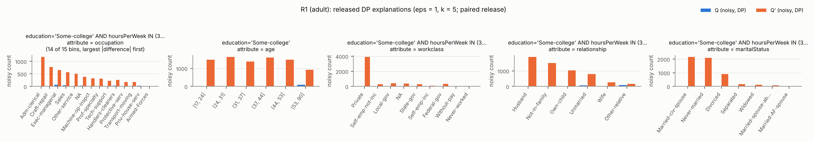

### R2 — adult

* Q1 = `occupation = 'Prof-specialty' AND maritalStatus = 'Married-civ-spouse'` (|Q1| = 3,182)
* Q2 = `occupation IN ('Other-service', 'Prof-specialty') AND maritalStatus IN ('Married-civ-spouse', 'Never-married')` (|Q2| = 8,561; overlap 3,182)
* constraint: >= 15% with race IN ('Black', 'Asian-Pac-Islander', 'Amer-Indian-Eskimo', 'Other'): 10.2% → 15.7%
* |P| = 1,048, tau = 15, gamma = 150.3, Laplace scale per bin = 30.0 (sd of released difference 60.0)
* view stage: overlap of the retained views with the exact top-tau = 0.87
* single-atom views on the query attributes (exact rank by Use / coverage / Rep): `occupation='Prof-specialty'` #5 (0.168 / 0.56); `occupation='Other-service'` #17 (0.072 / 0.55); `occupation='Craft-repair'` #470 (0.000 / 0.56); `occupation='Exec-managerial'` #471 (0.000 / 0.56); `occupation='Adm-clerical'` #472 (0.000 / 0.55); `occupation='Sales'` #473 (0.000 / 0.55)

| round | view | attribute | bins clearing 2σ | exact |Q1| / |Q2| in view |
|---|---|---|---|---|
| 1 | `workclass='Private' AND occupation='Other-service'` | education | HS-grad, Some-college, Bachelors, 11th, 10th | 0 / 2,945 |
| 2 | `workclass='Private' AND occupation='Other-service'` | age | [17, 24], (24, 31], (31, 37], (37, 44], (44, 53], (53, 90] | 0 / 2,945 |
| 3 | `workclass='Private' AND occupation='Other-service'` | relationship | Husband, Not-in-family, Own-child, Unmarried, Wife, Other-relative | 0 / 2,945 |
| 4 | `workclass='Private' AND occupation='Other-service'` | hoursPerWeek | [1, 32], (32, 40], (40, 50], (50, 99] | 0 / 2,945 |
| 5 | `workclass='Private' AND occupation='Other-service'` | race | White, Black | 0 / 2,945 |

### R3 — adult

* Q1 = `maritalStatus = 'Married-civ-spouse' AND age >= 40` (|Q1| = 12,932)
* Q2 = `maritalStatus IN ('Divorced', 'Married-civ-spouse', 'Widowed') AND age >= 61` (|Q2| = 3,296; overlap 2,134)
* constraint: >= 30% with gender = 'Female': 8.9% → 30.2%
* |P| = 1,048, tau = 15, gamma = 150.3, Laplace scale per bin = 30.0 (sd of released difference 60.0)
* view stage: overlap of the retained views with the exact top-tau = 0.93

| round | view | attribute | bins clearing 2σ | exact |Q1| / |Q2| in view |
|---|---|---|---|---|
| 1 | `race='White' AND gender='Male'` | education | HS-grad, Some-college, Bachelors, Masters, Assoc-voc, Assoc-acdm, 10th, 7th-8th, Prof-school, Doctorate | 10,665 / 2,106 |
| 2 | `race='White' AND gender='Male'` | occupation | Prof-specialty, Craft-repair, Exec-managerial, Adm-clerical, Sales, Other-service, Machine-op-inspct, NA, Transport-moving, Handlers-cleaners, Farming-fishing, Tech-support, Protective-serv, Priv-house-serv | 10,665 / 2,106 |
| 3 | `hoursPerWeek IN (32, 40]` | education | HS-grad, Some-college, Bachelors, Masters, Assoc-voc, Assoc-acdm, 10th, 5th-6th | 6,582 / 1,371 |
| 4 | `race='White' AND gender='Male'` | workclass | Private, Self-emp-not-inc, Local-gov, NA, State-gov, Self-emp-inc, Federal-gov | 10,665 / 2,106 |
| 5 | `gender='Male'` | age | (24, 31], (37, 44], (44, 53], (53, 90] | 11,780 / 2,300 |

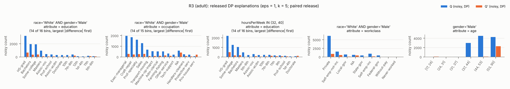

### R4 — adult

* Q1 = `occupation = 'Prof-specialty' AND hoursPerWeek >= 50` (|Q1| = 1,681)
* Q2 = `occupation IN ('Other-service', 'Prof-specialty') AND hoursPerWeek >= 30` (|Q2| = 9,186; overlap 1,681)
* constraint: >= 25% with age < 30: 14.7% → 25.3%
* |P| = 1,048, tau = 15, gamma = 150.3, Laplace scale per bin = 30.0 (sd of released difference 60.0)
* view stage: overlap of the retained views with the exact top-tau = 0.93
* single-atom views on the query attributes (exact rank by Use / coverage / Rep): `occupation='Prof-specialty'` #4 (0.149 / 0.56); `hoursPerWeek IN (32, 40]` #7 (0.113 / 0.67); `occupation='Other-service'` #16 (0.074 / 0.55); `hoursPerWeek IN (40, 50]` #22 (0.055 / 0.58); `hoursPerWeek IN (50, 99]` #32 (0.041 / 0.55); `hoursPerWeek IN [1, 32]` #75 (0.014 / 0.57)

| round | view | attribute | bins clearing 2σ | exact |Q1| / |Q2| in view |
|---|---|---|---|---|
| 1 | `occupation='Prof-specialty'` | education | HS-grad, Some-college, Bachelors, Masters, Assoc-voc, Assoc-acdm, Prof-school, 12th, Doctorate | 1,681 / 5,588 |
| 2 | `occupation='Prof-specialty' AND race='White'` | age | [17, 24], (24, 31], (31, 37], (37, 44], (44, 53], (53, 90] | 1,552 / 4,915 |
| 3 | `occupation='Prof-specialty'` | relationship | Husband, Not-in-family, Own-child, Unmarried, Wife | 1,681 / 5,588 |
| 4 | `occupation='Prof-specialty' AND race='White'` | maritalStatus | Married-civ-spouse, Never-married, Divorced | 1,552 / 4,915 |
| 5 | `occupation='Prof-specialty'` | workclass | Private, Self-emp-not-inc, Local-gov, State-gov, Federal-gov, Never-worked | 1,681 / 5,588 |

### R5 — tax

* Q1 = `Salary <= 30000 AND Rate <= 2` (|Q1| = 16,774)
* Q2 = `Salary <= 30000 AND Rate <= 3.2016153` (|Q2| = 25,621; overlap 16,774)
* constraint: >= 50% with Rate > 0: 23.7% → 50.0%
* |P| = 1,792, tau = 15, gamma = 147.2, Laplace scale per bin = 30.0 (sd of released difference 60.0)
* view stage: overlap of the retained views with the exact top-tau = 1.00
* single-atom views on the query attributes (exact rank by Use / coverage / Rep): `Rate IN [0, 3.07]` #1 (0.210 / 0.63); `Salary IN [5000, 20000]` #11 (0.154 / 0.58); `Salary IN (20000, 35000]` #52 (0.058 / 0.56); `Rate IN (3.07, 4.75]` #435 (0.002 / 0.57); `Salary IN (35000, 50000]` #642 (0.000 / 0.57); `Salary IN (50000, 70000]` #643 (0.000 / 0.58)

| round | view | attribute | bins clearing 2σ | exact |Q1| / |Q2| in view |
|---|---|---|---|---|
| 1 | `Salary IN [5000, 20000] AND Rate IN [0, 3.07]` | State | MT, OK, KY, PA, GA, CT, WV, ND, IL, MS, ID, CO, CA, AK, AR, ME, IA, AZ, VA, HI, NE, DE | 11,756 / 19,052 |
| 2 | `Rate IN [0, 3.07]` | State | KY, OH, PA, WV, ND, IL, MS, ID, CA, AR, ME, IA, AZ, HI, NE, LA, DE | 16,774 / 25,230 |
| 3 | `Salary IN [5000, 20000] AND ChildExemp IN [0, 103]` | State | MT, KY, PA, CT, WV, ND, IL, MS, ME, IA, AZ, WY, HI, NE, DE | 10,416 / 15,245 |
| 4 | `Salary IN [5000, 20000] AND Rate IN [0, 3.07]` | SingleExemp | [0, 87], (87, 2100], (2100, 12750] | 11,756 / 19,052 |
| 5 | `Salary IN [5000, 20000] AND Rate IN [0, 3.07]` | ChildExemp | [0, 103], (103, 1500], (1500, 3300] | 11,756 / 19,052 |

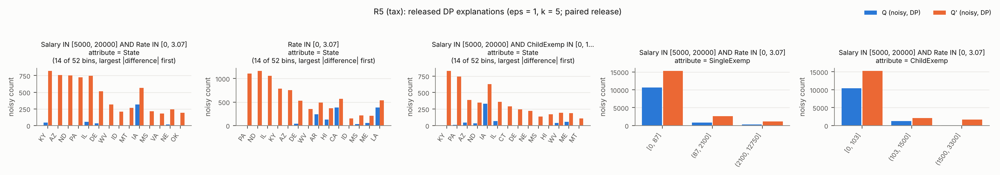

### R6 — tax

* Q1 = `MaritalStatus = 'S' AND HasChild = 'N' AND Salary >= 50000` (|Q1| = 27,694)
* Q2 = `MaritalStatus = 'S' AND Salary >= 50000` (|Q2| = 55,195; overlap 27,694)
* constraint: >= 30% with HasChild = 'Y': 0.0% → 49.8%
* |P| = 1,792, tau = 15, gamma = 147.2, Laplace scale per bin = 30.0 (sd of released difference 60.0)
* view stage: overlap of the retained views with the exact top-tau = 1.00
* single-atom views on the query attributes (exact rank by Use / coverage / Rep): `MaritalStatus='S'` #2 (0.414 / 0.67); `HasChild='N'` #7 (0.277 / 0.67); `HasChild='Y'` #21 (0.138 / 0.67); `Salary IN (50000, 70000]` #23 (0.150 / 0.58); `Salary IN (85000, 100000]` #42 (0.113 / 0.57); `Salary IN (70000, 85000]` #43 (0.113 / 0.57)

| round | view | attribute | bins clearing 2σ | exact |Q1| / |Q2| in view |
|---|---|---|---|---|
| 1 | `MaritalStatus='S' AND MarriedExemp IN [0, 174]` | State | PR, MT, OK, MO, KY, VT, UT, NY, OH, NM, PA, SC, GA, CT, WV, RI, ND, IL, DC, MS, WI, TN, AL, MN, KS, NH, ID, CO, CA, AK, AR, ME, IA, MD, AZ, FL, MA, TX, WY, VA, IN, NJ, HI, NC, WA, NV, NE, OR, SD, LA, DE, MI | 27,694 / 55,195 |
| 2 | `MaritalStatus='S'` | State | PR, MT, OK, MO, KY, VT, UT, NY, OH, NM, PA, SC, GA, CT, WV, RI, ND, IL, DC, MS, WI, TN, AL, MN, KS, NH, ID, CO, CA, AK, AR, ME, IA, MD, AZ, FL, MA, TX, WY, VA, IN, NJ, HI, NC, WA, NV, NE, OR, SD, LA, DE, MI | 27,694 / 55,195 |
| 3 | `Gender='F' AND MaritalStatus='S'` | State | PR, MT, OK, MO, KY, VT, UT, NY, OH, NM, PA, SC, GA, CT, WV, RI, ND, IL, DC, MS, WI, TN, AL, MN, KS, NH, ID, CO, CA, AK, AR, ME, IA, MD, AZ, FL, MA, TX, WY, VA, IN, NJ, HI, NC, WA, NV, NE, OR, SD, LA, DE, MI | 13,931 / 27,742 |
| 4 | `MaritalStatus='S' AND MarriedExemp IN [0, 174]` | Salary | (35000, 50000], (50000, 70000], (70000, 85000], (85000, 100000] | 27,694 / 55,195 |
| 5 | `MaritalStatus='S'` | Rate | [0, 3.07], (3.07, 4.75], (4.75, 5.95], (5.95, 7], (7, 9.3] | 27,694 / 55,195 |

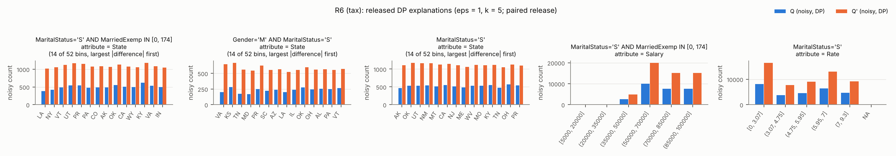

### C1 — tax_dirty

* Q1 = `State IN ('AL', 'AR', 'GA', 'MS', 'TN')` (|Q1| = 19,515)
* Q2 = `Q_Sigma(State IN ('AL', 'AR', 'GA', 'MS', 'TN'))` (|Q2| = 12,290; overlap 12,290)
* conflict hypergraph: 18192 of 200000 tuples on 3328948 edges
* |P| = 1,977, tau = 15, gamma = 147.2, Laplace scale per bin = 30.0 (sd of released difference 60.0)
* view stage: overlap of the retained views with the exact top-tau = 0.93
* single-atom views on the query attributes (exact rank by Use / coverage / Rep): `State='MS'` #52 (0.039 / 0.51); `State='GA'` #53 (0.039 / 0.51); `State='TN'` #54 (0.038 / 0.51); `State='AL'` #101 (0.023 / 0.51); `State='AR'` #116 (0.020 / 0.51); `State='AK'` #407 (0.000 / 0.51)

| round | view | attribute | bins clearing 2σ | exact |Q1| / |Q2| in view |
|---|---|---|---|---|
| 1 | `MaritalStatus='S' AND MarriedExemp IN [0, 174]` | State | AL, AR, CA, DE, MI, MO | 9,746 / 6,600 |
| 2 | `Gender='M'` | State | AL, AR, MO | 9,653 / 6,100 |
| 3 | `HasChild='N'` | ChildExemp | [0, 103], (103, 1500] | 9,950 / 5,675 |
| 4 | `MarriedExemp IN [0, 174] AND ChildExemp IN [0, 103]` | Salary | [5000, 20000], (20000, 35000], (35000, 50000], (50000, 70000], (70000, 85000], (85000, 100000] | 10,723 / 5,700 |
| 5 | `ChildExemp IN [0, 103]` | Rate | [0, 3.07], (3.07, 4.75], (4.75, 5.95], (5.95, 7] | 13,620 / 7,635 |

### C2 — tax_dirty

* Q1 = `State IN ('NJ', 'NY', 'PA', 'CT', 'MA')` (|Q1| = 19,466)
* Q2 = `Q_Sigma(State IN ('NJ', 'NY', 'PA', 'CT', 'MA'))` (|Q2| = 15,342; overlap 15,342)
* conflict hypergraph: 18192 of 200000 tuples on 3328948 edges
* |P| = 1,977, tau = 15, gamma = 147.2, Laplace scale per bin = 30.0 (sd of released difference 60.0)
* view stage: overlap of the retained views with the exact top-tau = 1.00
* single-atom views on the query attributes (exact rank by Use / coverage / Rep): `State='NY'` #64 (0.039 / 0.51); `State='PA'` #68 (0.039 / 0.51); `State='CT'` #74 (0.039 / 0.51); `State='MA'` #80 (0.038 / 0.51); `State='NJ'` #132 (0.020 / 0.51); `State='AK'` #421 (0.000 / 0.51)

| round | view | attribute | bins clearing 2σ | exact |Q1| / |Q2| in view |
|---|---|---|---|---|
| 1 | `HasChild='N' AND ChildExemp IN [0, 103]` | State | KY, NJ, NV, TX, Other | 9,643 / 7,685 |
| 2 | `MaritalStatus='M' AND SingleExemp IN [0, 87]` | State | ID, NJ, UT | 9,725 / 7,724 |
| 3 | `SingleExemp IN [0, 87] AND ChildExemp IN [0, 103]` | Rate | [0, 3.07] | 9,753 / 8,682 |
| 4 | `Gender='M'` | State | FL, NJ | 9,657 / 7,624 |
| 5 | `SingleExemp IN [0, 87] AND MarriedExemp IN [0, 174]` | MaritalStatus | — | 7,884 / 7,748 |

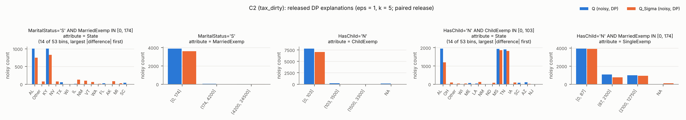

### C3 — tax_dirty

* Q1 = `Salary >= 70000` (|Q1| = 70,104)
* Q2 = `Q_Sigma(Salary >= 70000)` (|Q2| = 63,650; overlap 63,650)
* conflict hypergraph: 18192 of 200000 tuples on 3328948 edges
* |P| = 1,977, tau = 15, gamma = 147.2, Laplace scale per bin = 30.0 (sd of released difference 60.0)
* view stage: overlap of the retained views with the exact top-tau = 1.00
* single-atom views on the query attributes (exact rank by Use / coverage / Rep): `Salary IN (85000, 100000]` #15 (0.288 / 0.57); `Salary IN (70000, 85000]` #16 (0.287 / 0.57); `Salary IN (50000, 70000]` #90 (0.094 / 0.58); `Salary IN [5000, 20000]` #1133 (0.000 / 0.58); `Salary IN (20000, 35000]` #1134 (0.000 / 0.56); `Salary IN (35000, 50000]` #1135 (0.000 / 0.57)

| round | view | attribute | bins clearing 2σ | exact |Q1| / |Q2| in view |
|---|---|---|---|---|
| 1 | `Salary IN (85000, 100000]` | State | AK, AL, AR, MT, NJ, OK, PR, VA | 30,169 / 27,376 |
| 2 | `SingleExemp IN [0, 87]` | State | AK, AL, AR, NJ, PR, RI, WA | 46,894 / 42,168 |
| 3 | `HasChild='Y'` | MaritalStatus | M, S | 35,149 / 32,259 |
| 4 | `HasChild='Y'` | State | AK, AL, AR, HI, IA, NJ, SD | 35,149 / 32,259 |
| 5 | `MaritalStatus='M' AND SingleExemp IN [0, 87]` | Salary | (50000, 70000], (70000, 85000], (85000, 100000] | 34,830 / 31,464 |

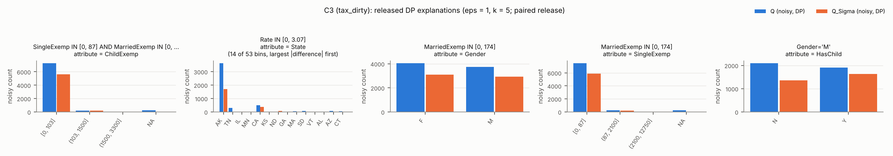

### C4 — hospital

* Q1 = `HospitalType = 'acute care hospitals'` (|Q1| = 968)
* Q2 = `Q_Sigma(HospitalType = 'acute care hospitals')` (|Q2| = 93; overlap 93)
* conflict hypergraph: 902 of 1000 tuples on 2170 edges
* |P| = 502, tau = 15, gamma = 150.3, Laplace scale per bin = 30.0 (sd of released difference 60.0)
* view stage: overlap of the retained views with the exact top-tau = 0.20

| round | view | attribute | bins clearing 2σ | exact |Q1| / |Q2| in view |
|---|---|---|---|---|
| 1 | `State='al'` | MeasureCode | ami-5, ami-7a | 923 / 89 |
| 2 | `State='al'` | CountyName | marshall, talladega | 923 / 89 |
| 3 | `State='al'` | City | birmingham, dothan, florence, mobile, oneonta, ozark, prattville | 923 / 89 |
| 4 | `State='al' AND EmergencyService='yes'` | Sample | [0, 3], (3, 19], (58, 107], (107, 210] | 761 / 84 |
| 5 | `EmergencyService='yes'` | Score | [0, 82], (82, 91], (91, 96], (96, 99], (99, 100] | 802 / 86 |

