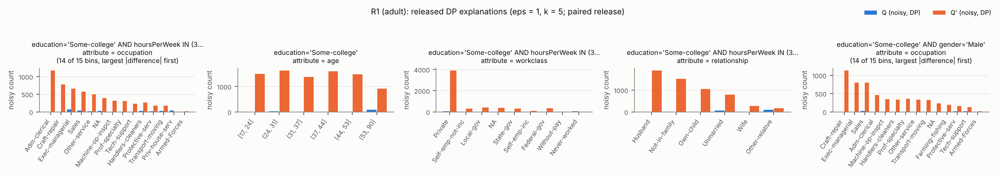
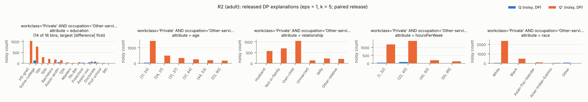
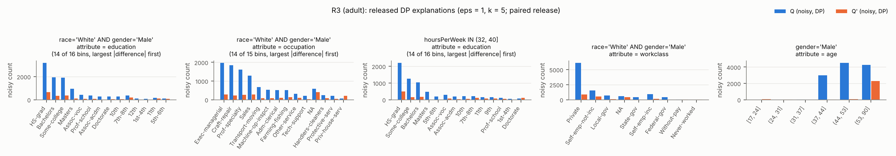
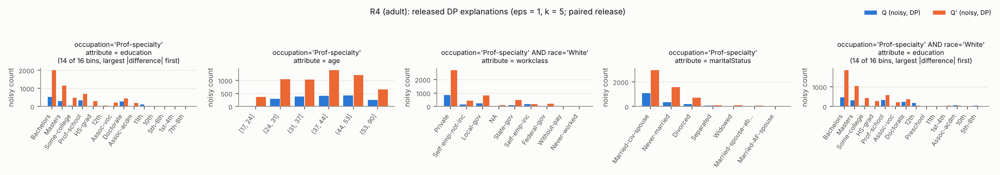
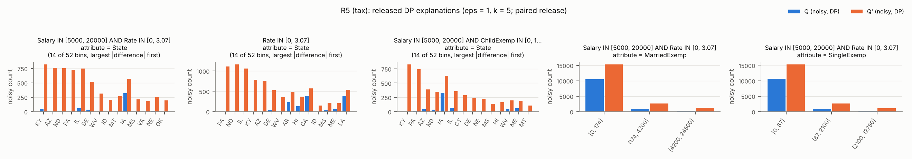
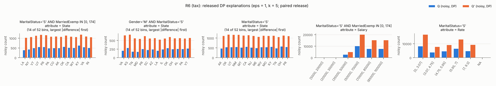
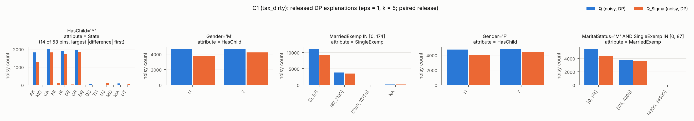
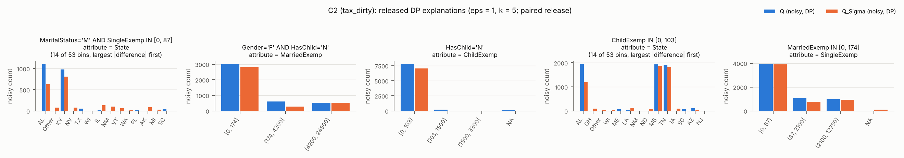
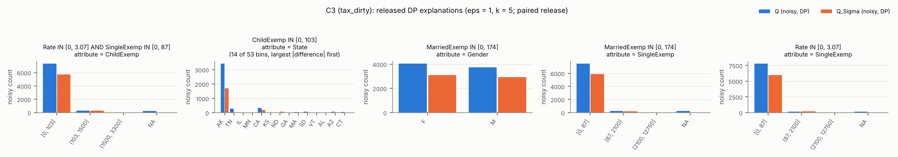
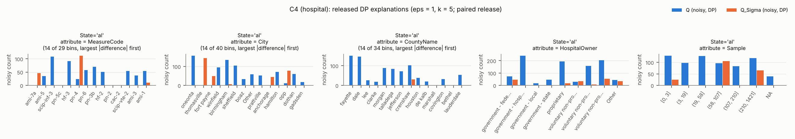

# Case-study pairs — data

Generated by `pqde run cases`. Exact (`exact_*`) numbers are non-private diagnostics.

## Overview

| pair | dataset | kind | role | |Q1| | |Q2| | AVG_Q1 | AVG_Q2 | hidden_drift | drift_attr | ratio_B2_eps1 | top_attr_share | constraint | agg_unexplained |
|---|---|---|---|---|---|---|---|---|---|---|---|---|---|
| R1 | adult | refinement | surprising | 1554 | 12064 | 0.734 | 0.358 | 0.478 | occupation | 0.964 | 1.675 | >= 30% with gender = 'Female': 17.6% -> 30.6% | -0.346 |
| R2 | adult | refinement | surprising | 3182 | 8561 | 0.708 | 0.315 | 0.393 | income | 1.125 | 1.125 | >= 15% with race IN ('Black', 'Asian-Pac-Islander', 'Amer-Indian-Eskimo', 'Other'): 10.2% -> 15.7% | -0.389 |
| R3 | adult | refinement | surprising | 12932 | 3296 | 0.500 | 0.246 | 0.294 | hoursPerWeek | 0.931 | 1.725 | >= 30% with gender = 'Female': 8.9% -> 30.2% | -0.253 |
| R4 | adult | refinement | surprising | 1681 | 9186 | 0.582 | 0.312 | 0.370 | education | 0.888 | 1.050 | >= 25% with age < 30: 14.7% -> 25.3% | -0.227 |
| R5 | tax | refinement | surprising | 16774 | 25621 | 16294.861 | 15311.463 | 0.318 | State | 0.977 | 3.175 | >= 50% with Rate > 0: 23.7% -> 50.0% |  |
| R6 | tax | refinement | sanity | 27694 | 55195 | 4.637 | 4.624 | 0.011 | State | 0.975 | 3.325 | >= 30% with HasChild = 'Y': 0.0% -> 49.8% |  |
| C1 | tax_dirty | cqa | surprising | 18729 | 16404 | 4.735 | 5.232 | 0.088 | State | 0.713 | 1.450 | Q_Sigma drops 12.4% |  |
| C2 | tax_dirty | cqa | surprising | 7986 | 7082 | 3.682 | 3.535 | 0.087 | State | 0.519 | 1.375 | Q_Sigma drops 11.3% |  |
| C3 | tax_dirty | cqa | surprising | 8126 | 6152 | 0.173 | 0.220 | 0.164 | State | 0.787 | 1.225 | Q_Sigma drops 24.3% |  |
| C4 | hospital | cqa | small-data | 968 | 93 | 89.505 | 92.607 | 0.766 | City | 0.733 | 0.925 | Q_Sigma drops 90.4% |  |

## R1 (adult, refinement, surprising)

* Q1: `education IN ('Masters', 'Doctorate', 'Prof-school') AND hoursPerWeek >= 50` — |Q1| = 1,554
* Q2: `education IN ('Doctorate', 'Masters', 'Prof-school', 'Some-college') AND hoursPerWeek >= 35` — |Q2| = 12,064
* >= 30% with gender = 'Female': 17.6% -> 30.6%
* AVG(income): 0.734 → 0.358
* hidden drift 0.48 on `occupation`; inside the constrained group 0.55 on `occupation`; aggregate change not explained by the constraint: -0.346
* ApproxRatio vs B2 at ε = 0.5 / 1 / 2 / 5: 0.87 / 0.96 / 0.97 / 0.99

Released explanations (ε = 1, one run; noisy vs exact on the bins with the largest released difference):

* `education='Some-college' AND hoursPerWeek IN (32, 40]` × **occupation** — Adm-clerical: -9/1176 (exact 0/1170); Craft-repair: 7/775 (exact 0/770); Exec-managerial: 69/656 (exact 0/622); Sales: 42/568 (exact 0/567)
* `education='Some-college'` × **age** — (37, 44]: -63/1609 (exact 0/1579); (24, 31]: 18/1639 (exact 0/1578); (44, 53]: -55/1488 (exact 0/1416); [17, 24]: -18/1493 (exact 0/1516)
* `education='Some-college' AND hoursPerWeek IN (32, 40]` × **workclass** — Private: 45/3913 (exact 0/3947); Local-gov: 5/403 (exact 0/383); NA: 25/391 (exact 0/380); Federal-gov: 1/321 (exact 0/268)
* `education='Some-college' AND hoursPerWeek IN (32, 40]` × **relationship** — Husband: 10/1904 (exact 0/1861); Not-in-family: -31/1516 (exact 0/1485); Own-child: 12/1043 (exact 0/1087); Unmarried: 63/796 (exact 0/732)
* `education='Some-college' AND gender='Male'` × **occupation** — Craft-repair: -20/1133 (exact 0/1134); Exec-managerial: -15/797 (exact 0/800); Sales: 25/802 (exact 0/781); Adm-clerical: -4/455 (exact 0/443)

Stability over 40 runs: `education='Some-college' AND hoursPerWeek IN (32, 40]`×occupation 100%, `education='Some-college' AND hoursPerWeek IN (32, 40]`×relationship 100%, `education='Some-college' AND hoursPerWeek IN (32, 40]`×age 90%, `education='Some-college' AND hoursPerWeek IN (32, 40]`×workclass 75%, `education='Some-college'`×occupation 35%, `education='Some-college' AND hoursPerWeek IN (32, 40]`×maritalStatus 32%

## R2 (adult, refinement, surprising)

* Q1: `occupation = 'Prof-specialty' AND maritalStatus = 'Married-civ-spouse'` — |Q1| = 3,182
* Q2: `occupation IN ('Other-service', 'Prof-specialty') AND maritalStatus IN ('Married-civ-spouse', 'Never-married')` — |Q2| = 8,561
* >= 15% with race IN ('Black', 'Asian-Pac-Islander', 'Amer-Indian-Eskimo', 'Other'): 10.2% -> 15.7%
* AVG(income): 0.708 → 0.315
* hidden drift 0.39 on `income`; inside the constrained group 0.44 on `education`; aggregate change not explained by the constraint: -0.389
* ApproxRatio vs B2 at ε = 0.5 / 1 / 2 / 5: 0.91 / 1.12 / 1.01 / 0.95

Released explanations (ε = 1, one run; noisy vs exact on the bins with the largest released difference):

* `workclass='Private' AND occupation='Other-service'` × **education** — HS-grad: -51/1030 (exact 0/1055); Some-college: 132/772 (exact 0/768); 11th: 7/282 (exact 0/258); 10th: -24/205 (exact 0/168)
* `workclass='Private' AND occupation='Other-service'` × **age** — [17, 24]: 47/1436 (exact 0/1388); (24, 31]: -145/501 (exact 0/552); (31, 37]: -20/341 (exact 0/344); (44, 53]: -59/202 (exact 0/208)
* `workclass='Private' AND occupation='Other-service'` × **relationship** — Own-child: -14/1044 (exact 0/1091); Not-in-family: -12/701 (exact 0/730); Husband: 15/572 (exact 0/552); Other-relative: -29/207 (exact 0/190)
* `workclass='Private' AND occupation='Other-service'` × **hoursPerWeek** — (32, 40]: 89/1413 (exact 0/1409); [1, 32]: 37/1197 (exact 0/1206); (40, 50]: 8/197 (exact 0/201); (50, 99]: -40/126 (exact 0/129)
* `workclass='Private' AND occupation='Other-service'` × **race** — White: 52/2353 (exact 0/2328); Black: -7/487 (exact 0/434); Asian-Pac-Islander: -19/84 (exact 0/124) ~noise; Other: 65/-10 (exact 0/29) ~noise

Stability over 40 runs: `occupation='Other-service'`×education 32%, `occupation='Other-service'`×age 32%, `occupation='Other-service'`×relationship 32%, `occupation='Other-service'`×workclass 32%, `occupation='Other-service'`×hoursPerWeek 22%, `occupation='Prof-specialty'`×relationship 20%

## R3 (adult, refinement, surprising)

* Q1: `maritalStatus = 'Married-civ-spouse' AND age >= 40` — |Q1| = 12,932
* Q2: `maritalStatus IN ('Divorced', 'Married-civ-spouse', 'Widowed') AND age >= 61` — |Q2| = 3,296
* >= 30% with gender = 'Female': 8.9% -> 30.2%
* AVG(income): 0.500 → 0.246
* hidden drift 0.29 on `hoursPerWeek`; inside the constrained group 0.42 on `income`; aggregate change not explained by the constraint: -0.253
* ApproxRatio vs B2 at ε = 0.5 / 1 / 2 / 5: 0.90 / 0.93 / 0.95 / 0.96

Released explanations (ε = 1, one run; noisy vs exact on the bins with the largest released difference):

* `race='White' AND gender='Male'` × **education** — HS-grad: 3203/655 (exact 3230/665); Bachelors: 1932/348 (exact 1962/328); Some-college: 1905/362 (exact 1929/311); Masters: 937/112 (exact 889/120)
* `race='White' AND gender='Male'` × **occupation** — Exec-managerial: 1978/282 (exact 1986/311); Craft-repair: 1849/222 (exact 1804/199); Prof-specialty: 1604/266 (exact 1560/249); Sales: 1281/273 (exact 1302/269)
* `hoursPerWeek IN (32, 40]` × **education** — HS-grad: 2212/487 (exact 2222/478); Some-college: 1259/148 (exact 1197/218); Bachelors: 1045/181 (exact 1049/172); Masters: 469/-2 (exact 462/54)
* `race='White' AND gender='Male'` × **workclass** — Private: 6141/847 (exact 6136/857); Self-emp-not-inc: 1513/528 (exact 1556/440); Self-emp-inc: 905/127 (exact 842/175); Local-gov: 706/100 (exact 733/108)
* `gender='Male'` × **age** — (44, 53]: 4525/65 (exact 4523/0); (37, 44]: 2982/32 (exact 2994/0); (53, 90]: 4259/2295 (exact 4263/2300); (24, 31]: -107/22 (exact 0/0)

Stability over 40 runs: `gender='Male'`×education 68%, `race='White' AND gender='Male'`×occupation 57%, `race='White' AND gender='Male'`×education 45%, `race='White' AND gender='Male'`×workclass 42%, `gender='Male'`×workclass 38%, `gender='Male'`×occupation 35%

## R4 (adult, refinement, surprising)

* Q1: `occupation = 'Prof-specialty' AND hoursPerWeek >= 50` — |Q1| = 1,681
* Q2: `occupation IN ('Other-service', 'Prof-specialty') AND hoursPerWeek >= 30` — |Q2| = 9,186
* >= 25% with age < 30: 14.7% -> 25.3%
* AVG(income): 0.582 → 0.312
* hidden drift 0.37 on `education`; inside the constrained group 0.50 on `education`; aggregate change not explained by the constraint: -0.227
* ApproxRatio vs B2 at ε = 0.5 / 1 / 2 / 5: 0.84 / 0.89 / 0.88 / 0.96

Released explanations (ε = 1, one run; noisy vs exact on the bins with the largest released difference):

* `occupation='Prof-specialty'` × **education** — Bachelors: 538/2009 (exact 530/2050); Masters: 309/1146 (exact 357/1203); Some-college: 41/479 (exact 87/497); Prof-school: 335/705 (exact 356/632)
* `occupation='Prof-specialty'` × **age** — (37, 44]: 410/1397 (exact 405/1278); (44, 53]: 427/1214 (exact 401/1194); (24, 31]: 299/1043 (exact 303/1033); (31, 37]: 387/1036 (exact 303/1033)
* `occupation='Prof-specialty' AND race='White'` × **workclass** — Private: 846/2705 (exact 811/2763); Local-gov: 243/817 (exact 251/846); State-gov: 87/481 (exact 122/442); Self-emp-not-inc: 152/434 (exact 199/444)
* `occupation='Prof-specialty'` × **maritalStatus** — Married-civ-spouse: 1083/2963 (exact 1051/2968); Never-married: 359/1584 (exact 384/1578); Divorced: 203/708 (exact 181/741); Widowed: 26/95 (exact 25/100) ~noise
* `occupation='Prof-specialty' AND race='White'` × **education** — Bachelors: 474/1845 (exact 495/1801); Masters: 323/1048 (exact 334/1065); Some-college: 45/421 (exact 76/427); HS-grad: -2/266 (exact 48/267)

Stability over 40 runs: `occupation='Prof-specialty'`×workclass 50%, `occupation='Other-service'`×education 35%, `occupation='Other-service'`×relationship 35%, `occupation='Other-service'`×maritalStatus 35%, `occupation='Prof-specialty'`×education 35%, `occupation='Prof-specialty'`×relationship 35%

## R5 (tax, refinement, surprising)

* Q1: `Salary <= 30000 AND Rate <= 2` — |Q1| = 16,774
* Q2: `Salary <= 30000 AND Rate <= 3.2016153` — |Q2| = 25,621
* >= 50% with Rate > 0: 23.7% -> 50.0%
* AVG(Salary): 16294.861 → 15311.463
* hidden drift 0.32 on `State`; inside the constrained group 0.62 on `State`; aggregate change not explained by the constraint: +nan
* ApproxRatio vs B2 at ε = 0.5 / 1 / 2 / 5: 0.95 / 0.98 / 0.99 / 0.99

Released explanations (ε = 1, one run; noisy vs exact on the bins with the largest released difference):

* `Salary IN [5000, 20000] AND Rate IN [0, 3.07]` × **State** — KY: 45/818 (exact 0/811); AZ: -2/758 (exact 0/779); ND: 4/751 (exact 0/750); PA: -1/722 (exact 0/766)
* `Rate IN [0, 3.07]` × **State** — PA: -123/1108 (exact 0/1146); ND: -6/1159 (exact 0/1156); IL: -5/1056 (exact 0/1136); KY: -23/784 (exact 0/811)
* `Salary IN [5000, 20000] AND ChildExemp IN [0, 103]` × **State** — KY: -39/826 (exact 0/811); PA: 9/743 (exact 0/766); AZ: 42/386 (exact 0/397); ND: 34/348 (exact 0/365)
* `Salary IN [5000, 20000] AND Rate IN [0, 3.07]` × **MarriedExemp** — [0, 174]: 10548/15275 (exact 10566/15314); (174, 4200]: 863/2596 (exact 857/2542); (4200, 24500]: 310/1201 (exact 333/1196)
* `Salary IN [5000, 20000] AND Rate IN [0, 3.07]` × **SingleExemp** — [0, 87]: 10634/15270 (exact 10634/15295); (87, 2100]: 860/2635 (exact 837/2613); (2100, 12750]: 285/1101 (exact 285/1144)

Stability over 40 runs: `Salary IN [5000, 20000] AND Rate IN [0, 3.07]`×State 100%, `Rate IN [0, 3.07]`×State 95%, `Salary IN [5000, 20000] AND Rate IN [0, 3.07]`×ChildExemp 68%, `Salary IN [5000, 20000] AND Rate IN [0, 3.07]`×SingleExemp 55%, `Rate IN [0, 3.07] AND ChildExemp IN [0, 103]`×State 48%, `Salary IN [5000, 20000] AND Rate IN [0, 3.07]`×MarriedExemp 45%

## R6 (tax, refinement, sanity)

* Q1: `MaritalStatus = 'S' AND HasChild = 'N' AND Salary >= 50000` — |Q1| = 27,694
* Q2: `MaritalStatus = 'S' AND Salary >= 50000` — |Q2| = 55,195
* >= 30% with HasChild = 'Y': 0.0% -> 49.8%
* AVG(Rate): 4.637 → 4.624
* hidden drift 0.01 on `State`; inside the constrained group 0.00 on `None`; aggregate change not explained by the constraint: +nan
* ApproxRatio vs B2 at ε = 0.5 / 1 / 2 / 5: 0.97 / 0.98 / 0.98 / 0.98

Released explanations (ε = 1, one run; noisy vs exact on the bins with the largest released difference):

* `MaritalStatus='S' AND MarriedExemp IN [0, 174]` × **State** — LA: 379/1017 (exact 507/1039); NY: 424/1059 (exact 547/1059); VT: 490/1120 (exact 546/1107); UT: 545/1171 (exact 550/1125)
* `Gender='M' AND MaritalStatus='S'` × **State** — VA: 198/648 (exact 290/550); KS: 280/667 (exact 284/539); TN: 175/559 (exact 247/530); MD: 168/546 (exact 244/512)
* `MaritalStatus='S'` × **State** — AK: 462/1109 (exact 505/1072); OK: 532/1171 (exact 557/1131); UT: 536/1161 (exact 550/1125); NM: 540/1161 (exact 515/1073)
* `MaritalStatus='S' AND MarriedExemp IN [0, 174]` × **Salary** — (50000, 70000]: 10048/19900 (exact 10038/19932); (85000, 100000]: 7531/15087 (exact 7512/15145); (70000, 85000]: 7538/15066 (exact 7524/15085); (35000, 50000]: 2625/4940 (exact 2620/5033)
* `MaritalStatus='S'` × **Rate** — [0, 3.07]: 8123/16402 (exact 8169/16381); (5.95, 7]: 6443/12987 (exact 6465/12998); (7, 9.3]: 4657/9134 (exact 4669/9123); (4.75, 5.95]: 4539/8982 (exact 4533/8983)

Stability over 40 runs: `MaritalStatus='S' AND MarriedExemp IN [0, 174]`×State 100%, `MaritalStatus='S'`×State 98%, `Gender='F' AND MaritalStatus='S'`×State 55%, `Gender='M' AND MaritalStatus='S'`×State 35%, `MarriedExemp IN [0, 174]`×State 32%, `Gender='F' AND MaritalStatus='S'`×Salary 25%

## C1 (tax_dirty, cqa, surprising)

* Q1: `State IN ('AK', 'CA', 'HI', 'OR', 'WA')` — |Q1| = 18,729
* Q2: `Q_Sigma(State IN ('AK', 'CA', 'HI', 'OR', 'WA'))` — |Q2| = 16,404
* Q_Sigma drops 12.4%
* AVG(Rate): 4.735 → 5.232
* removed tuples most uneven over `State` (TVD 0.62); largest losses: AK kept 48%, HI kept 94%, OR kept 97%, WA kept 98%
* ApproxRatio vs B2 at ε = 0.5 / 1 / 2 / 5: 0.60 / 0.71 / 0.80 / 0.83

Released explanations (ε = 1, one run; noisy vs exact on the bins with the largest released difference):

* `HasChild='Y'` × **State** — AK: 1812/1292 (exact 1819/1278); MO: -249/-5 (exact 0/0); CA: 2003/1818 (exact 1885/1872); MI: -50/124 (exact 0/0)
* `Gender='M'` × **HasChild** — N: 4658/3747 (exact 4657/3848); Y: 4650/4231 (exact 4591/4225)
* `MarriedExemp IN [0, 174]` × **SingleExemp** — [0, 87]: 11046/9184 (exact 11025/9247); (87, 2100]: 3788/3520 (exact 3760/3577); (2100, 12750]: -14/23 (exact 0/0) ~noise; NA: 108/92 (exact 200/0) ~noise
* `Gender='F'` × **HasChild** — N: 4734/4007 (exact 4733/3972); Y: 4815/4390 (exact 4748/4359)
* `MaritalStatus='M' AND SingleExemp IN [0, 87]` × **MarriedExemp** — [0, 174]: 5420/4301 (exact 5436/4275); (174, 4200]: 3743/3616 (exact 3744/3580); (4200, 24500]: 23/37 (exact 0/0) ~noise

Stability over 40 runs: `MarriedExemp IN [0, 174]`×SingleExemp 25%, `MaritalStatus='M'`×State 25%, `HasChild='N'`×State 22%, `SingleExemp IN [0, 87] AND MarriedExemp IN [0, 174]`×ChildExemp 20%, `MarriedExemp IN [0, 174] AND ChildExemp IN [0, 103]`×SingleExemp 20%, `SingleExemp IN [0, 87]`×ChildExemp 18%

## C2 (tax_dirty, cqa, surprising)

* Q1: `State IN ('AL', 'KY', 'MS', 'TN') AND HasChild = 'N'` — |Q1| = 7,986
* Q2: `Q_Sigma(State IN ('AL', 'KY', 'MS', 'TN') AND HasChild = 'N')` — |Q2| = 7,082
* Q_Sigma drops 11.3%
* AVG(Rate): 3.682 → 3.535
* removed tuples most uneven over `State` (TVD 0.68); largest losses: AL kept 60%, TN kept 98%, KY kept 100%, MS kept 100%
* ApproxRatio vs B2 at ε = 0.5 / 1 / 2 / 5: 0.33 / 0.52 / 0.56 / 0.57

Released explanations (ε = 1, one run; noisy vs exact on the bins with the largest released difference):

* `MaritalStatus='M' AND SingleExemp IN [0, 87]` × **State** — AL: 1106/635 (exact 1047/570); Other: -98/74 (exact 0/0); KY: 979/810 (exact 1002/999); NV: -89/77 (exact 0/0)
* `Gender='F' AND HasChild='N'` × **MarriedExemp** — (174, 4200]: 602/268 (exact 555/304); [0, 174]: 3014/2813 (exact 3017/2808); (4200, 24500]: 520/522 (exact 514/511) ~noise
* `HasChild='N'` × **ChildExemp** — [0, 103]: 7776/7071 (exact 7786/7064); (103, 1500]: 217/21 (exact 200/18); NA: 169/21 (exact 0/0); (1500, 3300]: -54/-152 (exact 0/0) ~noise
* `ChildExemp IN [0, 103]` × **State** — AL: 1947/1196 (exact 1919/1242); OH: -54/93 (exact 0/0); Other: -101/40 (exact 0/0); WI: -82/42 (exact 0/0)
* `MarriedExemp IN [0, 174]` × **SingleExemp** — (87, 2100]: 1061/753 (exact 1072/690); NA: 2/108 (exact 0/0) ~noise; (2100, 12750]: 992/926 (exact 965/963) ~noise; [0, 87]: 3931/3893 (exact 3909/3871) ~noise

Stability over 40 runs: `HasChild='N' AND SingleExemp IN [0, 87]`×ChildExemp 25%, `HasChild='N' AND MarriedExemp IN [0, 174]`×State 15%, `Gender='F'`×State 15%, `SingleExemp IN [0, 87] AND ChildExemp IN [0, 103]`×State 15%, `ChildExemp IN [0, 103]`×State 12%, `HasChild='N'`×ChildExemp 12%

## C3 (tax_dirty, cqa, surprising)

* Q1: `State IN ('AK', 'CA', 'HI', 'OR', 'WA') AND Rate <= 3` — |Q1| = 8,126
* Q2: `Q_Sigma(State IN ('AK', 'CA', 'HI', 'OR', 'WA') AND Rate <= 3)` — |Q2| = 6,152
* Q_Sigma drops 24.3%
* AVG(Rate): 0.173 → 0.220
* removed tuples most uneven over `State` (TVD 0.51); largest losses: AK kept 48%, WA kept 98%, HI kept 94%, CA kept 99%
* ApproxRatio vs B2 at ε = 0.5 / 1 / 2 / 5: 0.70 / 0.79 / 0.81 / 0.84

Released explanations (ε = 1, one run; noisy vs exact on the bins with the largest released difference):

* `Rate IN [0, 3.07] AND SingleExemp IN [0, 87]` × **ChildExemp** — [0, 103]: 7340/5711 (exact 7269/5712); NA: 251/-5 (exact 200/0); (1500, 3300]: -22/-58 (exact 0/0) ~noise; (103, 1500]: 274/283 (exact 274/267) ~noise
* `ChildExemp IN [0, 103]` × **State** — AK: 3421/1693 (exact 3432/1743); TN: 291/-3 (exact 0/0); IL: -183/25 (exact 0/0); MN: -172/-6 (exact 0/0)
* `MarriedExemp IN [0, 174]` × **Gender** — F: 4036/3083 (exact 4034/3069); M: 3739/2918 (exact 3923/2924)
* `MarriedExemp IN [0, 174]` × **SingleExemp** — [0, 87]: 7461/5856 (exact 7574/5820); NA: 240/-18 (exact 200/0); (87, 2100]: 227/196 (exact 183/173) ~noise; (2100, 12750]: -13/0 (exact 0/0) ~noise
* `Rate IN [0, 3.07]` × **SingleExemp** — [0, 87]: 7771/5949 (exact 7743/5979); NA: 174/-39 (exact 200/0); (87, 2100]: 135/209 (exact 183/173) ~noise; (2100, 12750]: 13/-42 (exact 0/0) ~noise

Stability over 40 runs: `Rate IN [0, 3.07] AND SingleExemp IN [0, 87]`×ChildExemp 30%, `Rate IN [0, 3.07] AND MarriedExemp IN [0, 174]`×SingleExemp 28%, `Rate IN [0, 3.07] AND ChildExemp IN [0, 103]`×SingleExemp 22%, `Rate IN [0, 3.07]`×State 20%, `MarriedExemp IN [0, 174]`×ChildExemp 18%, `MarriedExemp IN [0, 174]`×SingleExemp 15%

## C4 (hospital, cqa, small-data)

* Q1: `HospitalType = 'acute care hospitals'` — |Q1| = 968
* Q2: `Q_Sigma(HospitalType = 'acute care hospitals')` — |Q2| = 93
* Q_Sigma drops 90.4%
* AVG(Score): 89.505 → 92.607
* removed tuples most uneven over `City` (TVD 0.08); largest losses: birmingham kept 7%, montgomery kept 2%, gadsden kept 6%, dothan kept 5%
* ApproxRatio vs B2 at ε = 0.5 / 1 / 2 / 5: 0.45 / 0.73 / 0.84 / 0.93

Released explanations (ε = 1, one run; noisy vs exact on the bins with the largest released difference):

* `State='al'` × **MeasureCode** — ami-7a: -86/46 (exact 37/3); ami-5: 35/-89 (exact 37/4); scip-inf-3: 108/-8 (exact 33/3) ~noise; pn-5c: -12/-124 (exact 34/3) ~noise
* `State='al'` × **City** — oneonta: 156/-22 (exact 19/0); thomasville: -29/143 (exact 24/0); fort payne: -89/49 (exact 24/0); winfield: 94/-35 (exact 23/0)
* `State='al'` × **CountyName** — fayette: 150/-93 (exact 21/0); dale: 145/-8 (exact 22/0); lee: 26/-121 (exact 23/23); clarke: 18/-113 (exact 23/0)
* `State='al'` × **HospitalOwner** — government - hospital district or authority: 240/-46 (exact 184/50); proprietary: 194/16 (exact 182/4); voluntary non-profit - private: 204/52 (exact 244/25); voluntary non-profit - other: 158/8 (exact 116/5)
* `State='al'` × **Sample** — (107, 210]: 83/-82 (exact 143/18); (19, 58]: 128/-23 (exact 143/10); (3, 19]: 98/-12 (exact 134/12) ~noise; [0, 3]: 129/25 (exact 156/12) ~noise

Stability over 40 runs: `EmergencyService='yes'`×City 18%, `State='al'`×MeasureCode 18%, `State='al'`×CountyName 18%, `EmergencyService='yes'`×MeasureCode 15%, `EmergencyService='yes'`×CountyName 15%, `EmergencyService='yes'`×Sample 15%

