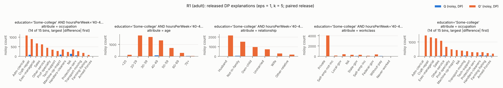
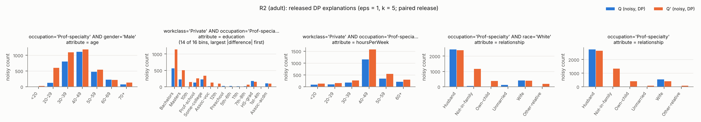
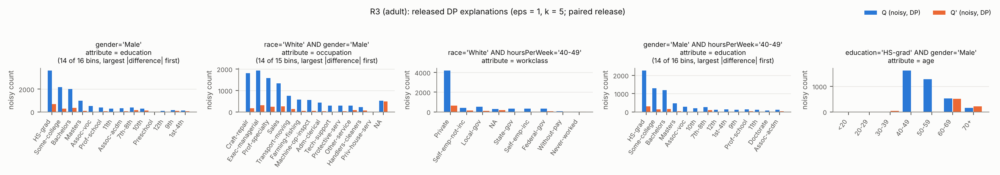
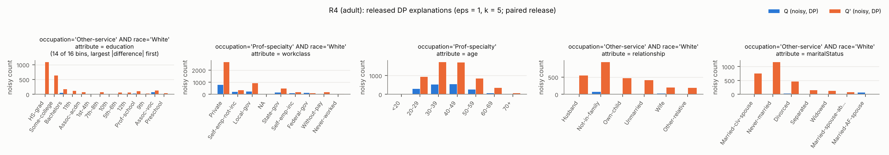
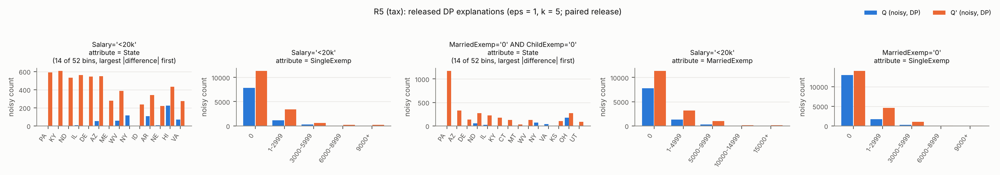
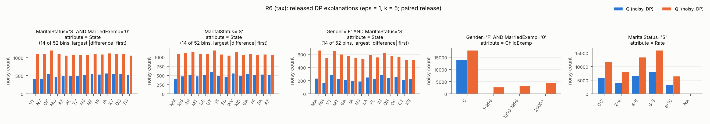
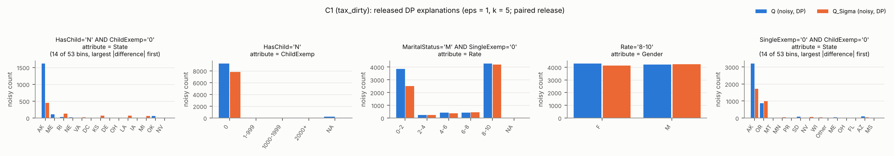
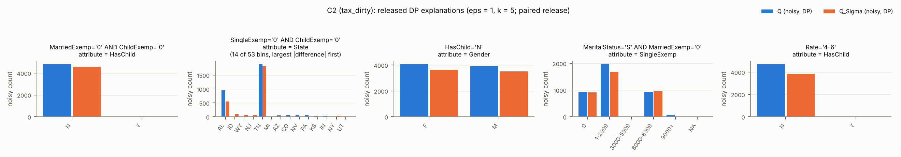
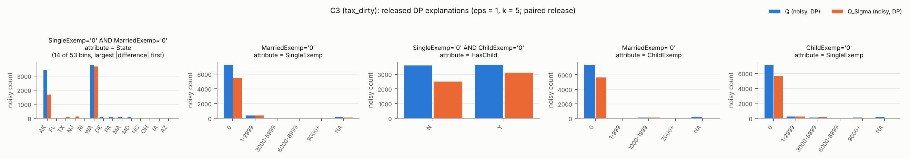
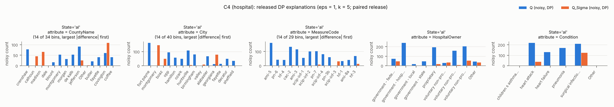

# Case-study pairs — data

Generated by `pqde run cases`. Exact (`exact_*`) numbers are non-private diagnostics.

## Overview

| pair | dataset | kind | role | |Q1| | |Q2| | AVG_Q1 | AVG_Q2 | hidden_drift | drift_attr | ratio_B2_eps1 | top_attr_share | constraint | agg_unexplained |
|---|---|---|---|---|---|---|---|---|---|---|---|---|---|
| R1 | adult | refinement | surprising | 1554 | 12064 | 0.734 | 0.358 | 0.478 | occupation | 0.962 | 1.725 | >= 30% with gender = 'Female': 17.6% -> 30.6% | -0.346 |
| R2 | adult | refinement | surprising | 3182 | 8561 | 0.708 | 0.315 | 0.393 | income | 1.086 | 1.075 | >= 15% with race IN ('Black', 'Asian-Pac-Islander', 'Amer-Indian-Eskimo', 'Other'): 10.2% -> 15.7% | -0.389 |
| R3 | adult | refinement | surprising | 12932 | 3296 | 0.500 | 0.246 | 0.317 | hoursPerWeek | 0.924 | 1.850 | >= 30% with gender = 'Female': 8.9% -> 30.2% | -0.253 |
| R4 | adult | refinement | surprising | 1681 | 9186 | 0.582 | 0.312 | 0.370 | education | 0.891 | 1.000 | >= 25% with age < 30: 14.7% -> 25.3% | -0.227 |
| R5 | tax | refinement | surprising | 16774 | 25621 | 16294.861 | 15311.463 | 0.318 | State | 0.937 | 2.475 | >= 50% with Rate > 0: 23.7% -> 50.0% |  |
| R6 | tax | refinement | sanity | 27694 | 55195 | 4.637 | 4.624 | 0.011 | State | 0.977 | 3.250 | >= 30% with HasChild = 'Y': 0.0% -> 49.8% |  |
| C1 | tax_dirty | cqa | surprising | 18729 | 16404 | 4.735 | 5.232 | 0.088 | State | 0.704 | 1.625 | Q_Sigma drops 12.4% |  |
| C2 | tax_dirty | cqa | surprising | 7986 | 7082 | 3.682 | 3.535 | 0.087 | State | 0.503 | 1.225 | Q_Sigma drops 11.3% |  |
| C3 | tax_dirty | cqa | surprising | 8126 | 6152 | 0.173 | 0.220 | 0.164 | State | 0.726 | 1.450 | Q_Sigma drops 24.3% |  |
| C4 | hospital | cqa | small-data | 968 | 93 | 89.505 | 92.607 | 0.766 | City | 0.756 | 1.025 | Q_Sigma drops 90.4% |  |

## R1 (adult, refinement, surprising)

* Q1: `education IN ('Masters', 'Doctorate', 'Prof-school') AND hoursPerWeek >= 50` — |Q1| = 1,554
* Q2: `education IN ('Doctorate', 'Masters', 'Prof-school', 'Some-college') AND hoursPerWeek >= 35` — |Q2| = 12,064
* >= 30% with gender = 'Female': 17.6% -> 30.6%
* AVG(income): 0.734 → 0.358
* hidden drift 0.48 on `occupation`; inside the constrained group 0.55 on `occupation`; aggregate change not explained by the constraint: -0.346
* ApproxRatio vs B2 at ε = 0.5 / 1 / 2 / 5: 0.91 / 0.96 / 0.98 / 1.00

Released explanations (ε = 1, one run; noisy vs exact on the bins with the largest released difference):

* `education='Some-college' AND hoursPerWeek='40-49'` × **occupation** — Adm-clerical: -27/1088 (exact 0/1105); Craft-repair: 70/898 (exact 0/874); Exec-managerial: -15/671 (exact 0/709); Sales: -8/619 (exact 0/618)
* `education='Some-college' AND hoursPerWeek='40-49'` × **age** — 20-29: -4/1757 (exact 0/1748); 30-39: 15/1624 (exact 0/1564); 40-49: 67/1333 (exact 0/1338); 50-59: 3/701 (exact 0/703)
* `education='Some-college' AND hoursPerWeek='40-49'` × **relationship** — Husband: 20/2160 (exact 0/2170); Not-in-family: 52/1510 (exact 0/1516); Own-child: 13/958 (exact 0/972); Unmarried: 7/720 (exact 0/700)
* `education='Some-college' AND hoursPerWeek='40-49'` × **workclass** — Private: -2/4069 (exact 0/4134); Local-gov: 7/381 (exact 0/389); Federal-gov: -8/345 (exact 0/289); NA: -13/270 (exact 0/341)
* `education='Some-college'` × **occupation** — Adm-clerical: -14/1464 (exact 0/1423); Craft-repair: -11/1328 (exact 0/1185); Exec-managerial: 3/1253 (exact 0/1182); Sales: 24/1088 (exact 0/1091)

Stability over 40 runs: `education='Some-college' AND hoursPerWeek='40-49'`×occupation 100%, `education='Some-college' AND hoursPerWeek='40-49'`×age 98%, `education='Some-college' AND hoursPerWeek='40-49'`×relationship 90%, `education='Some-college' AND hoursPerWeek='40-49'`×workclass 70%, `education='Some-college'`×occupation 45%, `education='Some-college' AND hoursPerWeek='40-49'`×maritalStatus 22%

## R2 (adult, refinement, surprising)

* Q1: `occupation = 'Prof-specialty' AND maritalStatus = 'Married-civ-spouse'` — |Q1| = 3,182
* Q2: `occupation IN ('Other-service', 'Prof-specialty') AND maritalStatus IN ('Married-civ-spouse', 'Never-married')` — |Q2| = 8,561
* >= 15% with race IN ('Black', 'Asian-Pac-Islander', 'Amer-Indian-Eskimo', 'Other'): 10.2% -> 15.7%
* AVG(income): 0.708 → 0.315
* hidden drift 0.39 on `income`; inside the constrained group 0.44 on `education`; aggregate change not explained by the constraint: -0.389
* ApproxRatio vs B2 at ε = 0.5 / 1 / 2 / 5: 0.97 / 1.09 / 0.88 / 0.90

Released explanations (ε = 1, one run; noisy vs exact on the bins with the largest released difference):

* `occupation='Prof-specialty' AND gender='Male'` × **age** — 20-29: 120/599 (exact 185/592); 30-39: 801/1096 (exact 816/1081); 40-49: 1111/1181 (exact 936/1053) ~noise; 50-59: 476/537 (exact 503/539) ~noise
* `workclass='Private' AND occupation='Prof-specialty'` × **education** — Bachelors: 558/1138 (exact 627/1128); Masters: 222/506 (exact 315/494); 10th: -29/146 (exact 1/6); Prof-school: 123/256 (exact 171/238)
* `workclass='Private' AND occupation='Prof-specialty'` × **hoursPerWeek** — 40-49: 1154/1570 (exact 947/1551); 50-59: 343/543 (exact 363/510); 60+: 209/299 (exact 186/263) ~noise; 30-39: 173/259 (exact 127/255) ~noise
* `occupation='Prof-specialty' AND race='White'` × **relationship** — Not-in-family: 45/1156 (exact 1/1144); Own-child: -29/373 (exact 7/364); Other-relative: 14/182 (exact 10/39); Unmarried: 114/6 (exact 0/60) ~noise
* `occupation='Prof-specialty'` × **relationship** — Not-in-family: -24/1327 (exact 3/1303); Own-child: 5/407 (exact 7/421); Wife: 546/408 (exact 467/467); Husband: 2740/2654 (exact 2691/2691) ~noise

Stability over 40 runs: `occupation='Prof-specialty'`×age 28%, `occupation='Prof-specialty'`×hoursPerWeek 28%, `occupation='Prof-specialty'`×relationship 25%, `occupation='Prof-specialty' AND race='White'`×age 22%, `workclass='Private'`×education 20%, `occupation='Other-service'`×education 20%

## R3 (adult, refinement, surprising)

* Q1: `maritalStatus = 'Married-civ-spouse' AND age >= 40` — |Q1| = 12,932
* Q2: `maritalStatus IN ('Divorced', 'Married-civ-spouse', 'Widowed') AND age >= 61` — |Q2| = 3,296
* >= 30% with gender = 'Female': 8.9% -> 30.2%
* AVG(income): 0.500 → 0.246
* hidden drift 0.32 on `hoursPerWeek`; inside the constrained group 0.42 on `income`; aggregate change not explained by the constraint: -0.253
* ApproxRatio vs B2 at ε = 0.5 / 1 / 2 / 5: 0.91 / 0.92 / 0.94 / 0.95

Released explanations (ε = 1, one run; noisy vs exact on the bins with the largest released difference):

* `gender='Male'` × **education** — HS-grad: 3647/671 (exact 3574/718); Some-college: 2179/278 (exact 2104/336); Bachelors: 2015/362 (exact 2140/344); Masters: 992/95 (exact 966/130)
* `race='White' AND gender='Male'` × **occupation** — Craft-repair: 1803/161 (exact 1804/199); Exec-managerial: 1937/312 (exact 1986/311); Prof-specialty: 1583/244 (exact 1560/249); Sales: 1329/250 (exact 1302/269)
* `race='White' AND hoursPerWeek='40-49'` × **workclass** — Private: 4208/624 (exact 4183/593); Local-gov: 519/78 (exact 546/80); Self-emp-inc: 334/33 (exact 320/82); State-gov: 332/36 (exact 320/41)
* `gender='Male' AND hoursPerWeek='40-49'` × **education** — HS-grad: 2269/309 (exact 2248/323); Some-college: 1300/142 (exact 1235/147); Bachelors: 1181/155 (exact 1152/144); Masters: 458/29 (exact 469/47)
* `education='HS-grad' AND gender='Male'` × **age** — 40-49: 1622/11 (exact 1568/0); 50-59: 1280/8 (exact 1287/0); 70+: 154/208 (exact 145/174) ~noise; <20: -64/-10 (exact 0/0) ~noise

Stability over 40 runs: `gender='Male' AND hoursPerWeek='40-49'`×education 57%, `race='White' AND gender='Male'`×education 55%, `gender='Male'`×education 52%, `gender='Male' AND hoursPerWeek='40-49'`×occupation 38%, `gender='Male'`×occupation 38%, `race='White' AND gender='Male'`×workclass 35%

## R4 (adult, refinement, surprising)

* Q1: `occupation = 'Prof-specialty' AND hoursPerWeek >= 50` — |Q1| = 1,681
* Q2: `occupation IN ('Other-service', 'Prof-specialty') AND hoursPerWeek >= 30` — |Q2| = 9,186
* >= 25% with age < 30: 14.7% -> 25.3%
* AVG(income): 0.582 → 0.312
* hidden drift 0.37 on `education`; inside the constrained group 0.50 on `education`; aggregate change not explained by the constraint: -0.227
* ApproxRatio vs B2 at ε = 0.5 / 1 / 2 / 5: 0.83 / 0.89 / 0.90 / 0.94

Released explanations (ε = 1, one run; noisy vs exact on the bins with the largest released difference):

* `occupation='Other-service' AND race='White'` × **education** — HS-grad: -32/1086 (exact 0/1129); Some-college: 9/633 (exact 0/627); Bachelors: 53/174 (exact 0/164); 11th: 20/123 (exact 0/130) ~noise
* `occupation='Prof-specialty' AND race='White'` × **workclass** — Private: 789/2650 (exact 811/2763); Local-gov: 244/923 (exact 251/846); State-gov: 155/469 (exact 122/442); Without-pay: 41/183 (exact 0/0)
* `occupation='Prof-specialty'` × **age** — 30-39: 515/1711 (exact 512/1692); 40-49: 537/1695 (exact 546/1696); 20-29: 292/928 (exact 246/979); 50-59: 259/843 (exact 269/857)
* `occupation='Other-service' AND race='White'` × **relationship** — Not-in-family: 70/933 (exact 0/923); Husband: -18/548 (exact 0/550); Own-child: 3/470 (exact 0/518); Unmarried: -9/407 (exact 0/420)
* `occupation='Other-service' AND race='White'` × **maritalStatus** — Never-married: -11/1161 (exact 0/1160); Married-civ-spouse: -52/746 (exact 0/722); Divorced: 28/458 (exact 0/511); Separated: 1/149 (exact 0/139)

Stability over 40 runs: `occupation='Other-service'`×education 38%, `occupation='Prof-specialty'`×workclass 38%, `occupation='Other-service'`×age 35%, `occupation='Other-service'`×maritalStatus 32%, `occupation='Other-service'`×relationship 30%, `occupation='Prof-specialty'`×relationship 28%

## R5 (tax, refinement, surprising)

* Q1: `Salary <= 30000 AND Rate <= 2` — |Q1| = 16,774
* Q2: `Salary <= 30000 AND Rate <= 3.2016153` — |Q2| = 25,621
* >= 50% with Rate > 0: 23.7% -> 50.0%
* AVG(Salary): 16294.861 → 15311.463
* hidden drift 0.32 on `State`; inside the constrained group 0.62 on `State`; aggregate change not explained by the constraint: +nan
* ApproxRatio vs B2 at ε = 0.5 / 1 / 2 / 5: 0.92 / 0.94 / 0.95 / 0.95

Released explanations (ε = 1, one run; noisy vs exact on the bins with the largest released difference):

* `Salary='<20k'` × **State** — PA: -36/592 (exact 0/591); KY: 2/605 (exact 0/617); ND: -32/534 (exact 0/571); IL: 5/560 (exact 0/564)
* `Salary='<20k'` × **SingleExemp** — 0: 7841/11306 (exact 7872/11287); 1-2999: 1110/3367 (exact 1111/3360); 3000-5999: 286/633 (exact 285/745); 6000-8999: -65/184 (exact 0/104)
* `MarriedExemp='0' AND ChildExemp='0'` × **State** — PA: -60/1169 (exact 0/1146); AZ: -140/328 (exact 0/307); DE: -106/131 (exact 0/135); ND: 51/268 (exact 0/274)
* `Salary='<20k'` × **MarriedExemp** — 0: 7766/11327 (exact 7808/11322); 1-4999: 1280/3159 (exact 1127/3170); 5000-9999: 300/1022 (exact 333/917); 15000+: -47/117 (exact 0/94)
* `MarriedExemp='0'` × **SingleExemp** — 1-2999: 1668/4617 (exact 1685/4621); 0: 12949/13954 (exact 12802/13948); 3000-5999: 248/1043 (exact 285/1038); 9000+: -17/107 (exact 0/110)

Stability over 40 runs: `Salary='<20k'`×State 100%, `Salary='<20k'`×MarriedExemp 68%, `Salary='<20k'`×SingleExemp 68%, `Salary='<20k'`×ChildExemp 40%, `MarriedExemp='0'`×State 22%, `Gender='F'`×State 20%

## R6 (tax, refinement, sanity)

* Q1: `MaritalStatus = 'S' AND HasChild = 'N' AND Salary >= 50000` — |Q1| = 27,694
* Q2: `MaritalStatus = 'S' AND Salary >= 50000` — |Q2| = 55,195
* >= 30% with HasChild = 'Y': 0.0% -> 49.8%
* AVG(Rate): 4.637 → 4.624
* hidden drift 0.01 on `State`; inside the constrained group 0.00 on `None`; aggregate change not explained by the constraint: +nan
* ApproxRatio vs B2 at ε = 0.5 / 1 / 2 / 5: 0.96 / 0.98 / 0.98 / 0.98

Released explanations (ε = 1, one run; noisy vs exact on the bins with the largest released difference):

* `MaritalStatus='S' AND MarriedExemp='0'` × **State** — VT: 399/1108 (exact 546/1107); NY: 417/1100 (exact 547/1059); OK: 542/1195 (exact 557/1131); MO: 469/1104 (exact 541/1071)
* `MaritalStatus='S'` × **State** — NM: 392/1090 (exact 515/1073); MS: 475/1121 (exact 525/1055); AR: 517/1130 (exact 543/1083); MT: 473/1084 (exact 522/1099)
* `Gender='F' AND MaritalStatus='S'` × **State** — MA: 230/656 (exact 267/511); NH: 163/540 (exact 279/546); VT: 282/652 (exact 274/560); MT: 226/596 (exact 252/551)
* `Gender='F' AND MarriedExemp='0'` × **ChildExemp** — 2000+: -40/4347 (exact 0/4270); 0: 13962/17739 (exact 13931/17665); 1000-1999: 90/3147 (exact 0/3204); 1-999: 45/2655 (exact 0/2603)
* `MaritalStatus='S'` × **Rate** — 6-8: 7940/15874 (exact 7936/15803); 4-6: 6688/13348 (exact 6696/13356); 0-2: 5829/11678 (exact 5829/11703); 2-4: 4011/8015 (exact 4035/8015)

Stability over 40 runs: `MaritalStatus='S'`×State 98%, `MaritalStatus='S' AND MarriedExemp='0'`×State 95%, `Salary='80k-100k'`×SingleExemp 45%, `Gender='F' AND MaritalStatus='S'`×State 40%, `Gender='F' AND MaritalStatus='S'`×ChildExemp 30%, `Gender='M' AND MaritalStatus='S'`×State 28%

## C1 (tax_dirty, cqa, surprising)

* Q1: `State IN ('AK', 'CA', 'HI', 'OR', 'WA')` — |Q1| = 18,729
* Q2: `Q_Sigma(State IN ('AK', 'CA', 'HI', 'OR', 'WA'))` — |Q2| = 16,404
* Q_Sigma drops 12.4%
* AVG(Rate): 4.735 → 5.232
* removed tuples most uneven over `State` (TVD 0.62); largest losses: AK kept 48%, HI kept 94%, OR kept 97%, WA kept 98%
* ApproxRatio vs B2 at ε = 0.5 / 1 / 2 / 5: 0.61 / 0.70 / 0.75 / 0.83

Released explanations (ε = 1, one run; noisy vs exact on the bins with the largest released difference):

* `HasChild='N' AND ChildExemp='0'` × **State** — AK: 1613/451 (exact 1613/465); ME: 111/3 (exact 0/0) ~noise; RI: 26/130 (exact 0/0) ~noise; NE: 23/-69 (exact 0/0) ~noise
* `HasChild='N'` × **ChildExemp** — 0: 9216/7811 (exact 9190/7820); NA: 211/-33 (exact 200/0); 2000+: 5/30 (exact 0/0) ~noise; 1000-1999: 25/8 (exact 0/0) ~noise
* `MaritalStatus='M' AND SingleExemp='0'` × **Rate** — 0-2: 3855/2518 (exact 3781/2626); 8-10: 4265/4192 (exact 4253/4126) ~noise; NA: -28/31 (exact 0/0) ~noise; 4-6: 411/366 (exact 417/400) ~noise
* `Rate='8-10'` × **Gender** — F: 4283/4144 (exact 4295/4149); M: 4204/4224 (exact 4222/4091) ~noise
* `SingleExemp='0' AND ChildExemp='0'` × **State** — AK: 3196/1718 (exact 3232/1743); OR: 862/997 (exact 922/898); MT: 13/-105 (exact 0/0) ~noise; MN: -52/46 (exact 0/0) ~noise

Stability over 40 runs: `HasChild='N'`×State 30%, `MaritalStatus='M' AND SingleExemp='0'`×State 22%, `MarriedExemp='0' AND ChildExemp='0'`×SingleExemp 22%, `MarriedExemp='0'`×ChildExemp 20%, `MarriedExemp='0'`×SingleExemp 18%, `MaritalStatus='M'`×SingleExemp 18%

## C2 (tax_dirty, cqa, surprising)

* Q1: `State IN ('AL', 'KY', 'MS', 'TN') AND HasChild = 'N'` — |Q1| = 7,986
* Q2: `Q_Sigma(State IN ('AL', 'KY', 'MS', 'TN') AND HasChild = 'N')` — |Q2| = 7,082
* Q_Sigma drops 11.3%
* AVG(Rate): 3.682 → 3.535
* removed tuples most uneven over `State` (TVD 0.68); largest losses: AL kept 60%, TN kept 98%, KY kept 100%, MS kept 100%
* ApproxRatio vs B2 at ε = 0.5 / 1 / 2 / 5: 0.39 / 0.50 / 0.60 / 0.64

Released explanations (ε = 1, one run; noisy vs exact on the bins with the largest released difference):

* `MarriedExemp='0' AND ChildExemp='0'` × **HasChild** — N: 4832/4540 (exact 4846/4518); Y: 12/2 (exact 0/0) ~noise
* `SingleExemp='0' AND ChildExemp='0'` × **State** — AL: 945/549 (exact 945/559); ID: -63/105 (exact 0/0); WY: -30/77 (exact 0/0) ~noise; NJ: -30/66 (exact 0/0) ~noise
* `HasChild='N'` × **Gender** — F: 4085/3647 (exact 4086/3623); M: 3900/3513 (exact 3900/3459)
* `MaritalStatus='S' AND MarriedExemp='0'` × **SingleExemp** — 1-2999: 1976/1687 (exact 1970/1701); 9000+: 81/8 (exact 0/0) ~noise; 3000-5999: -12/-62 (exact 0/0) ~noise; NA: -12/-44 (exact 0/0) ~noise
* `Rate='4-6'` × **HasChild** — N: 4721/3840 (exact 4711/3842); Y: -37/12 (exact 0/0) ~noise

Stability over 40 runs: `HasChild='N'`×ChildExemp 25%, `HasChild='N' AND MarriedExemp='0'`×ChildExemp 20%, `HasChild='N' AND ChildExemp='0'`×State 18%, `Gender='F' AND HasChild='N'`×State 15%, `HasChild='N' AND SingleExemp='0'`×State 12%, `HasChild='N' AND SingleExemp='0'`×ChildExemp 12%

## C3 (tax_dirty, cqa, surprising)

* Q1: `State IN ('AK', 'CA', 'HI', 'OR', 'WA') AND Rate <= 3` — |Q1| = 8,126
* Q2: `Q_Sigma(State IN ('AK', 'CA', 'HI', 'OR', 'WA') AND Rate <= 3)` — |Q2| = 6,152
* Q_Sigma drops 24.3%
* AVG(Rate): 0.173 → 0.220
* removed tuples most uneven over `State` (TVD 0.51); largest losses: AK kept 48%, WA kept 98%, HI kept 94%, CA kept 99%
* ApproxRatio vs B2 at ε = 0.5 / 1 / 2 / 5: 0.69 / 0.73 / 0.80 / 0.85

Released explanations (ε = 1, one run; noisy vs exact on the bins with the largest released difference):

* `SingleExemp='0' AND MarriedExemp='0'` × **State** — AK: 3407/1690 (exact 3432/1743); FL: 37/-184 (exact 0/0); TX: -29/107 (exact 0/0); NJ: 3/135 (exact 0/0)
* `MarriedExemp='0'` × **SingleExemp** — 0: 7255/5425 (exact 7194/5445); NA: 193/99 (exact 200/0) ~noise; 3000-5999: -10/75 (exact 0/0) ~noise; 9000+: 37/-47 (exact 0/0) ~noise
* `SingleExemp='0' AND ChildExemp='0'` × **HasChild** — N: 3597/2495 (exact 3575/2499); Y: 3644/3108 (exact 3597/3118)
* `MarriedExemp='0'` × **ChildExemp** — 0: 7383/5650 (exact 7370/5615); NA: 205/60 (exact 200/0); 2000+: 46/3 (exact 0/0) ~noise; 1-999: 28/55 (exact 83/83) ~noise
* `ChildExemp='0'` × **SingleExemp** — 0: 7146/5614 (exact 7172/5617); NA: 157/-45 (exact 200/0); 9000+: 122/46 (exact 0/0) ~noise; 3000-5999: 109/126 (exact 0/0) ~noise

Stability over 40 runs: `MarriedExemp='0' AND ChildExemp='0'`×SingleExemp 22%, `SingleExemp='0'`×ChildExemp 20%, `Rate='0-2' AND SingleExemp='0'`×ChildExemp 20%, `Rate='0-2' AND ChildExemp='0'`×SingleExemp 20%, `MarriedExemp='0'`×ChildExemp 18%, `Rate='0-2'`×ChildExemp 18%

## C4 (hospital, cqa, small-data)

* Q1: `HospitalType = 'acute care hospitals'` — |Q1| = 968
* Q2: `Q_Sigma(HospitalType = 'acute care hospitals')` — |Q2| = 93
* Q_Sigma drops 90.4%
* AVG(Score): 89.505 → 92.607
* removed tuples most uneven over `City` (TVD 0.08); largest losses: birmingham kept 7%, montgomery kept 2%, gadsden kept 6%, dothan kept 5%
* ApproxRatio vs B2 at ε = 0.5 / 1 / 2 / 5: 0.53 / 0.76 / 0.88 / 0.93

Released explanations (ε = 1, one run; noisy vs exact on the bins with the largest released difference):

* `State='al'` × **CountyName** — crenshaw: 77/-126 (exact 22/1); calhoun: -97/45 (exact 26/0); madison: -37/66 (exact 23/23) ~noise; dale: -91/-4 (exact 22/0) ~noise
* `State='al'` × **City** — fort payne: 161/-22 (exact 24/0); montgomery: -6/144 (exact 47/1); boaz: -91/49 (exact 22/0); opp: 95/-35 (exact 24/0)
* `State='al'` × **MeasureCode** — ami-5: 160/-109 (exact 37/4); pn-6: 42/-142 (exact 38/2); hf-4: 41/-90 (exact 38/3); cac-2: 132/3 (exact 3/2)
* `State='al'` × **HospitalOwner** — government - hospital district or authority: 240/-46 (exact 184/50); proprietary: 194/16 (exact 182/4); voluntary non-profit - private: 204/52 (exact 244/25); voluntary non-profit - other: 158/8 (exact 116/5)
* `State='al'` × **Condition** — pneumonia: 169/-14 (exact 217/19); heart attack: 218/38 (exact 254/25); heart failure: 130/-11 (exact 145/13); Other: 3/-97 (exact 29/3) ~noise

Stability over 40 runs: `EmergencyService='yes'`×City 20%, `EmergencyService='yes'`×CountyName 18%, `EmergencyService='yes'`×MeasureCode 18%, `EmergencyService='yes'`×HospitalOwner 18%, `EmergencyService='yes'`×Condition 15%, `State='al'`×City 15%

